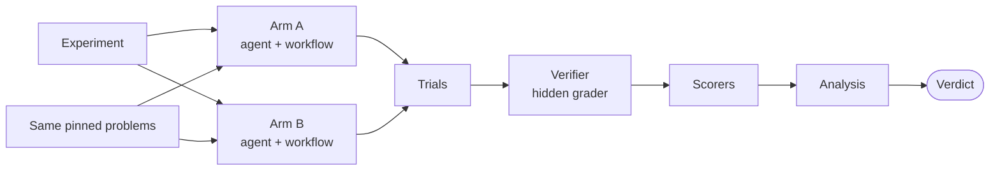

# Raidar


**Test whether a coding agent plus a workflow does better than another, on the same fixed problems.**



Each arm attempts every problem in Docker, in a seeded, counterbalanced order. A hidden grader marks the results, scorers turn the marks into numbers, and the analysis compares the arms with uncertainty.

## Get started

| You need                        | For                        |
| ------------------------------- | -------------------------- |
| Python 3.13.7 and `uv >=0.13.7` | bootstrap                  |
| Docker Compose 2.40.1+          | running and grading trials |
| Node 18+                        | review UI and formatting   |

Run everything from the repository root.

**1. Install**

```bash
uv sync --project orchestrator --python 3.13.7 --all-extras --frozen
make env-setup
npm ci --ignore-scripts
```

**2. Dry run.** Validate the shipped smoke experiment and print its plan. No agent runs.

```bash
E=lab/experiments/smoke/python__circuit_eval-cp1__agent-health/experiment.yaml
make experiment-validate EXPERIMENT="$E"
make experiment-plan EXPERIMENT="$E"
```

**3. Real run.** Needs a Docker target and credentials (below). It calls a real model, so it incurs provider usage. It proves the mechanics work, not that an agent is better.

```bash
make orchestrator-smoke
```

Output goes to `var/tmp/smoke/` (lock) and `var/jobs/` (job).

<details>
<summary>Docker target and credentials</summary>

- **Target:** `make target-init`, edit `~/.config/raidar/targets.toml`, then `make target-up TARGET=<name>` and `make target-status TARGET=<name>`. Choice order: `TARGET`, then `RAIDAR_TARGET`, then the file default; the current Docker context is never used.
- **Trust:** set `trusted = true` only for a target approved to receive agent credentials and hidden tests.
- **Secrets:** `SECRETS=auto|infisical|dotenv`. Auto tries accessible Infisical (project `mac-os-cf`, env `dev`, from `orchestrator/.infisical.json`), then `orchestrator/.env` (copy `.env.example`), then shell/file login.
- **Codex:** `make codex-auth-setup` (file login) or `OPENAI_API_KEY`. An OS-keyring-only login cannot reach Harbor.
- **Claude Code:** `ANTHROPIC_API_KEY`, `ANTHROPIC_AUTH_TOKEN` or `CLAUDE_CODE_OAUTH_TOKEN`.
- **Pins:** the host Python is pinned in `.python-version`; packages accept `>=3.12`, but validated grading needs exactly 3.13.7.
- **Resolver:** result-affecting calls use the exact uv dependency in `orchestrator/uv.lock`.

</details>

`make help` lists every command.

## Concepts

| Term                    | Plain meaning                                                                                                              |
| ----------------------- | -------------------------------------------------------------------------------------------------------------------------- |
| **Experiment**          | A written comparison: problems, arms and how to analyse them. Kinds: `ab-test`, `benchmark`, `smoke`.                      |
| **Problem, checkpoint** | A pinned task and one graded step of it. The workspace carries over between checkpoints.                                   |
| **Agent**               | A pinned coding agent plus a model and its settings.                                                                       |
| **Workflow**            | A build prompt plus optional stage packages (prompts, tools, checks). The default is `raidar/one-shot@2`, no stages.       |
| **Arm**                 | The thing under test: one agent plus one workflow.                                                                         |
| **Lock**                | The experiment frozen with exact versions and digests, so a job can be reproduced.                                         |
| **Job, trial, attempt** | A job is one run of a locked experiment. A trial is one arm on one problem in one attempt; an attempt runs every arm once. |
| **Verifier**            | The hidden host-side grader. Its output is the reward.                                                                     |
| **Scorer, Assessment**  | An offline measurement and its stored result. Missing evidence is never silently zero.                                     |
| **Analysis, verdict**   | Paired comparison against the baseline arm, with uncertainty and exclusions.                                               |

## Where next

| I want to...                             | Read                                                                                |
| ---------------------------------------- | ----------------------------------------------------------------------------------- |
| Design, run and read a comparison        | [Experiment workflow](docs/references/experiment-workflow.md)                       |
| Explore features and their user journeys | [Feature guide](docs/features/README.md)                                            |
| Add a problem to test on                 | [Problem onboarding](docs/references/problem-onboarding.md)                         |
| Build or change a workflow               | [Workflows and stages](docs/references/workflows-and-stages.md)                     |
| Choose or interpret measurements         | [Scoring](docs/references/scoring.md)                                               |
| Check a run is valid or pool jobs        | [Health and pooling](docs/references/health-and-pooling.md)                         |
| Contribute or release                    | [Contributing](docs/references/contributing.md)                                     |
| Extend stages or runtime packs           | [Stage contract](lab/stages/README.md), [runtime packs](lab/environments/README.md) |
| See the binding design                   | [`split-design.md`](split-design.md)                                                |

Layout: `orchestrator/` (CLI), `lab/` (experiments, problems, stages), `contract/` (schemas), `review-surface/` (UI), `var/` (generated, git-ignored).
