# Raidar Reboot — Conceptual Design and Path to Completion

Status: decision memo (innovation council: own analysis + independent adversarial challenger, synthesized).
Scope: design only. No code was changed in any repository.
Evidence shorthand: **R** = `/Users/adamjackson/Projects/complete/raidar`, **S** = `/Users/adamjackson/Projects/inflight/slop-code-bench`, **P** = `/Users/adamjackson/Projects/inflight/scb-problems`, **J** = `~/.omp/agent`. `[INFERENCE]` marks claims that were not directly observed.

---

> **§10.2 REOPENED (user challenge):** an alternative is to chain one Harbor trial per checkpoint, with the oracle out of band and the halt decision in Raidar. Harbor stays the kernel. Pending the ResearchHarborDeepDive results and a Phase 0 overhead measurement.

> **Revision 1 (user answers, 2026-09-29) — see §10.** It supersedes: strict = SCB halt-on-failure progression (not a Condition); Raidar owns the checkpoint loop (Harbor demoted to an optional backend); the host sandbox (srt + synthetic HOME) is a canonical backend; one experiment file; pluggable Condition components.

## 0. Recommendation (one line)

**Evolve Raidar; don't rewrite it.** Keep its orchestrator, AgentSpec adapters, artifact/provenance backbone, execution-validity gate and review surface. Replace the *scenario* monolith with separate, independently versioned nouns: **Problem → Checkpoints → Oracle**, **Condition**, **Protocol**, **AgentSpec** and **Experiment**. Run each trajectory as a **Harbor multi-step trial**: one warm container for all ~8 checkpoints, a fresh agent session per checkpoint, and a per-step workspace snapshot. Run **correctness and every scorer out of band** on those immutable snapshots, inside a separate, lazily provisioned evaluation sandbox. Scorers become observation-only plugins. Weights and composites move into explicit, versioned *score policies*, and paired arm comparisons move into an *analysis* layer. Keep containers as the canonical sandbox, and measure before replacing anything. Phase 1 is one Python problem (`forge`, 8 checkpoints) under two process conditions, followed by a hard review gate.

---

## 1. Diagnosis

### 1.1 What is wrong with "scenarios"

These are root causes, not symptoms:

1. **One identity fuses the thing under test with the things that must be held constant.** A scenario revision bundles the prompt, rules (AGENTS.md), starter, runtime image, verification commands, requirements, retained-evidence policy and weighted scorer attachments. Examples: `R/scenarios/bugfix-ledger-balance/v001/scenario.yaml:1-139`; the contract list in `R/docs/references/metrics.md` and `R/docs/references/new-scenario.md`. Changing a starting condition (skills, AGENTS.md, process) requires a **new scenario revision**, which can also change the oracle, image or scoring. That makes a controlled experiment *structurally* impossible: a revision delta is never a clean treatment effect. The matrix contract can only vary `scenario_revision` × AgentSpec (`R/matrices/skill-benchmark-coding-test-v003-codex-gpt55.yaml`, one repeat, mixed reasoning levels). There are no declarative treatment factors.
2. **The execution unit is one shot, not a trajectory.** `R/orchestrator/src/raidar/runtime/pipeline.py:14-38` prepares, executes, persists and scores exactly one task. No checkpoint loop exists, so code continuity, cumulative specifications, regression and erosion over time cannot be measured. Measuring those is the core of what you want.
3. **Correctness is authored per scenario by hand, and it is often invalid.** Each task kind needed a bespoke oracle, and the repo's own cleanup plan quarantines four of nine scenarios for exactly this reason (`R/raidar-revision-cleanup.md`: missing defect replay, refactor without a baseline, a judged mutable plan, test-generation without baseline coverage). Hand-authored single-shot tasks are expensive, which leads to few tasks, low statistical power and fragile validity.

### 1.2 What is wrong with "scorers"

The *idea* of pluggable scoring lenses is right (the challenger insisted on this and I agree). The *contract* is wrong:

1. **Scorers do the oracle's job.** `bugfix@1`, `refactor@1`, `test-generation@1` and `plan-to-code@1` each re-derive task success (defect-resolution, behavior-preservation, coverage-lift…) inside a scorer (`R/docs/references/metrics.md`, "Active Scorers"). So each new task kind needs a new scorer, and those scorers aren't reusable lenses. Correctness belongs to the Problem's Oracle.
2. **Measurement, weighting and comparison are collapsed into one object.** Scorers own weighted metrics, and scenarios own scorer weights. The result is a single `composite_score`, e.g. `functional 0.30 + code-quality 0.25 + … + artifact-checks 0.15` (`R/docs/references/metrics.md`). Correctness can be traded off against quality, so a broken but tidy program scores competitively. Weight changes silently change score scales between revisions.
3. **Quality is duplicated per language.** `python-code-task@1` and `typescript-code-task@1` are the same profile copied twice (`R/docs/references/metrics.md:42-45`). There is no shared metric schema with language-specific detectors.
4. **Measurement tooling is baked into the agent's image.** Scorer tool requirements are merged into the task image (`R/docs/references/metrics.md`, "Scorer Runtime Requirements"; `R/environments/python/3.12/Dockerfile`, `R/environments/node/20-bun/Dockerfile` with Chromium). That makes images heavy and cold builds slow, and it rules out lazy provisioning. It also exposes grading tools to the agent.
5. **Judgment is expensive, nondeterministic and hard-wired.** The judge runs Codex CLI in Docker with ChatGPT auth (`R/orchestrator/src/raidar/scorers/llm_as_judge.py:40-155`). It has no calibration, no cache and no cheaper tier, and Jev is absent.

### 1.3 What to KEEP

| Keep | Why / where |
|---|---|
| Phase-separated orchestrator with timings | `runtime/pipeline.py`, `workspace_phase.py:95-257`, `execution_phase.py`. It already records prep/preflight/image timings. |
| AgentSpec = harness + model, adapter registry, repo-local Harbor CLI agents | `agents/adapters/*`, `agents/harbor_agents/cli_agents.py`. Binaries are baked into images, so there is no per-trial install. |
| Harbor as execution kernel | `agents/adapters/base.py:225-232`. Harbor now provides multi-step tasks and 30+ environment backends (see §5). |
| Execution validity as a system gate, not a scorer | `runtime/scorecard.py:1-224` |
| Metric ownership / duplicate / missing-output validation | `runtime/scoring_outputs.py:25-174`, reused in the new scorer runner |
| Immutable baseline evidence, epochs, "missing ≠ zero" | `raidar-revision-cleanup.md` principles |
| Review surface as a read-only projection, with annotations as its only owned data | `review-surface/README.md:10-62`. Its annotations become Jev calibration labels. |
| Cache identities (task images, workspace, preflight) | `runtime/task_images.py`, `workspace_cache.py`, `starter_preflight.py` |

**DROP / archive:** the scenario schema, the scenario-attached weighted scorer profiles, the Codex-in-Docker judge as a default path, and the matrix schema. The nine existing scenarios become a **read-only historical epoch**. None is ported in Phase 1, and none is rescored into the new epoch.

---

## 2. Core domain model

### 2.1 Nouns and boundaries

| Noun | Owns | Must NOT own |
|---|---|---|
| **Problem** (versioned, content-hashed) | Metadata, ordered **Checkpoints**, starter, assets, permitted **RuntimeBindings**, reference solutions (hidden) | Prompts/process text, scorer choice, weights, model |
| **Checkpoint** | Spec delta (markdown) and cumulative spec; its **Oracle** slice; test groups (core/functionality/error/regression); `include_prior_tests` | A reset workspace for the agent (the agent continues from its own prior output) |
| **Oracle** | Hidden, trusted, executable acceptance tests that emit normalized `CaseResult{id, group, checkpoint_origin, status}`; strict *all-cases* solved rule | Anything agent-visible; quality judgments |
| **RuntimeBinding** | Per-language `build` + `launch` contract (e.g. `entrypoint: ./forge`), idiomatic starter, runtime pack reference | Different semantics disguised as a port |
| **RuntimePack** (python, node-ts, go, rust, java, dotnet) | Toolchain pins, agent base image, eval image, test adapter, quality-tool lock, lazy provisioner | Problem semantics |
| **Condition** (the treatment; content-hashed) | Interventions: rules file (AGENTS.md / CLAUDE.md compiled per harness), skills (compiled into the harness-specific skills dir), prompt wrapper template, process policy, starter overlay | Hidden tests, reference solutions, scorer config, budgets |
| **Protocol** (held constant within an experiment) | Session continuity (default: fresh session per checkpoint, persistent code); spec delivery (cumulative); feedback (default: no oracle feedback); progression (default: continue after failure); per-checkpoint timeouts and budgets; network policy; sandbox backend; assessment policy (`all-cases`) | Results |
| **AgentSpec** (kept) | Harness + version, model (resolved ID recorded), reasoning/sampling options | Problem/scoring identity |
| **AssessmentPlan** | Pinned scorer set (`id@version` + config + tool lock), the privileged correctness scorer, score policies to compute | Anything agent-editable |
| **Experiment** | Frozen problem(s), AgentSpec(s), Protocol, AssessmentPlan, **arms** (Conditions, or a factor grid), baseline arm, repeats *n*, blocking/order-randomization seed, pre-registered primary outcome and exclusion rules | Mutable defaults resolved mid-run |
| **Trajectory** (= Run) | One arm replicate through all checkpoints; one Harbor multi-step trial | Being counted as *k* independent samples |
| **CheckpointAttempt** | Rendered prompt, agent transcript/trace, usage/cost/time, termination reason, **snapshot** (workspace tarball + manifest hash), parent snapshot | Authority to overwrite history |
| **Assessment** | `scorer@version × snapshot(s) → Observations + evidence`, keyed by input hash. A rescore creates a new Assessment. | Mutating runs |
| **ScorePolicy** (versioned view) | Explicit composites, e.g. `scb-canonical@1`: `S = 100·C·(0.70 + 0.30·I)` (`S/docs/metrics-reference.md`, canonical scoring) | Being baked into scorer outputs |
| **Analysis** | Arm-level estimates, paired deltas, CIs, trajectory plots | Raw measurement |

Identity: every noun's content hash (and resolved harness/model/tool versions) goes into the Trajectory's provenance. Two arms may differ **only** in their Condition hash; the runner refuses to start otherwise.
*(Superseded by §10.1: arms may differ only in the factors the experiment declares.)*

### 2.2 How a trajectory flows

```mermaid
flowchart LR
  E[Experiment] --> S[Schedule: blocks × arms, randomized AB/BA order]
  S --> C[Compile Condition for harness: rules file, skills dir, prompt wrapper, starter overlay]
  C --> H[Compile Harbor multi-step task: N steps, shared env = RuntimePack agent image]
  H --> T[Harbor trial: one container; per step fresh agent session; step 'verifier' = snapshot-only]
  T --> A[Per-step artifacts: /app snapshot + agent logs]
  A --> O[Oracle in EVAL sandbox: pytest black-box vs snapshot k; tests 1..k]
  A --> Q[Scorers on snapshots k, k-1, starter]
  O --> Q
  O --> X[Assessments store]
  Q --> X
  X --> P[ScorePolicies + Analysis: paired deltas, CIs]
  P --> R[Review surface projection]
```



Key properties:

- **Warm across checkpoints.** Harbor multi-step keeps one environment for all steps and starts a fresh agent session per step by default (`--resume-trajectory` opts into conversation carry-over). It collects per-step artifacts under `steps/<name>/artifacts/` (Harbor docs, multi-step; confirmed via search of `harbor-framework/harbor` docs/CHANGELOG). The `scb-problems` converter already emits this `[[steps]]` format (`P/scripts/scb_to_harbor_lib/renderers.py:139-158`).
- **Hidden tests never enter the agent's environment.** Harbor's SHARED verifier mode leaked `/tests` and `/logs/verifier` into the next step's agent phase (issue #1960, closed 2026-09-14). Agents were observed reading and diffing the graders. Raidar therefore uses the step verifier **only to export a snapshot**. It never uploads tests. The Oracle runs afterwards, from the snapshot, in a separate eval sandbox. This also makes every result replayable offline.
- **Progression:** Phase 1 uses `continue` (every checkpoint runs, and failures stay visible as regressions and recovery). Early halt, or reset-to-reference, is a different Protocol and is never mixed.

### 2.3 Scores, deltas, repeats, variance

Notation: `Y[a,r,k,m]` is metric *m* for arm *a*, replicate *r*, checkpoint *k*.

- **Primary outcome (pre-registered per experiment):** Phase 1 default is **strict checkpoint-solve rate over the trajectory**, `C_r = (1/K)·Σ_k 1[all-cases pass at k]`, one value per trajectory. Secondary outcomes: final-checkpoint solved, mean case pass-rate, regression transitions (tests from checkpoint < k failing at k), inertia components, cost/tokens/wall time.
- **Pairing unit:** a *block* is one replicate slot for all arms, run in the same time window with the same image/cache state. Arm order within a block is randomized (AB/BA), and cache warmth is equalized. A matched "seed" is not meaningful for proprietary agents.
- **Estimate:** `D_r = Y[B,r] − Y[A,r]` per block, computed once per trajectory for trajectory outcomes. Report `mean(D)`, `SD(D)`, a 95% CI (paired t at small *n*; whole-trajectory bootstrap at *n* ≥ 10), and per-checkpoint curves with bands. Eight checkpoints are **not** eight samples. Binary final success is reported with a paired 2×2 table / exact McNemar test.
- **Multi-problem:** estimate within each problem first, then take an equal-weight problem aggregate, clustered by problem.
- **Quality under correctness gating:** quality is observed at every checkpoint. It is reported (a) unconditionally, starter-relative (`M[k] − M[starter]`) and transition-relative (`M[k] − M[k−1]`), and (b) conditional on solved checkpoints. (b) is explicitly labeled *selection-conditioned*, and eligibility rates are shown. A no-op solution cannot win because every ScorePolicy multiplies by correctness.
- **Sample size:** `n_pairs ≈ 7.84·(SD(D)/δ)²` gives 80% power at α = 0.05. A standardized effect of 1.0 needs about 8 pairs, 0.5 about 32, 0.25 about 126. **Policy:** *n* = 5 pairs is a pilot that yields variance, cost and ceiling/floor evidence, with no superiority claim. Size the confirmatory run from the pilot SD, and never stop early on p < .05. Each pair costs 16 checkpoint executions; the per-trajectory cost comes from the pilot.
- **Verdict vocabulary:** `improved` / `worse` / `inconclusive` (CI spans 0) / `insufficient` (*n* below the pre-registered minimum, or exclusions exceeding the pre-registered limit). An infrastructure-invalid trajectory is replaced under the pre-registered rule, and the exclusion count is always shown.

---

## 3. Scorer plugin contract

### 3.1 Principles

- Scorers **observe**; they never decide task success (the Oracle does), apply weights (ScorePolicy does) or compare arms (Analysis does).
- A problem/experiment attaches **one or more** scorers. The quality/inertia scorer is one plugin among many (correctness, resource usage, process compliance, security, performance…).
- Unavailable is never zero. Every output carries a status.

### 3.2 Manifest (static, versioned)

```yaml
id: code-quality            # stable
version: 1.0.0              # semantic: any definition change → new major, new epoch
implementation_digest: sha256:…
runtimes: [python]          # or ["*"] for language-neutral
evidence_required: [snapshot.current, snapshot.prior, snapshot.starter, oracle.cases, trace]
tools:                      # resolved lazily by the RuntimePack provisioner, locked
  python: {ruff: "0.8.6", lizard: "1.17.x", scb-check: "0.1.3", jscpd: "4.x"}
execution: host-parse | eval-sandbox   # anything that builds or executes candidate code → eval-sandbox
metrics:
  - id: verbosity            # namespaced: code-quality.verbosity
    level: checkpoint | transition | trajectory
    type: ratio | count | probability | ordinal | real
    direction: lower_better
    range: [0, 1]
    tier: deterministic | jev | llm
    exactness: scb-exact | scb-inspired | native
```

### 3.3 Runtime interface

```python
class Scorer(Protocol):
    manifest: ScorerManifest
    def assess(self, ctx: AssessContext) -> AssessResult: ...

AssessContext:
  problem/checkpoint identity + cumulative spec
  snapshots: current, prior, starter (read-only paths) + assessor-owned file inventory
  oracle: CaseResult[] (read-only)
  trace: normalized agent events (commands run, files edited, usage)
  tools: ToolRunner (host or eval sandbox, per manifest.execution; pinned versions)
  jev: JevClient (policy-bound, cached, audited)  # only if a metric declares tier=jev
  labels_blinded: True  # arm/model labels withheld from judgment tiers

AssessResult:
  status: ok | not_applicable | insufficient_evidence | unsupported | error
  observations: [{metric, value, numerator?, denominator?, unit}]
  evidence: [{path(hash-indexed), kind, spans[]}]   # every finding traceable to file:line
  exclusions: [{path, reason}]                       # accounted, never silent
  provenance: {tool_versions, jev_model_resolved, policy_modes, cache_hits, duration, cost}
```

Mechanics:

- The assessment cache key is `hash(scorer@version, config, tool lock, input snapshot hashes)`. Deterministic tiers must reproduce byte-identical observations on replay, and this is proven by a determinism test per scorer.
- Validation (kept from `scoring_outputs.py`): disjoint metric namespaces, all declared metrics present or explicitly statused.
- **Assessor-owned inventory.** The scorer, not the agent, decides production/test/generated classification. The challenger found that lizard honours `.gitignore` and a `GENERATED CODE` marker, so an agent could hide code. Agent-controlled exclusions are ignored, and every excluded file is listed.

### 3.4 Measurement tiers (evidence ladder)

1. **Deterministic:** oracle tests, parsers/static analyzers, trace invariants. This tier is always tried first, and it alone may be authoritative.
2. **Jev:** narrow residual judgments with sufficient evidence (e.g. "is this function a trivial wrapper that adds no behavior?", "does this handler swallow errors silently?"). Output is a probability, recorded as `ΣP` expected counts (continuous and less threshold-sensitive). A thresholded count is also produced, but only once a policy is `enforce`.
3. **LLM judge:** only for genuinely high-context questions, under a declared budget, blinded, with repeat-agreement measured. It is not an automatic fallback: an unsupported language is `unsupported`, not an LLM opinion.

When two tiers could answer the same metric, they publish **separate metric IDs** until agreement is validated.

### 3.5 Jev integration (replacing LLM-as-judge)

- **Client:** a small Python port of the local contract (`J/extensions/lib/jev.ts:17-23,62-135`): POST to `https://openrouter.ai/api/alpha/decisions`, `~typesafe/jev-latest` with the **resolved model checked against a pin** (`typesafe/jev-1.13-20260917`); `noul`/`choice`/`score` validation; ≤96k-char state; timeout; redaction. It lives in Raidar with no dependency on a personal OMP install.
- **Cache:** decisions are cached by `hash(state, questions, resolved_model)`, which makes rescoring reproducible and nearly free.
- **Audit:** decision records go into the run's assessment artifacts (not `~/.omp`), in the same record shape as `appendDecision`/`appendLabel`.
- **Policy per question-set,** versioned in the repo: `off | shadow | enforce`. In shadow, observations are stored and shown as *uncalibrated*, and they are excluded from ScorePolicies and verdicts.
- **Promotion to enforce** follows `J/skills/evaluate-jev/references/policies.md`, applied per policy and per runtime:
  - ≥30 labeled decisions with ≥5 minority labels, with input sufficiency ≥80% (otherwise fix the state template first).
  - The threshold is chosen on the calibration split and frozen.
  - A separate regression corpus is used.
  - Calibration and evaluation data are **split by trajectory/problem**, so near-identical checkpoints can't leak.
  - Labels come from review-surface annotations (vocabulary `correct/false_positive/false_negative/uncertain`).
  - Promotion is a new scorer minor version, and enforced observations start a new epoch.
- **First Jev uses (Phase 1):**
  1. The SCB rubric criteria (`S/configs/rubrics/llm_judge.jsonl`: hidden retries, lenient parsing, cloning, hand-rolled stdlib…) as `noul` questions per *changed symbol*. Only symbols changed since k−1 are asked, and unchanged answers carry forward, mirroring SCB's `rubric/carry_forward.py`.
  2. **Process-compliance manipulation check** on transcripts: did the strict arm actually plan, write tests first, or run the suite before finishing? Deterministic trace parsing comes first; Jev handles only the ambiguous residue.

### 3.6 Correctness gating

- `correctness@1` is a built-in, privileged scorer backed by the Oracle. It emits per-checkpoint strict-solved, the case pass-rate by group, and regression failures.
- Every ScorePolicy multiplies by correctness (SCB form). Quality is never averaged against correctness.
- Oracle results come only from the eval sandbox. Agent-produced "tests passed" logs are evidence of *process*, never of correctness.

### 3.7 The quality/inertia scorer (one plugin)

`code-quality@1` for Python, with per-checkpoint and per-transition metrics:

| Component | Tool (tier) | Exactness |
|---|---|---|
| verbosity, erosion, clone LOC/% | pinned `scb-check==0.1.3` via `uvx` (`S/src/slop_code/metrics/checkpoint/driver.py:24-28`) | scb-exact |
| lint density by rule family | Ruff pinned to SCB's contract (`S/src/slop_code/metrics/scoring/contract.py`) | scb-exact rules; native reporting |
| CC distribution (mean, p90, max, count > 10), CC mass `Σ CC·√SLOC`, NLOC, params | lizard (+ radon for MI, optional) | scb-inspired (SCB uses radon) |
| rework (lines rewritten in previously introduced symbols), regression breadth | port of SCB `lineage.py` / `regression.py` logic onto tree-sitter symbol identities | scb-inspired → becomes language-neutral |
| coupling/cycles (cyclic mass, propagation cost) | import graph via grimp (Python), then NetworkX as in SCB's graph module | scb-inspired |
| smells beyond tools | Jev noul per changed symbol (shadow first) | jev |

The SCB composite (`I = .15V + .15E + .20H + .30R + .20G`, `S = 100·C·(.70+.30·I)`) is shipped as **ScorePolicy `scb-canonical@1`**, a view, so it can be compared against SCB publications without becoming scorer internals. Metric names are claimed as "SCB" only when the definition is exact.

The other Phase 1 scorers:

- `resource-usage@1`: tokens, cost, turns, wall time per checkpoint. It is descriptive and always shown next to effects.
- `process-compliance@1`: deterministic trace plus Jev shadow.

---

## 4. Runtime packs and lazy provisioning

### 4.1 Pack concept

A pack is `runtimes/<id>/pack.yaml` + lockfiles. It declares:

1. **Toolchain** pins (via mise or uv).
2. **agent image:** a lean base plus toolchain plus harness binaries. *No scorer tools and no browsers.*
3. **eval image** (= agent base + oracle driver + build/execute-class measurement tools).
4. **test adapter** (normalizes to `CaseResult` via JUnit XML/JSON).
5. **quality tool lock** split into `host-parse` tools and `eval-sandbox` tools.

**Rule:** a tool that only parses may run on the host from a content-addressed cache (`$RAIDAR_TOOL_CACHE`, else `var/cache/tools/<lockhash>/` under the var root, via `uv tool`/`npm ci`/pinned release binaries). Any tool that **builds or executes** candidate code (tests, `dotnet build` with Roslyn analyzers, `cargo clippy`, `golangci-lint` with type-check, anything running `build.rs` or MSBuild targets) runs in the eval sandbox.

**Laziness:**

- A pack is provisioned the first time an experiment references it. That covers image build/pull, tool download and hash verification, with an atomic publish of the environment, which is read-only afterwards.
- A Python-only user never fetches a JVM, .NET or Rust.
- First-use provisioning is timed separately and **excluded from the arms' efficiency metrics** (challenger point). Both arms of a block run against the same cache state.

### 4.2 Language-neutral core (shared across packs)

Where a tool covers every target language, one tool gives one schema:

- **lizard:** CC, NLOC, token count, params. Its docs list Python, C#, Java, JS/TS, Go and Rust. It approximates complexity, which is fine for within-runtime deltas.
- **jscpd:** token-based clones for all six languages.
- **scc:** SLOC/LOC by language; a fast static binary.
- **tree-sitter:** symbol identities for rework/lineage and import extraction for coupling graphs.
- **ast-grep:** declarative smell rules, e.g. catch-all handlers, trivial wrappers, "hidden retry" loops. Deterministic rules replace some Jev/LLM rubric items.
- **git diff:** churn.

Cross-language comparisons of absolute SLOC/CC are **not** made. Effects are estimated within each runtime first.

### 4.3 Per-runtime choices

| Runtime | Toolchain (lazy) | Oracle / tests | Lint & analyzers | CC / size / clones | Coupling / erosion | Pack weight [INFERENCE] |
|---|---|---|---|---|---|---|
| **Python** | uv-managed CPython 3.12 | pytest black-box oracle (SCB tests as-is) + project pytest | Ruff (pinned to SCB contract), optional vulture (dead code) | lizard, radon MI, `scb-check` (verbosity/erosion/clones), jscpd | grimp import graph, SCB graph metrics, tree-sitter lineage | small |
| **Node/TS** | Node LTS via mise; pnpm/npm lockfile | pytest black-box oracle vs built CLI; vitest/node:test (JUnit reporter) for project tests; `tsc --noEmit` | ESLint + typescript-eslint (pinned flat config, SARIF), knip (unused files/exports/deps) | lizard, jscpd, scc | dependency-cruiser (cycles, instability), tree-sitter lineage | medium |
| **Go** | Go via mise | pytest black-box vs `go build` binary; `go test -json` → gotestsum JUnit | `go vet`, staticcheck, golangci-lint (gocyclo, gocognit, dupl, errcheck, unused) | lizard, gocognit, jscpd/dupl | `go list -deps` graph, tree-sitter lineage | small |
| **Rust** | rustup (pinned toolchain) | pytest black-box vs `cargo build --release` binary; `cargo nextest` JUnit | clippy `--message-format=json` (default + selected pedantic lints, pinned) | lizard, jscpd, scc | `cargo modules`/tree-sitter `use` graph | large (compile) |
| **Java** | Temurin JDK via mise; Gradle/Maven wrapper pinned | pytest black-box vs built jar (JVM start cost policy); JUnit 5 surefire XML | PMD (pinned ruleset; SARIF), Checkstyle optional; SpotBugs optional (bytecode) | lizard, PMD-CPD (clones), scc | jdeps package graph, tree-sitter lineage | large |
| **.NET** | .NET SDK via `dotnet-install`/mise | pytest black-box vs `dotnet publish` output; `dotnet test --logger trx/junit` | Roslyn analyzers (`AnalysisLevel=latest-All`, SARIF via `ErrorLog`), Roslynator optional | lizard, jscpd, scc | project/namespace graph via Roslyn or tree-sitter | large |

**Black-box oracle across runtimes:** the oracle driver is always pytest (a harness-side tool in the eval image). Only the RuntimeBinding's `build` and `launch` change. Builds happen once per checkpoint, **outside per-case timeouts**. JVM/.NET startup is handled by a declared per-case timeout policy per pack.

---

## 5. Sandbox strategy

### 5.1 Honest assessment

- **The cold start probably isn't container start.** [INFERENCE, to measure] Raidar images bundle scorer tools and, for Node, Playwright Chromium (`R/environments/node/20-bun/Dockerfile:1-40`). Its Harbor agents assume binaries are baked into the image (`R/orchestrator/src/raidar/agents/harbor_agents/cli_agents.py:32-42,170-171`). So cold cost is dominated by **image builds**, plus the Docker Desktop VM. Against an 8-checkpoint trajectory of tens of minutes, a few seconds of container start is noise. The pain is in the dev loop, first runs, and RAM under parallelism.
- **Harbor already abstracts the sandbox.** Its `environments/` directory ships docker, podman, apple_container, daytona, e2b, modal, runloop, gke, kata and more, and it loads custom environments by `import_path` (GitHub `harbor-framework/harbor` `src/harbor/environments/`, `factory.py:243-406`). *(Corrected 2026-10-23, ADR-002: Harbor has no ssh environment, and switching backends is not "a flag": Raidar's verifier, reaper, cleanup and copy-only data path talk to the Docker API directly, so each backend needs its own sandbox and cleanup integration. A remote Docker host is reached as a Raidar target, `make target-up`.)*
- **Apple `container`** has a Harbor backend (`apple_container.py`: arm64 check, `container` CLI, CPU/memory limits). Upstream supports **macOS 26**, but this workstation is Darwin 24 (macOS 15). It can't be on Phase 1's critical path.
- **srt (Seatbelt/bubblewrap)** is the lowest overhead but has a host-kernel boundary and no Linux parity. **Reads are unrestricted by default** (challenger, citing srt docs), so hidden tests and credentials must be explicitly denied. It also **leaks host agent configuration** (e.g. `~/.claude` skills and user-level AGENTS/CLAUDE files) unless HOME is redirected. That directly corrupts Condition control; memory notes a prior requirement to isolate and fingerprint host skills. It would also need a custom Harbor environment plus host-installed agent CLIs.
- **Pydantic Monty** is a Rust interpreter for a *Python subset*. It has no shell, subprocess, package manager, or general FS/network (`SandboxResearch.md`; github.com/pydantic/monty). Its ~1 ms start figures are the author's own, from a warm pool. **It cannot host a coding agent, a test suite, or non-Python runtimes.** At most it could sandbox tiny Python predicates; that isn't needed here, so it is not adopted.
- **Firecracker/gVisor/nsjail** are Linux-host tools. They are relevant only for a future Linux worker fleet.
- **Hosted (Daytona/E2B/Modal via Harbor `-e`)** is the right answer to "resource hungry" at matrix scale: laptop RAM stops mattering. Vendor start-time claims measure different endpoints.

*(Superseded by §10.3.)*

### 5.2 Tiered recommendation

| Tier | Backend | Use |
|---|---|---|
| **Canonical (Phase 1)** | Harbor + local containers (Docker engine; **try OrbStack as a drop-in engine** first) with slim prebuilt pack images and one warm container per trajectory | All benchmark results |
| **Scale-out** | Harbor `-e daytona\|modal\|e2b` using the same pack images | Large matrices; removes laptop RAM pressure |
| **Mac VM-per-container** | Harbor `apple_container` | Once the host is on macOS 26, if measurements favor it |
| **Dev-only fast loop (optional, gated)** | srt host-process custom Harbor env, HOME redirected, read-deny list | Scorer/Condition authoring smoke runs only. Its results are never in the canonical epoch. Built only if §5.3 shows container overhead is >15% of a trajectory's wall time, or blocks the dev loop. |
| Not adopted | Monty; Dev Containers as isolation | — |

**Cheap wins, no new backend needed:**

1. Strip scorer tools and browsers from agent images (they move to eval images and host caches).
2. Prebuild and tag pack images once per lock hash, and use Harbor's prebuilt `docker_image` path.
3. Keep one container per trajectory (multi-step).
4. Keep one warm eval container per pack per experiment, exec per snapshot.
5. Bound concurrency by measured RAM.

### 5.3 Measurement plan (Phase 0, decides the tier)

- **Workload:** the `forge` trajectory with Harbor's `oracle` agent (reference solutions, no LLM cost), plus one real agent trajectory.
- **Backends:** Docker Desktop and OrbStack (plus Apple container if macOS 26 is available, and the srt prototype only if already built).
- **Cache states:** (i) cold (no images or tool caches), (ii) images cached, no worker, (iii) warm worker.
- **Endpoints, recorded separately:** engine ready; image resolve/build; container create/start; workspace materialize; first command; per-step agent time; snapshot export; eval-sandbox oracle run; scorer run; teardown; **whole 8-checkpoint wall time**.
- **Resources:** engine idle RSS, peak RSS/CPU per trajectory, disk per pack, saturation at concurrency 1/2/4/8.
- **Report:** p50/p95 over ≥10 repetitions per cell, plus failure counts.
- **Decision rule:**
  - adopt OrbStack if it cuts idle RSS or cold-to-first-command by ≥30% with no failures;
  - build the srt dev tier only per §5.2;
  - use hosted if concurrency ≥4 saturates the laptop.
- **Security acceptance (all backends):** hidden tests and oracle output unreachable from the agent phase; no host credentials or home config; network default-deny with an allowlist (model API and package registries per pack); no Docker socket in the agent env; subprocess trees reaped on timeout; no cross-trajectory residue.

---

## 6. Problem sourcing

### 6.1 Adopt scb-problems (Python first)

- **Importer:** `raidar problem import scb <dir> --commit <sha>` maps the SCB layout to a Raidar Problem:
  - `config.yaml`, `checkpoint_N.md`, `files/` (starter), `tests/` (Oracle; conftest `--entrypoint`/`--checkpoint`), `solutions/checkpoint_N/` (hidden references);
  - canaries preserved; source commit and file hashes pinned.
  - It reuses the SCB converter's parsing (`P/scripts/scb_to_harbor_lib/*`) rather than a second parser.
- **Validation gate per problem (before it can rank):**
  - every reference `solutions/checkpoint_k` passes tests 1..k under all-cases;
  - a negative fixture (reference k−1 run against checkpoint k tests) fails;
  - repeat oracle runs are deterministic (no flaky cases);
  - the spec contains no language leakage (needed for multi-runtime).
- **Phase 1 problem: `forge`.** It has 8 checkpoints with `include_prior_tests: true` from checkpoint 2 (`P/forge/config.yaml`), JSON CLI contracts and stateful behavior. The replication candidate is `circuit_eval` (8 checkpoints, language-neutral spec: no Python mentions in `checkpoint_1.md`, `entry_file: circopt`). Its config does **not** declare `include_prior_tests`, so regression semantics must be set explicitly. Other 7–8-checkpoint problems: `recli`, `meshctl`, `test_translator`, `sheeteval`, `datagate`, `mocked_http`.
- **License:** `P/README.md` shows an MIT badge, but `P/LICENSE` is Apache-2.0. Resolve which applies before any redistribution; preserve notices.

### 6.2 Multi-runtime strategy: language-neutral CLI problems

- **Evidence that it works:** SCB oracles are already black-box. `P/log_query/tests/conftest.py` takes an arbitrary `--entrypoint` argv. The tests use `run_case(entrypoint_argv, …)` with JSON case files under `tests/data/` and import only stdlib and local helpers (httpx for server problems). So **a single pytest oracle can grade Python, TS, Go, Rust, Java or .NET executables unchanged.**
- **Per-problem porting cost:**
  1. Spec audit and neutralization (Python-specific wording, float formatting, key ordering, Unicode, error envelopes, time zones);
  2. a RuntimeBinding (build + launch);
  3. an idiomatic starter;
  4. a reference solution per runtime. It is required to validate the oracle, and it can be agent-generated, then *verified* by the oracle and reviewed.
  5. Per-case timeout policy for JVM/.NET start.
- **Fairness limits** (stated in reports):
  - it compares observable behavior only;
  - stdlib richness differs (Python json/sqlite/decimal vs crates/NuGet), so a dependency and network policy per pack is part of the Protocol;
  - absolute size/CC is not comparable across languages;
  - CLI tasks aren't all of software engineering.
- **Later:** language-native problems (library/API-level tests in the native framework) are added per runtime once packs exist. Hold back private checkpoint extensions to detect contamination, since public problems are in training corpora.

---

*(Phase items amended by §10.6.)*

## 7. Phased plan

### Phase 0: salvage, cutover decisions, spikes (short; no framework build yet)

1. **Freeze the contract** by writing the ADR for this memo:
   - the noun schemas (§2.1);
   - the Phase 1 primary outcome and exclusion rules;
   - the concrete definition of *strict* (Q1);
   - the threat model (§5.3).
2. **Archive scenarios** as the historical epoch: read-only CLI/report access, excluded from new experiments. `raidar-revision-cleanup.md` work stops, since it repairs the abstraction being replaced. The review surface keeps projecting old runs.
3. **Harbor multi-step spike** on `forge`, using the SCB→Harbor converter with the step verifier replaced by snapshot export, and the Harbor `oracle` agent. Prove:
   - one container across 8 steps;
   - a fresh agent session per step;
   - a per-step `/app` artifact snapshot;
   - no `/tests` visible to the agent;
   - the installed Harbor version supports `[[steps]]`.
   **Fallback if it fails:** Raidar owns the loop and calls Harbor once per checkpoint, restoring the prior snapshot. This costs more cold starts and is measured.
4. **Oracle validation** of `forge` (§6.1 gate) in an eval container.
5. **Timing baseline** (§5.3) on the current Docker path.

**Exit:** the ADR is approved, the spike is green or the fallback is chosen with numbers, and forge's oracle is validated.

### Phase 1: Python end-to-end

Deliverables:

| # | Deliverable | Acceptance (observable) |
|---|---|---|
| 1.1 | Pydantic schemas + loaders for Problem/Checkpoint/Oracle/RuntimeBinding/Condition/Protocol/AssessmentPlan/Experiment; content hashing | Strict validation; two arms differing in anything other than the Condition are rejected before any run |
| 1.2 | SCB importer + per-problem validation command | `forge` imported at a pinned commit; the validation report shows references pass and negatives fail |
| 1.3 | Condition compiler per harness (rules file name from `harness_definition`, cf. `R/orchestrator/src/raidar/agents/rules.py`; skills dir; prompt wrapper; starter overlay) + **discovery proof** | For each harness, a canary rule/skill is observably loaded in the trace; the Condition fingerprint is recorded; there is no host config inside the container |
| 1.4 | Trajectory runner: compiles Harbor multi-step tasks, schedules blocks with randomized arm order, persists CheckpointAttempts | 8 snapshots + prompts + traces + usage per trajectory; infra failure is classified via the kept execution-validity gate |
| 1.5 | Oracle runner in the eval sandbox (pytest black-box, normalized `CaseResult`, SCB groups, all-cases) | Oracle results are identical when re-run on the same snapshot; the agent environment never contained tests |
| 1.6 | Scorer SDK + registry + Assessment store + `raidar assess --rescore` | Rescoring a finished experiment with a new scorer version creates new Assessments without touching runs |
| 1.7 | Scorers: `correctness@1`, `code-quality@1` (Python, §3.7), `resource-usage@1`, `process-compliance@1` | Each has a positive and a negative fixture; deterministic tiers are byte-identical on replay |
| 1.8 | Jev Python client + cache + audit + policy file + labeling via review-surface annotations | Rubric and process questions run in **shadow**; cached replay costs $0; the audit is complete |
| 1.9 | Python RuntimePack with lazy provisioning (slim agent image; eval image; host tool cache) | A fresh machine running only Python never pulls other runtimes; first-use provisioning is timed separately |
| 1.10 | Analysis + reports: paired deltas, CIs, per-checkpoint curves, ScorePolicy `scb-canonical@1`, review-surface projection | The report shows effect ± CI, exclusions, cost, and the verdict vocabulary |
| 1.11 | **Pilot:** `forge` × {non-strict, strict} × 5 blocks × 1 AgentSpec | Completed, with a variance-based sample-size recommendation |
| 1.12 | Cutover of docs/README/Makefile/CHANGELOG; deletion of scenario-era authoring paths (historical read paths kept) | No dual authoring conventions remain |

**Phase 1 exit criteria:**

1. 10 pilot trajectories completed with ≤1 infrastructure exclusion.
2. Workspace continuity proven across all 8 checkpoints.
3. The oracle's identity is identical across arms.
4. Condition discovery is proven for the harness used.
5. The manipulation check shows the strict arm behaves differently (e.g. test runs before completion).
6. Full offline rescoring reproduces deterministic observations.
7. The report produces an honest verdict: *inconclusive* is an acceptable outcome.
8. Sandbox timings and the tier decision are recorded.

### ⛔ PAUSE-AND-REVIEW GATE (user decision required)

**Review packet:**

- the pilot report: effects, CIs, per-checkpoint curves, failure patterns, ceiling/floor, and cost per trajectory with a projection for a confirmatory *n*;
- oracle validity evidence;
- the Condition discovery/manipulation proof;
- quality findings traceable to file:line;
- the Jev shadow audit (coverage, sufficiency, disagreements);
- sandbox timing/resource tables and the threat-model check;
- the list of friction points in the nouns.

**Decisions:**

1. proceed to Phase 2;
2. revise the strict/non-strict treatment;
3. buy more repeats or add a 2nd problem (`circuit_eval`) before expanding;
4. adjust the model/abstractions.

A green smoke run alone is not permission to proceed.

### Phase 2: first non-Python runtime (proves the pack boundary)

- Default: **Node/TypeScript**. Raidar already has Node/TS images and scorer knowledge, the tooling is mature (tsc, ESLint, knip, dependency-cruiser), and demand is likely high [INFERENCE].
- Port `forge` (and `circuit_eval`) via RuntimeBinding: neutralized spec, TS starter, verified reference.
- Build the pack (§4.3) and reuse `code-quality` with TS detectors. **No change to the scorer contract, oracle or analysis** is the acceptance test of the architecture.
- Mini-gate: within-runtime strict/non-strict pilot, plus a per-runtime Jev calibration (calibration does not transfer across languages automatically).

### Phase 3+: remaining runtimes, one at a time

- Order: **Go → Rust → Java → .NET**, lightest toolchain first; the heaviest JVM/.NET startup and build-policy work comes last.
- Each runtime has the same exit criteria: pack provisioning lazily verified, reference solutions validated, quality detectors with positive and negative fixtures, and a within-runtime pilot.
- In parallel, add problems and a factorial Condition design (e.g. AGENTS.md × skills), and move to hosted Harbor backends when matrices outgrow the laptop.

### Jev rollout

| Stage | When | Content |
|---|---|---|
| J0 | Phase 1 | Client, cache, audit; rubric-smell and process-compliance question-sets in **shadow** |
| J1 | During/after pilot | Label ≥30 decisions per policy (≥5 minority), check sufficiency ≥80%, freeze thresholds, build a regression corpus |
| J2 | At review gate | Promote validated policies to **enforce** (scorer minor bump, new epoch); report ΣP metrics |
| J3 | Per new runtime | Re-calibrate per language before enforcing |
| J4 | Phase 3+ | Replace the remaining LLM-judge uses (e.g. per-requirement adherence where the oracle doesn't reach) with decomposed Jev questions; LLM judge only for residual high-context review under budget |

---

## 8. Risks, adversarial critique, open questions

### 8.1 Risks and mitigations

| Risk | Mitigation | Reversibility |
|---|---|---|
| **Rewrite trap:** the noun refactor eats the budget and confounds persist | The Phase 1 vertical slice precedes generalization; the arm-diff guard in 1.1 | High (Phase 0/1 scope is small) |
| **Noise swamps effects** (one problem, *n* = 5) | The pilot is labeled as a pilot; power from the observed SD; the `inconclusive` verdict; a 2nd problem before claims | n/a |
| **Harness/environment leakage becomes the real treatment** (host skills, unequal cache warmth, model alias drift) | Containers, isolated HOME, discovery proof, resolved-model recording, randomized blocks | Medium |
| **Strict arm "wins" by buying turns/cost** | Resource usage reported next to every effect; optional equal-budget Protocol (Q3) | High |
| **Metric gaming** (less functionality, hidden code, function splitting) | Correctness multiplier, assessor-owned inventory, component-level reporting, no single quality scalar as the headline | High |
| **Jev confidently wrong / uncalibrated** | Shadow by default, per-language calibration, trajectory-split data, separate metric IDs | High (policy flip) |
| **Harbor dependency drift** (multi-step semantics, #1960-type leaks) | Pin the Harbor version; tests never enter the agent environment; conformance spike tests in CI; fallback loop | Medium |
| **Cross-language unfairness** | Within-runtime estimates first; declared build/timeout/dependency policy; no absolute cross-language quality ranking | n/a |
| **Cost explosion** (runtimes × models × conditions × repeats) | One two-arm experiment at a time; cost projection in the gate packet; hosted backends only when justified | High |
| **Problem contamination** (public SCB) | Pinned commits, held-back private extensions for generalization checks | Medium |

### 8.2 What the challenger changed

The challenger was an independent model family and received no leaning from me. It changed my recommendation in these ways:

1. **Kept the noun "Scorer"** (I had planned to rename it to "Measure"). The flaw is composition, not the concept. The fix is splitting observation / ScorePolicy / Analysis.
2. **Protocol defaults:** a fresh agent session per checkpoint, persistent code, no oracle feedback, continue after failure. *Strict is a treatment, not stricter grading.*
3. **Randomized AB/BA ordering, blocking, and cache-warmth parity**, plus excluding first-use provisioning from efficiency metrics.
4. **srt demoted further** (reads unrestricted by default) and **Apple container off the critical path** (macOS 26 vs Darwin 24).
5. **Lizard exclusion trap:** agents can hide code via `.gitignore`/`GENERATED CODE` markers, so scorers use an assessor-owned inventory.
6. **Problem choice `forge`** over `circuit_eval` (explicit cumulative prior tests), and the **license discrepancy** check.
7. **Phase 2 is one runtime and then another mini-gate**, not five runtimes at once. SCB-exact vs SCB-inspired metric naming. Selection-conditioned labeling of quality-among-passing.

Where I overrode or extended the challenger:

- **Harbor multi-step is the trajectory engine.** The challenger kept an SCB-native adapter as the fallback. I found native `[[steps]]` support, the existing SCB→Harbor converter, and the #1960 verifier leak. That produced the design of a snapshot-only step verifier with an out-of-band oracle.
- **Where the oracle runs.** The challenger's "trusted black-box driver outside the candidate sandbox" is refined to *a separate eval sandbox*, because running the black-box oracle still executes candidate code.
- **Tool placement.** The host-parse vs eval-sandbox rule decides where lazily provisioned tools run.

*(Answered in §10.0.)*

### 8.3 Open questions for the user (each with a recommended default)

1. **What does "strict process" mean?**
   - Options: stronger instructions; mechanically enforced steps (e.g. tests must run before completion, lint gate); extra review/repair turns (factory-x-loops style); or SCB's halt-on-failure progression.
   - **Default:** strict = instructed *and observable* discipline via AGENTS.md + prompt wrapper (plan → tests first → full suite before done), with no extra turns and identical grading. Enforced review loops come later as a separate arm.
2. **Should effects be judged at each workflow's natural cost, or at equal token/$ budgets?** **Default:** natural cost, with cost always reported beside the effect. An equal-budget Protocol is added after the gate.
3. **Claim scope: improvement on a named problem, or across a population of coding tasks?** **Default:** Phase 1 claims only `forge`. Add `circuit_eval` (and more) before any general claim, spending money on more problems rather than on repeats.
4. **Isolation: is a host-kernel sandbox acceptable, and is Linux parity part of the benchmark contract?** **Default:** Linux containers are canonical. Host srt is a dev-only tier, never ranked.
5. **Runtime order after the gate?** **Default:** Node/TS → Go → Rust → Java → .NET, one at a time, each with a mini-gate.
6. **Conversation continuity across checkpoints: fresh session with persistent code, or resumed conversation? And may agents see oracle feedback?** **Default:** fresh session and persistent code; no oracle feedback; agents may write and run their own tests. Resumed conversation is a different Protocol if wanted later.

---

## 9. Evidence index

- Raidar:
  - `R/orchestrator/src/raidar/runtime/pipeline.py:14-38` (single-shot phases)
  - `workspace_phase.py:95-257`, `harbor_execution.py:23-113`
  - `scoring_outputs.py:25-174`, `scorecard.py:1-224`
  - `scorers/llm_as_judge.py:40-155`
  - `agents/adapters/base.py:225-232` (`harbor run --path`)
  - `agents/harbor_agents/cli_agents.py:32-42,170-171` (binaries baked into image)
  - `agents/rules.py` (per-harness rule file)
  - `environments/tools.yaml`, `environments/node/20-bun/Dockerfile`
  - `docs/references/metrics.md` (weighted scorer profiles, duplicated py/ts)
  - `docs/references/raidar-framework-comparison.md`
  - `raidar-revision-cleanup.md` (quarantines, validity diagnosis)
- SCB:
  - `S/docs/metrics-reference.md` (canonical `S = 100·C·(.70+.30·I)`, components, mass, deltas)
  - `S/src/slop_code/metrics/scoring/{production_quality.py,lineage.py,regression.py,contract.py}`
  - `S/src/slop_code/metrics/checkpoint/driver.py:24-28` (`scb-check==0.1.3`)
  - `S/README.md:93-96` and `docs/commands/run.md` (strict all-cases; `continue_after_test_failure` independent)
- Problems:
  - `P/forge/config.yaml` (8 checkpoints, prior tests)
  - `P/circuit_eval/config.yaml` + `checkpoint_1.md` (no Python mentions)
  - `P/log_query/tests/conftest.py` + `test_checkpoint_1.py` (black-box `--entrypoint`)
  - `P/scripts/scb_to_harbor_lib/renderers.py:139-158`, `templates.py:277-330` (Harbor `[[steps]]`, per-step rewards)
  - `P/README.md:5` (MIT badge) vs `P/LICENSE:1` (Apache-2.0)
- Harbor:
  - `github.com/harbor-framework/harbor` `src/harbor/environments/` (apple_container, docker, podman, daytona, e2b, modal, ssh, …)
  - `environments/factory.py:243-406` (`import_path` custom environments)
  - `environments/apple_container.py` (preflight arm64 + `container` CLI)
  - Issue #1960 (shared-verifier leak; closed 2026-09-14)
  - multi-step docs (fresh session per step, persistent FS, per-step artifacts)
- Jev:
  - `J/extensions/lib/jev.ts:17-23,62-135,190,242-253` (endpoint, pin, validation, policy, audit)
  - `J/skills/evaluate-jev/references/policies.md` (shadow default; ≥30 labels / ≥5 minority; frozen threshold; one policy at a time)
- Sandboxes: `SandboxResearch.md` (Monty, srt, Apple container, Firecracker, hosted), github.com/pydantic/monty, github.com/anthropics/sandbox-runtime, github.com/apple/container
- Challenger memo: `agent://RebootCouncil.RaidarChallenger`

---

## 10. Revision 1: user answers and follow-ups

### 10.0 Answers recorded

| # | Question | Decision |
|---|---|---|
| Q1 | Strict | SCB halt-on-failure: a trajectory stops at the first checkpoint that fails any case |
| Q2 | Cost basis | Natural cost; resource usage is reported beside every effect |
| Q3 | Claim scope | Council default: claims name the problem(s); `circuit_eval` is added before any general claim |
| Q4 | Host-kernel sandbox | Acceptable. SCB's approach was investigated (§10.3) |
| Q5 | Runtime order | Node/TS → Go → Rust → Java → .NET |
| Q6 | Sessions | Fresh session per checkpoint, persistent code, no oracle feedback |

New requirements:
- **R-A:** one configuration file drives a run (§10.4).
- **R-B:** starting conditions are pluggable beyond files: lint, typing, review processes, services (§10.5).

### 10.1 Strict is a Protocol progression policy, not a Condition

**Evidence (SCB):**
- Grading is always `all-cases`. The CLI rejects any other policy (`S/src/slop_code/entrypoints/commands/common.py:80-88`).
- `continue_after_test_failure: false` (the default, `run_config.py:99-101`) makes `runner.py:_should_early_stop` (`:776-807`) stop the trajectory after the first failed checkpoint.
- Checkpoint rows are created only for checkpoints that actually run (`runner.py:899-955`; `docs/metrics-reference.md:57`).
- Evaluation happens after the agent's session for that checkpoint ends, and results are never shown to the agent.
- Non-strict is `continue`: grading is the same, execution just carries on.

**Model change:**
- `Protocol.progression: halt_on_failure | continue`, with grading fixed at `all-cases` in both.
- `Experiment.factors` declares which nouns may differ between arms, e.g. `[condition]` or `[condition, protocol.progression]`. The arm-diff guard enforces exactly the declared set.
- Condition effects are estimated **within** each progression mode and never pooled across modes. Strict-vs-lenient is itself a valid factor.

**Consequence:** the oracle must run *between* checkpoints, because progression depends on it. The design already runs the oracle in a separate eval sandbox, so it simply runs synchronously after each snapshot. Tests still never enter the agent's sandbox, and the agent still receives no oracle feedback. Only the loop controller sees the verdict.

**Scoring halted trajectories:**

| Metric | Rule |
|---|---|
| `checkpoint_state[k]` | `solved \| failed \| not_attempted \| infra_error`, stored explicitly and never inferred from a missing row |
| Correctness `C` | `(# solved)/K`, where K is the configured checkpoint count; `not_attempted` counts as unsolved |
| Strict primary outcome | `reached = number of checkpoints solved before the halt` (ordinal 0..K); the paired difference in `reached` per block |
| Non-strict primary outcome | Strict checkpoint-solve rate over K (unchanged from §2.3) |
| Quality / transition metrics | Computed only on attempted checkpoints. Reported with the attempted count; `not_attempted` checkpoints never contribute 0s |
| `scb-canonical@1` ScorePolicy | Uses C over K, matching SCB's denominator |

**Power note:** under halt, most of the information is in the reached-checkpoint count. A weak arm that halts at checkpoint 1 also yields almost no quality data. Expect to need `continue` runs to learn anything about quality erosion. That is the argument for running both modes.

### 10.2 Raidar owns the checkpoint loop; Harbor becomes optional

**Evidence:**
- The installed Harbor is `v0.1.42` (`~/.local/bin/harbor`; `harbor/environments/` contains only docker, daytona, e2b, gke, modal, runloop). It has no `[[steps]]` task model and no apple_container backend. PyPI's latest is `0.23.0`, and Raidar does not pin a version.
- Current Harbor multi-step docs show that `min_reward` halting requires the step verifier to run **inside the shared environment**. That is the leak class behind issue #1960.
- Strict halt needs a per-checkpoint verdict computed *outside* the agent's sandbox. Harbor's multi-step mode cannot provide that without placing tests in the shared env.

**Decision:**
- Raidar's trajectory runner owns the loop: `for k in 1..K: session(k) → snapshot → oracle(eval sandbox) → progression decision`.
- Harness adapters are retargeted. Instead of emitting a Harbor command, they emit `argv + env + config files` for a `SandboxBackend.exec`. This is the pattern SCB (`agent_runner/agents/*`) and factory-x-loops (`harnesses/local.py`) already use.
- Raidar's existing trace/usage parsers (`harness/definitions.py`) are kept.
- Harbor stays available as a `SandboxBackend` implementation for hosted scale-out (Daytona, Modal, E2B), pinned to a version, and used only for exec and file transfer.

**Cost:** porting the Harbor CLI agents (`agents/harbor_agents/cli_agents.py`) to direct adapters. SCB's adapter set, which covers Claude Code, Codex, Gemini and others, is the reference.

### 10.3 Sandbox: how SCB does it, and what Raidar adopts

**SCB, observed:**
- **`local`** (`execution/local_streaming.py:114-139`; `configs/environments/local-py.yaml`) is a plain host `subprocess.Popen` with `include_os_env: true`.
  - No HOME remap, network restriction, or filesystem boundary.
  - Timeouts kill the process group.
  - Tests are copied into the workspace **at eval time** (`evaluation/pytest_runner.py:139-221`). An agent could still read the problem directory on the host.
- **Docker** (`docker_runtime/streaming.py:132-294`, `exec.py`) uses a persistent `sleep infinity` container plus `docker exec`.
  - Workspace is bind-mounted rw; static assets are ro.
  - Runs as UID 1000; network mode comes from config; no CPU or memory limits.
  - Claude auth uses a **synthetic HOME**: a temp `claude_home` mounted at `/tmp/agent_home/.claude` with `HOME=/tmp/agent_home` (`agents/claude_code/agent.py:350-390,650-689`).
- SCB has **no** sandbox-exec, bubblewrap or srt usage.

So SCB's lightweight mode is unisolated. Raidar adopts its lightness and synthetic-HOME pattern and closes the gaps with srt.

`SandboxBackend` interface: `provision(pack, lock)`, `start(trajectory)`, `exec(argv, env, timeout, policy)`, `snapshot()`, `restore(snapshot)`, `teardown()`, `describe()`. `describe()` records the backend identity into provenance.

| Backend | Mechanism | Status |
|---|---|---|
| **`host-srt`** (default, canonical) | `srt` (Seatbelt on macOS, bubblewrap on Linux) per exec. A per-trajectory synthetic HOME holds the compiled Condition: rules, skills, harness settings, auth token file. Toolchains come from the read-only pack cache (uv/mise) | Phase 1 |
| **`docker`** (parity / untrusted) | SCB-style persistent container plus exec. Slim pack image; synthetic HOME mount; UID 1000; CPU/memory limits | Phase 1 (kept for the comparison in §5.3) |
| **`harbor-hosted`** | Pinned Harbor, `-e daytona\|modal\|e2b` | After the review gate, only if concurrency needs it |
| Not adopted | Monty (Python subset, no shell) | — |

**`host-srt` policy** (srt semantics per its README: reads allowed by default and deny-then-allow, `allowRead` beats `denyRead`, writes allow-only, network allow-only via proxy):

```jsonc
{
  "filesystem": {
    "denyRead":  ["/Users", "/Volumes", "/private/var/folders"],  // all homes, incl. real ~/.claude, ~/.omp, keys
    "allowRead": ["<workspace>", "<synthetic_home>", "<pack_cache>/<lockhash>", "<harness_bin_cache>"],
    "allowWrite": ["<workspace>", "<synthetic_home>", "<trajectory_tmp>"]
  },
  "network": { "allowedDomains": ["<model API host>", "<pack registries e.g. pypi.org, files.pythonhosted.org>"] }
}
```

Rules:
- The problem directory, hidden tests and reference solutions live outside every `allowRead` path. The oracle runs under a **separate** srt profile that reads the tests and a *copy* of the snapshot, has no network, and uses a fresh temp dir.
- Harness CLIs are pinned into `<harness_bin_cache>` (npm/uv tool installs by version) instead of running from host PATH. That closes the "host agent config leaks into the Condition" risk the challenger raised.
- Backend identity is part of the Protocol, and results from different backends are not pooled.
- **Residual risks, stated plainly:**
  - host-kernel boundary;
  - macOS `sandbox-exec` is deprecated but functional [INFERENCE: platform risk];
  - Linux glob `denyRead` is expanded at wrap time, so paths created later aren't covered;
  - no CPU/memory cgroups on macOS, so limits are enforced through timeouts and process-group kill (SCB's pattern).

§5.3's measurement plan still applies, now comparing `host-srt` against `docker`. Expected [INFERENCE]: `host-srt` has near-zero start cost, and first-use cost is just pack provisioning.

### 10.4 One configuration file

One `experiment.yaml` is the only file a user writes. Every other noun is either **inline** or a **registry reference** (`id@version`) resolved from built-in or installed plugins.
- `raidar lock experiment.yaml` resolves every reference to content hashes and writes `experiment.lock.json`. This makes the run reproducible, and it is what the arm-diff guard checks.
- CLI overrides use SCB's precedence: `key=value` > flags > file > defaults (`S/src/slop_code/entrypoints/config/loader.py:330-390`).
- `scenario` is **not** a noun. What people called a scenario is `problem + protocol + conditions + assessment` in this file.

```yaml
# experiment.yaml
schema: raidar/experiment@1
id: forge-agentsmd-vs-baseline
problem: scb/forge@<commit>            # or inline path: ./problems/forge
runtime: python                        # selects the RuntimePack; provisioned lazily
agents:
  - {harness: claude-code@2.1.x, model: anthropic/claude-sonnet-4.5}

protocol:
  progression: halt_on_failure         # SCB strict; 'continue' = non-strict
  session: fresh_per_checkpoint
  oracle_feedback: none
  budgets: {per_checkpoint: {timeout_s: 1800, usd: 5}}
  sandbox: host-srt

factors: [condition, protocol.progression]   # what may vary between arms
protocol_levels:
  progression: [halt_on_failure, continue]   # crossed with conditions below

conditions:                            # arms; each = list of components (§10.5)
  baseline: []
  guided:
    - rules-file: {path: ./conditions/AGENTS.md}
    - skills: {dir: ./conditions/skills}
    - lint-config: {tool: ruff, config: ./conditions/ruff.toml}
    - stop-hook: {run: "ruff check . && mypy ."}      # enforced self-check the agent sees
    - review-loop: {reviewer: {harness: claude-code, model: anthropic/claude-sonnet-4.5}, max_rounds: 2}

assessment:
  scorers: [correctness@1, code-quality@1, resource-usage@1, process-compliance@1]
  policies: [scb-canonical@1]

analysis:
  baseline_arm: baseline
  blocks: 5                            # pilot
  primary_outcome: {halt_on_failure: reached, continue: solve_rate}
  seed: 20260929
```

### 10.5 Pluggable starting conditions: Condition components

A Condition is an ordered list of **components**. A component is a plugin with the same manifest and registry machinery as scorers (§3.2), so the framework has one plugin SDK. Its kinds are `scorer`, `condition-component`, `workflow`, `runtime-pack`, `sandbox-backend` and `harness-adapter`. Third-party plugins install through Python entry points and are imported lazily, only when the experiment references them.

Components are classified by **where they act**, which determines what the framework must do to apply them:

| Kind | Acts on | Examples | Applied by |
|---|---|---|---|
| `workspace` | Files in the repo at the start | AGENTS.md/CLAUDE.md, `ruff.toml`, `mypy.ini`/`pyproject [tool.mypy]`, `.pre-commit-config.yaml`, CI config, starter overlay, test scaffolds | Copied before checkpoint 1; hashed |
| `harness` | The agent CLI's own configuration | skills dir, MCP servers, Claude Code hooks (Stop/PostToolUse running lint/type/tests), permission modes, settings | Compiled per harness adapter into the synthetic HOME; **an arm is rejected if its harness doesn't support the component** (never silently skipped) |
| `prompt` | Checkpoint prompt text | wrapper templates (plan-first, tests-first, anti-slop as in `S/configs/prompts/*.jinja`) | Rendered around the spec |
| `workflow` | How one checkpoint's sessions are orchestrated | single-pass (default), review loop (implement → review → fix, from factory-x-loops `review_loop.py:224-295`), plan → implement, multi-agent | Replaces the default "one session per checkpoint" step. Its extra sessions are billed to the arm's resource usage |
| `service` | Sidecar or external dependencies | LSP server, MCP server process, hosted code-review service/bot, internal package mirror | Started per trajectory; network allowlist entries and secret refs declared in the manifest |

Manifest additions for components:
- `supports: {harnesses: […], runtimes: […]}`
- `network: [domains]`
- `secrets: [refs]` (resolved at run time, never hashed or logged)
- `fingerprint` (content hash of materialized files/config)
- **`discovery_probe`**: how Raidar proves the component took effect, e.g. a canary rule echoed in the trace, a hook-fired event, a skill-load event, or the reviewer session present in the transcript.

A trajectory whose probe fails is `infra_invalid` for that arm. This is the "controlled skill experiments must verify discovery" lesson from memory, made mechanical.

Invariants:
1. **Components may give the agent tool output it could have produced itself** (lint, type-check, its own tests, a reviewer's opinion). **They may never expose the oracle, hidden tests or reference solutions.** Enforcement is by sandbox policy, not trust. Service components also run outside the oracle's read scope.
2. **"Available" vs "enforced" are different treatments.** A `ruff.toml` in the workspace (available) and a Stop hook that runs ruff automatically (enforced) are separate components, so their effects are separable.
3. **Scorer tools stay independent of Condition tools.** If a Condition adds `ruff.toml`, the `code-quality` scorer still uses its own pinned config and assessor-owned inventory. Otherwise an arm could lower its measured lint count by editing the linter config.
4. Workflow components cost money. `resource-usage@1` reports the per-arm cost, and the natural-cost comparison (Q2) shows it beside the effect.

### 10.6 Plan amendments

**Phase 0 changes:**
- **Replace** the Harbor multi-step spike with a **`host-srt` loop spike** on `forge`:
  - 8 checkpoints with a synthetic HOME and a pinned harness binary;
  - per-checkpoint snapshot, and the oracle in a separate srt profile;
  - a halt decision;
  - an attempted read of the tests dir from the agent profile must be **denied** (negative test);
  - an attempted read of the real `~/.claude` must be **denied**.
- Timing baseline: `host-srt` vs `docker`, cold and warm.

**Phase 1 deliverables changed/added:**

| # | Change |
|---|---|
| 1.1 | `experiment.yaml` schema + `raidar lock`; `factors` guard; `protocol.progression` |
| 1.3 | Condition compiler becomes the **component SDK** with the kinds `workspace`, `harness`, `prompt`, `workflow` (single-pass + `review-loop@1`) and `service` (manifest only). Each shipped component has a discovery probe |
| 1.4 | Trajectory runner owns the loop: synchronous oracle per checkpoint, `halt_on_failure`/`continue`, explicit `checkpoint_state` |
| 1.4b | Harness adapters retargeted to `SandboxBackend.exec`; Claude Code first, then Codex |
| 1.9 | Python RuntimePack serves `host-srt` (uv cache) and `docker` (slim image) |
| 1.11 | Pilot: `forge` × {baseline, guided} × {halt_on_failure, continue} × 5 blocks. That is 20 trajectories, roughly 100–160 checkpoint sessions plus review-loop sessions [INFERENCE: halted arms run fewer] |

Exit criteria added:
- the leak negative tests pass;
- every component's discovery probe passes on the pilot harness;
- halt semantics match SCB's on a fixture where checkpoint 3 fails.

**Review gate additions:**
- `host-srt` vs `docker` numbers, with the decision on whether `docker` stays a supported backend;
- component-probe failure rates;
- the halt vs continue data yield (how much quality data halt produces).

### 10.7 New risks

| Risk | Mitigation |
|---|---|
| Porting harness adapters off Harbor takes longer than expected | Start with Claude Code only in Phase 1; SCB adapters as reference; Codex second |
| srt policy gaps (macOS deprecation, glob expansion timing) | Negative leak tests in CI; `docker` backend kept as a fallback until the gate |
| Workflow components confound "more compute" with "better process" | Natural cost reported beside every effect (Q2); an equal-budget Protocol remains possible later |
| Halt mode starves quality analysis | Both progression levels in the pilot; quality conclusions come from `continue` |

---

## 11. Post-research candidate architecture (2026-09-29, not yet landed)

Sources: `agent://ResearchHarborDeepDive`, `agent://ResearchEvalFrameworks`, `agent://ResearchSandboxes`, `agent://ResearchQualityTooling`. I verified the HF dataset file list (cpp, java, js, python, rust) and that the Hub page exists.

**Kernel: Harbor, upgraded from 0.1.42 to a pinned ≥0.23.** It gives us native multi-step tasks, custom host-side verifiers, and the ability to regrade finished runs.

**Checkpoint mechanism (option A′):**
- **One multi-step trial per trajectory**, with one environment for all checkpoints.
- **Each step launches a new headless CLI process.**
  - For Claude Code, Harbor sets `CLAUDE_CONFIG_DIR=/logs/agent/sessions` and wipes it per step, so session files and auto-memory don't carry over.
  - Codex's `CODEX_HOME` persists across steps, so it needs a per-step reset in `setup.sh`.
- **The oracle is a custom `BaseVerifier` loaded via `verifier.import_path`.** It runs in the Harbor host process, downloads `/app`, and runs the hidden tests in a fresh subprocess or container. Tests never enter the agent's environment.
  - Because verification is host-side, `min_reward` halting is safe, so halt mode is native.
  - Strict remains derivable from continue runs.
  - `harbor trial regrade` covers offline rescoring.
- **One-shot tasks** (N=1) are simply a 1-step task through the same pipeline.
- **Start at checkpoint k:** not required (user, 2026-09-29). If ever needed, Raidar would derive a task seeded from a snapshot.
- **Residual risk:** Harbor does not reap agent processes between steps (open PR #3454). Mitigation: a per-step setup that kills agent-user processes.
- **Fallbacks:**
  - **E** is a custom agent that loops fresh `claude -p` calls inside one trial. It works on 0.1.42, but per-checkpoint results fall outside Harbor's result model.
  - **B** is one trial per checkpoint. It gives the strongest isolation, at about 8× the trial start cost.

**Problems:**
- The SCB authors publish SlopCodeBench as a Harbor Hub multi-step dataset (36 problems). The HF dataset `gabeorlanski/slopcodebench` has python/js/cpp/rust/java splits under MIT.
  - That is Python, JS/TS, Rust and Java for free. **Go and .NET are missing.**
  - Parity between the Harbor port and the original SCB runner has not been verified.
- EvoCode-Bench (Harbor multi-step, 26 tasks) is a candidate second suite.

**Sandbox:**
- **Local default:** Harbor's `docker` backend (Docker Desktop, OrbStack or Colima). A third-party M3 benchmark measured warm container start at about 0.3–0.4 s.
- **Cold-start cost is image builds.** The fix is prebuilt per-runtime images, content-hashed through Harbor's `hb__` image tags.
- **Scale-out:** Daytona or Modal via `-e`.
- **Later:** microsandbox as a custom `BaseEnvironment`, if hard local isolation or fork is needed.
- **srt:** not needed. Harbor has no host backend, and building one is the highest-risk option.

**Quality tooling:**

| Tool | Coverage | Role |
|---|---|---|
| `scb-check` | py/ts/js/rust | Exact SCB verbosity/erosion/clones |
| `lizard` (Python API) | all 6 | CC, cognitive complexity, erosion mass |
| `jscpd` v5 | all 6 | Clones |
| `scc` | all 6 | LOC/ULOC |
| ruff / eslint-or-biome / golangci-lint / clippy / PMD / .NET SDK analyzers | one per runtime | Lint, installed lazily in the runtime image |
| `agent-slop-lint` | 5 of 6 (no Rust dependency graph) | Optional, for coupling/cycles |

- Qlty is rejected as the core: its BSL licence forbids offering an "AI Coding Service", and its metrics output format is unproven.
- SonarQube, CodeScene, CodeQL and MegaLinter are rejected.

**Judging:**
- Jev is implemented as a small in-house protocol.
- Harbor main has an unreleased RewardKit JEV judge (#3325), which is worth checking before we write our own.
- Inspect Scout is optional, as a host for transcript scanners.

**What Raidar still owns:**
- the experiment file, and its expansion into Harbor JobConfigs;
- Condition components, implemented as task-overlay transforms plus `--skill`, `--ak config` (hooks/settings) and `mcp_servers`, each with a discovery probe;
- the oracle verifier plugin;
- offline scorers over the job directory;
- the Jev tier;
- paired statistics (Harbor has none);
- the review surface: retained with its UI frozen, and the projection rewritten (§12). Harbor's viewer is held in reserve.

Everything else moves to Harbor: environment lifecycle, agent installation, step sequencing, artifacts, concurrency, and trajectory format.

---

## 12. Review surface (frozen UI) and the SCB-fork quality port

Sources:
- `agent://ReviewSurfaceContract`: the UI projection contract.
- `agent://SCBForkQualitySignals`: the fork's signals and coupling.
- The fork diff `upstream/main..HEAD` (9 commits, ~10.8k insertions; `metrics/scoring/` is new).

### 12.1 The UI stays frozen; only the projection changes

The UI reads a **Python-emitted projection**, `schema_version=1`: `runs`, `experiments`, `revision_diffs`, `run_details`.
- It is produced by `orchestrator/src/raidar/review_projection.py`.
- `build-review-data.mjs` only validates and copies it.
- So the seam is the producer. The UI, the TS types, `server.mjs` and the Playwright suite stay unchanged, and the suite acts as the regression net.

| Frozen concept (field) | Old source | New source |
|---|---|---|
| `scenario`, `revision`, `scenario_meta` (grouping, sidebar) | Scenario revision | `scenario` = Problem id; `revision` = arm/Condition id; `scenario_meta` = problem metadata. Only the labels change |
| `composite_score` and delivery tiers (.9/.75/.5), Δ-vs-best, scatter | Scenario-weighted scorer composite | The experiment's declared **headline ScorePolicy**, normalised to [0,1], e.g. `scb-canonical@1` S/100. It is correctness-gated, so the tiers keep their meaning |
| `quality_score`, `diagnostic_score` | Scorecard | Quality = the inertia I from `code-quality`; diagnostic = the correctness C |
| `failed_gates`, `gate:*` spans, gate chips, failure patterns | Verification gates | One `gate:checkpoint_k` per checkpoint (oracle strict all-cases), plus the validity gates (infra, component discovery probes) |
| `scorer:*` / `metric:*` spans, scorecard, `metric_outcomes`, `scorer_outcomes` | Scorer outputs | Assessment observations. Weights come from the headline ScorePolicy |
| Findings and `finding_counts` | `findings.json` | Scorer evidence findings (file:line) plus deterministic validity findings, with the same categories |
| Span tree, span detail, search | Raidar trace | Harbor per-step trajectories (ATIF) projected to spans, with one parent span per checkpoint |
| `duration`, tokens, pace | `run.json` | Harbor `TimingInfo` and per-model usage |
| `sample.*`, repeatability (stddev .1) | Scenario sample policy and repeats | Experiment blocks/repeats; same thresholds |
| RevisionMovement and contract diffs with comparability warnings | Scenario file diffs | **Condition diffs**: component manifests and files between arms. Warnings come from the arm-diff guard (anything differing outside the declared `factors`) |
| Annotations (user-owned) | `data/user-annotations.json` | Unchanged; also exported as Jev calibration labels |

### 12.2 Porting the SCB fork quality scorer

**What the fork's scorer computes:**
- **C** (correctness) = passed/total per checkpoint.
- **V** (verbosity) = `1 − |ruff-marked ∪ clone lines| / production SLOC`.
- **E** (erosion) = `1 − high-CC mass / total mass`, where mass = `cc·√sloc` and "high" means CC > 10.
- **H** (architecture) = `1 − cyclic SCC edge mass / production edge mass`.
- **R** (rework) = `1 − repeated changed lines / eligible changed lines` per transition. It uses a lineage ledger across checkpoints.
- **G** (regression breadth) = `1 − changed symbols covered by failing regression tests / changed symbols`. It needs per-test coverage and parity between the baseline and produced evaluator runs.
- **Composites:** I = .15V + .15E + .20H + .30R + .20G; S = 100·C·(.70 + .30·I).
- **Eligibility:** typed reasons mark a score *ineligible*; it is never set to zero.
- **Sensitivity:** single-component perturbation, weight ablation, and component correlation.

**Boundary decision: copy the bounded core into Raidar** (the scout's option b).
- **What gets copied:** the models/contracts, the canonical arithmetic, the lineage (R) kernel, the regression-attribution (G) kernel and the sensitivity analysis. That is roughly 1.1–1.6 kLOC [INFERENCE].
- **What gets rebuilt:** the measurement adapters are rebuilt over Harbor per-step `/app` snapshots.
- **What is left behind:** SCB's lifecycle plumbing (oracle capture, live collectors, generation/publication, `current.json`, historical backfill, dashboard ingestion). Raidar's Assessment store, with hash-keyed immutable evidence, replaces generation/publication.

**Why the core generalises beyond Python:** it is language-neutral once it receives normalized inputs.
- Per checkpoint: inventory with roles and hashes; production LOC and line masks; lint diagnostic spans; clone spans; a symbol table (identity, kind, span, CC, SLOC, body/structure/signature hashes); a weighted dependency graph.
- Per transition: physical diff lines.
- From the oracle: test outcomes plus per-test coverage contexts.

So the fork's kernel becomes the `code-quality` scorer core, and **RuntimePacks become the adapters**:
- **Python:** the fork's exact producers (Ruff, AST clone detector, radon CC, the import graph).
- **Other runtimes:** lizard, jscpd, the runtime's linter, and tree-sitter graphs. Labelled "scb-inspired", not exact.

**New requirement on the oracle verifier:** G needs per-test coverage contexts (pytest-cov with contexts for Python), plus environment/corpus/invocation parity between the baseline and produced runs. The oracle plugin must emit these.

**One-shot tasks (N = 1):** R and G have no transition, so they are `not_applicable`. The fork requires at least 2 checkpoints for S. A one-shot policy is needed: e.g. `scb-canonical-oneshot@1` renormalises I over V, E and H. `[?]` user decision.

### 12.3 New review-surface element: Quality (the `code-quality` scorer)

This is added alongside the frozen components, with new types, a new API endpoint and a new route/panel. No existing component changes.

```text
Run detail → new "Quality" panel (under Scorecard)
  checkpoint strip: C · V · E · H · R · G · I · S per checkpoint (+ eligibility badges with reasons)
  drilldowns (file:line, deep-link to span/file):
    V  ruff diagnostics + clone groups (union line set)
    E  symbols by mass, high-CC highlighted, excluded symbols with reasons
    H  cyclic SCCs with edge mass
    R  rework ledger: symbol lineage, repeated vs first-time changed lines
    G  failing regression tests → covered changed symbols
Experiments → new "Quality" section per arm
  component curves over checkpoints (mean ± band) · paired Δ per component vs baseline arm
  distributions carried from the SCB dashboard: lint density, CC mass concentration, function LOC
  sensitivity: weight ablation + component correlation (is any component redundant?)
```

