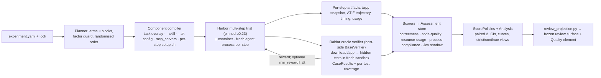
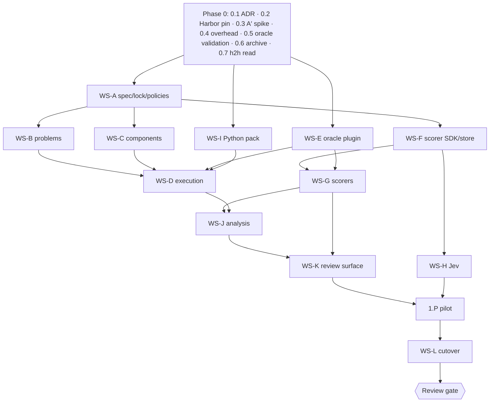

# Raidar reboot — implementation plan

- **Authority:** `docs/reboot/requirements.md` (v1, frozen). Requirement IDs (F*, N*) are cited per task.
- **Background:** `docs/reboot/design-memo.md` records the history of the design, including superseded options. Its §11–§12 describe the architecture this plan implements.
- **Scope:** Phase 0 and Phase 1 (Python end-to-end) in full detail. Then a **pause-and-review gate**, followed by later phases as outlines to be detailed after the gate.

---

## 1. Target architecture



**What Harbor owns:** environment lifecycle, agent installation and execution, step sequencing, artifacts, concurrency and trajectory format.

**What Raidar owns (N4):** the experiment spec, components, oracle plugin, scorers, Jev, analysis, review projection, and overhead budgets.

**Proposed module layout** (under `orchestrator/src/raidar/`; existing packages reused where they fit):

```text
spec/            experiment.yaml schema, lock, factor guard, ScorePolicy registry      (new)
problems/        Harbor-dataset import, validation, one-shot support                  (new)
components/      component SDK + built-ins + discovery probes                         (new)
execution/       experiment → Harbor JobConfigs, block scheduling, per-phase timing   (replaces runtime/ scenario pipeline)
oracle/          host-side BaseVerifier, CaseResult normalisation, coverage capture   (new)
scorers/         Scorer SDK, registry, Assessment store; correctness, code_quality/,
                 resource_usage, process_compliance                                   (reworked)
jev/             client, cache, audit, policies                                       (new)
packs/python/    image definition, tool lock, lazy provisioner                        (new; environments/python migrates here)
analysis/        paired stats, curves, verdicts                                       (replaces comparison/)
review_projection.py                                                                   (rewritten producer; schema_version=1 kept)
```

---

## 2. Phase 0: foundation and spikes

Phase 0 builds no framework code beyond what the spikes need.

| ID | Task | Files / touchpoints | Acceptance | Req |
|---|---|---|---|---|
| 0.1 | **ADR-001 "Harbor-kernel reboot".** Record: the requirements freeze, the checkpoint mechanism (option A′), the oracle placement, the score policies, the scenario-epoch archive, and the Harbor pin policy | `docs/reboot/adr-001.md` | Approved by user | all |
| 0.2 | **Pin and upgrade Harbor** from 0.1.42 to a pinned release ≥0.23.0.<ul><li>The host-side verifier means the unreleased #1961 fix is not needed.</li><li>Port the repo-local CLI agents to the new API: `--agent-import-path` folded into `--agent`; validated agent kwargs; hyphenated hook events; changed auth.</li></ul> | `orchestrator/pyproject.toml`, `agents/harbor_agents/cli_agents.py`, `agents/adapters/*` | `harbor --version` matches the pin; a smoke trial runs the current hello-world task on the new version | N3, N4 |
| 0.3 | **A′ spike** on one SCB Harbor-dataset problem (8 checkpoints), using the Claude Code agent. It has four parts, listed below the table | throwaway `spikes/a-prime/` (deleted after Phase 1 lands) | All four checks pass. Evidence is saved into the ADR appendix | F3, F4, N2 |
| 0.4 | **Overhead baseline.**<ul><li>Record Harbor `TimingInfo` phases plus Raidar phases (component apply, per-step reset, snapshot download, verifier plumbing, scorer orchestration, result write).</li><li>Measure cold (no images) and warm, ≥10 reps per cell, on Docker Desktop, and on OrbStack if available.</li><li>Derive the N1 budgets.</li></ul> | spike harness + `docs/reboot/overhead-baseline.md` | p50/p95 table per phase; budgets proposed and accepted | N1 |
| 0.5 | **Oracle validation of pilot problems.**<ul><li>Reference solution k passes tests 1..k.</li><li>Reference k−1 fails checkpoint k.</li><li>Three repeat runs are identical.</li><li>The Harbor port grades like SCB's native runner on the same snapshots.</li><li>Also check the third-party audit claims (bad gold keys) against the chosen problems.</li></ul> | spike harness | Validation report per problem; any failing problem is excluded | F4, F13 |
| 0.6 | **Archive the scenario epoch.** `scenarios/`, `matrices/` and existing `experiments/` become read-only history. Stop the `raidar-revision-cleanup.md` work. The review surface keeps projecting old runs until 1.K1 lands | `README.md`, `raidar-revision-cleanup.md` (mark superseded) | No new scenario revisions accepted | — |
| 0.7 | **Read the unread SCB dashboard page.** Confirm the signals in `head_to_head_quality.py`: a checkpoint-level A-vs-B scatter for lint and complexity. Include them in the 1.K2 spec | — | Signal list finalised | F14 |

**Task 0.3 checks.** The spike verifies:
1. `[[steps]]` trial with a **custom host-side `BaseVerifier`**. It downloads `/app` and runs the hidden tests in a separate container on a copy. No `tests/` is ever uploaded to the agent's environment.
2. **Context isolation.**
   - At step 2, the agent cannot find step-1 transcripts or auto-memory (`CLAUDE_CONFIG_DIR` is wiped).
   - A per-step `setup.sh` kills leftover agent-user processes. A deliberately planted background process from step 1 must be gone at step 2.
3. Per-step `/app` artifacts land on the host.
4. Both progression modes work: `min_reward` halt, and continue.

**Phase 0 exit criteria:**
- ADR approved.
- Harbor pinned.
- A′ spike green (or fallback E/B chosen, with timing evidence).
- N1 budgets set.
- At least 1 validated 8-checkpoint problem and at least 1 validated one-shot problem.

---

## 3. Phase 1: Python end-to-end

Workstreams run in parallel where dependencies allow (see §6). Every deliverable has an observable acceptance check. Test policy:
- Behaviour, boundary, invariant and precedence tests only.
- The review-surface Playwright suite is the frozen-UI regression net.

### WS-A: Experiment spec, lock, policies (F9, F10, F15, N3)

| ID | Deliverable | Acceptance |
|---|---|---|
| A1 | `experiment.yaml` schema covering problem(s), runtime, agents, protocol, `factors`, conditions (component lists), assessment (scorers + headline policy) and analysis (baseline arm, blocks, seed, concurrency). CLI overrides follow SCB precedence | Invalid files are rejected with field-level errors. `raidar validate` passes on the pilot file |
| A2 | `raidar lock`: resolves every registry reference and component file to content hashes, and records Harbor, harness and tool versions | Re-locking unchanged inputs gives a byte-identical lock. Changing any component file changes the hash |
| A3 | **Factor guard.** Arms may differ only in the declared factors | An arm pair differing in an undeclared noun is rejected before any trial starts |
| A4 | ScorePolicy registry with `scb-canonical@1` and `scb-canonical-oneshot@1` (I₁ = .30V + .30E + .40H). The headline policy is selected per experiment, with a default chosen by K | Formula unit tests on boundary inputs (C = 0, missing component → ineligible, K = 1 selects oneshot) |

### WS-B: Problems (F1, F13)

| ID | Deliverable | Acceptance |
|---|---|---|
| B1 | Importer from the SCB Harbor dataset, pinned by digest. It rewrites each task so that step verification uses the Raidar oracle plugin and the hidden tests stay host-side | Pilot problems import with a recorded source digest |
| B2 | `raidar problem validate`: runs the 0.5 checks as a command | Report is written. The negative fixture fails as expected |
| B3 | One-shot problems are a 1-step task through the same path | A one-shot problem runs, grades and scores with the oneshot policy. R/G are shown as `not_applicable` |

### WS-C: Component SDK (F5, F3, N2)

| ID | Deliverable | Acceptance |
|---|---|---|
| C1 | Component SDK with manifest fields: `kind`, `supports`, `network`, `secrets`, `fingerprint`, `discovery_probe`. Registry uses entry points with lazy import | An unknown or unsupported component for the chosen harness rejects the arm (never silently skipped) |
| C2 | Built-ins mapped onto Harbor inputs:<ul><li>`rules-file`, `workspace-files`, `lint-config` → task overlay / `workdir`;</li><li>`skills` → `--skill`;</li><li>`harness-settings` and `stop-hook` → `--ak config`;</li><li>`mcp-server` → `mcp_servers`;</li><li>`prompt-wrapper` → instruction rendering.</li></ul> | Each built-in's discovery probe passes on Claude Code in a real trial |
| C3 | **Per-step context reset.** Wipe harness state (Claude config dir; `CODEX_HOME` for Codex later) and kill leftover processes. Implemented as a generated `setup.sh` | The 0.3 context-isolation check is automated as a regression test |
| C4 | `workflow` kind: `review-loop@1`, ported from factory-x-loops `review_loop.py` as a custom Harbor agent wrapper. Its extra sessions are billed to the arm | The pilot "guided" arm can include it. Reviewer sessions appear in the trace. Cost is attributed |

### WS-D: Execution (F1, F4, F10, N1)

| ID | Deliverable | Acceptance |
|---|---|---|
| D1 | Planner: experiment → Harbor JobConfigs per arm/block, with AB/BA randomised order and configurable concurrency | The dry-run plan lists every trial with its hashes. Concurrency is honoured |
| D2 | Execution driver: runs jobs, maps results to `CheckpointAttempt` records (`checkpoint_state`: solved / failed / not_attempted / infra_error) and keeps the execution-validity gate | A failed infra step is classified `infra_error`, not `failed` |
| D3 | Progression: `continue` by default; `halt_on_failure` via `min_reward`. Strict metrics (`reached`) are derived from continue runs | On a fixture where checkpoint 3 fails, halt and derived-strict give an identical `reached` |
| D4 | **Per-phase timing and budget check.** Every run records N1 phases. `raidar perf check` fails if p95 exceeds the budget | The CI job runs it on a fixture experiment |

### WS-E: Oracle plugin (F4, F14-G)

| ID | Deliverable | Acceptance |
|---|---|---|
| E1 | Host-side `BaseVerifier` implementation. It copies the `/app` snapshot and runs pytest black-box against it in a fresh container, with no network. Results are normalised to `CaseResult{id, group, checkpoint_origin, status}` using SCB groups and the all-cases rule | Re-running on the same snapshot gives identical results. Tests are never present in the agent's environment (asserted) |
| E2 | **Coverage capture** for G: per-test coverage contexts (pytest-cov with contexts), plus environment/corpus/invocation parity evidence for baseline and produced runs | The G kernel's parity checks pass on the pilot. A mismatch yields `ineligible` with a reason |
| E3 | Regrade path: `raidar assess --regrade` reruns the oracle over stored snapshots | Results match the original run |

### WS-F: Scorer SDK and Assessment store (F6, N3)

| ID | Deliverable | Acceptance |
|---|---|---|
| F1 | Scorer protocol and manifest: metrics with level, type, direction, tier and exactness; `AssessResult` status; evidence with file:line; exclusions; provenance. Reuse the ownership, duplicate and missing validation from `runtime/scoring_outputs.py` | A scorer emitting an undeclared or duplicate metric is rejected |
| F2 | Assessment store keyed by `hash(scorer@version, config, tool lock, snapshot hashes)`, plus `raidar assess --rescore` | Rescoring with a new scorer version adds Assessments and never mutates runs. Deterministic replay is byte-identical |
| F3 | Assessor-owned file inventory (production / test / generated), ignoring agent-controlled exclusions | A fixture that hides code via `.gitignore` or a `GENERATED` marker is still counted |

### WS-G: Scorers (F6, F7, F14)

| ID | Deliverable | Acceptance |
|---|---|---|
| G1 | `correctness@1`: per-checkpoint strict-solved, case pass-rate by group, regression failures, `reached` | Matches the oracle results exactly |
| G2 | **`code-quality@1` core ported from the SCB fork** (`metrics/scoring/`):<ul><li>models and contracts;</li><li>V/E/H/R/G/I arithmetic;</li><li>lineage (R) kernel and ledger;</li><li>regression attribution (G) kernel;</li><li>eligibility;</li><li>sensitivity.</li></ul>SCB's lifecycle plumbing (generation/publication, live collectors, historical backfill) is replaced by the Assessment store | Golden tests: on SCB-fork fixtures, Raidar and the fork produce identical component values and evidence |
| G3 | **Python measurement adapters** over Harbor snapshots, using the fork's exact producers: Ruff (pinned contract), the clone detector, radon CC/SLOC rows, the import graph, and tree-sitter symbol hashes for lineage. Diffs between adjacent snapshots | V/E/H per checkpoint and R/G per transition are computed on the pilot. Evidence is traceable to file:line |
| G4 | `resource-usage@1`: tokens, cost, turns, wall time per checkpoint (from Harbor usage/timing) | Totals reconcile with Harbor's `agent_result` |
| G5 | `process-compliance@1`: deterministic trace checks (e.g. tests run before finishing, plan written), plus Jev shadow for ambiguous cases | The manipulation check separates the pilot arms, or reports that they are not separated |

### WS-H: Jev (F7, N5)

| ID | Deliverable | Acceptance |
|---|---|---|
| H1 | Python Jev client ported from the local `jev.ts` contract:<ul><li>endpoint, pinned-model check, `noul`/`choice`/`score` validation;</li><li>96k-char state cap, timeout, redaction;</li><li>cache keyed on `hash(state, questions, resolved_model)`.</li></ul>Before writing it, check Harbor main's RewardKit JEV judge (#3325) for reuse | Cached replay costs $0. A model mismatch is rejected |
| H2 | Policies (`off | shadow | enforce`) versioned in the repo. Audit records are stored in the run's assessment artifacts | Every decision is audited. Shadow observations are excluded from policies and verdicts |
| H3 | Question sets: SCB rubric criteria (`llm_judge.jsonl`) as per-changed-symbol `noul`, with carry-forward; process-compliance residue | Runs in shadow on the pilot. Coverage and input-sufficiency are reported |

### WS-I: Python runtime pack (F8, N1, N3)

| ID | Deliverable | Acceptance |
|---|---|---|
| I1 | `packs/python`: a slim agent image (toolchain + harness binary, no scorer tools, no browsers), prebuilt and tagged by lock hash | Warm trial start meets the N1 budget. The image contains no scorer tools (asserted) |
| I2 | Lazy measurement provisioning: scorer tools installed into a host cache keyed by tool lock (uv tool / pinned binaries) on first use. Build/execute-class tools run in the eval container | A fresh machine running Python only never pulls other runtimes' tools. First-use provisioning is timed separately and excluded from arm efficiency |

### WS-J: Analysis (F10)

| ID | Deliverable | Acceptance |
|---|---|---|
| J1 | Paired deltas per block and per problem:<ul><li>mean, SD, 95% CI (paired t; bootstrap at n ≥ 10);</li><li>McNemar for binary final-solved;</li><li>per-checkpoint curves with bands;</li><li>strict (`reached`) and continue views;</li><li>verdict vocabulary;</li><li>exclusion counts;</li><li>cost beside every effect.</li></ul> | Tests on synthetic data with known effects (improved, worse, inconclusive, insufficient) |
| J2 | Sample-size recommendation from the pilot SD (`n ≈ 7.84·(SD/δ)²`) | Included in the gate packet |

### WS-K: Review surface (F12, F14, F15)

| ID | Deliverable | Acceptance |
|---|---|---|
| K1 | **Rewrite `review_projection.py`** to source the frozen `schema_version=1` projection from the new artifacts, per `design-memo.md` §12.1:<ul><li>scenario → problem;</li><li>revision → arm;</li><li>composite → headline ScorePolicy;</li><li>gates → checkpoints + validity;</li><li>spans ← ATIF;</li><li>contract diffs → Condition diffs, with factor-guard warnings.</li></ul>The UI, TS types, `server.mjs` and the Playwright suite are unchanged | `make review-surface-test` passes **unmodified** against a new-model synthetic fixture and the pilot data. Old-epoch runs still render |
| K2 | **Quality element** (new types, endpoint, route/panel; no change to existing components):<ul><li>Run detail: per-checkpoint C·V·E·H·R·G·I·S strip, eligibility badges, and V/E/H/R/G drill-downs to file:line.</li><li>Experiments: component curves per arm; paired Δ per component; SCB dashboard distributions (lint density, CC-mass concentration, function LOC); the head-to-head checkpoint scatter (0.7); sensitivity (weight ablation, correlation).</li></ul> | New Playwright specs for the Quality element. The existing spec is untouched and green |
| K3 | Headline-policy mismatch warning on the comparison views | Comparing experiments with different headline policies shows the warning |
| K4 | Annotation export as Jev calibration labels (`correct/false_positive/false_negative/uncertain`) | Exported labels load into the H2 calibration workflow |

### WS-L: Cutover and cleanup

| ID | Deliverable | Acceptance |
|---|---|---|
| L1 | Remove scenario-era authoring and execution paths (scenario schema, scenario-attached weighted scorers, Codex-in-Docker judge default, matrix schema, `task_bundle*`/`task_images*` where superseded). Historical read paths are kept for old runs | No dual authoring conventions remain. `grep` finds no live references |
| L2 | Docs, README, Makefile and CHANGELOG describe the experiment/problem/component/scorer model | New-user walkthrough: write `experiment.yaml` → run → review |

### 1.P: Pilot

- **Design:** one validated 8-checkpoint problem × {baseline, guided} × 5 blocks. Continue mode, with strict derived. One AgentSpec (Claude Code).
- **Plus:** one validated one-shot problem × the same arms × 3 blocks, to exercise the F1 and F15 paths.

**Phase 1 exit criteria:**
1. All pilot trajectories complete with ≤1 infra exclusion per arm.
2. Context-isolation and no-test-leak checks are green on every trajectory.
3. Every component's discovery probe passes.
4. Offline rescoring reproduces deterministic observations byte-identically.
5. The G2 golden parity against the SCB fork passes.
6. N1 budgets hold (`raidar perf check`).
7. The frozen review-surface suite is green unmodified, and the Quality element is live.
8. The analysis report gives an honest verdict (`inconclusive` is acceptable).

---

## 4. Pause-and-review gate (user decision)

**Packet:**
- the pilot report (effects ± CI, strict/continue views, per-checkpoint curves, Quality components, cost, sample-size projection);
- oracle validation evidence;
- the component probe and manipulation-check results;
- the Jev shadow audit (coverage, sufficiency, disagreements);
- overhead budget results;
- friction points in the spec and components.

**Decisions:**
1. Proceed to Phase 2.
2. Revise the treatments.
3. Add problems or repeats first.
4. Adjust abstractions.
5. Promote any Jev policy to enforce (needs ≥30 labels, ≥5 minority, frozen threshold).

---

## 5. Later phases (detailed after the gate)

**Per-runtime template.** Each runtime phase must satisfy all of:
- pack image + lazy tool lock;
- problems;
- quality adapters feeding the **same** `code-quality` core (labelled `scb-inspired` unless exact);
- per-runtime Jev recalibration;
- a within-runtime pilot and mini-gate.

**Acceptance of the architecture:** each phase needs no changes to the scorer contract, oracle plugin, analysis or frozen UI.

| Phase | Runtime | Problems | Quality adapters |
|---|---|---|---|
| 2 | Node/TS | SCB HF `js` split | `scb-check` (clones/erosion), lizard, jscpd, eslint/biome, tree-sitter graph |
| 3 | Go | Author/port (no SCB split) | lizard, jscpd, golangci-lint, `go list` graph |
| 4 | Rust | SCB HF `rust` split | `scb-check`, lizard, jscpd, clippy |
| 5 | Java | SCB HF `java` split | lizard, jscpd/PMD-CPD, PMD, jdeps |
| 6 | .NET | Author/port (no SCB split) | lizard, jscpd, SDK analyzers (CA1502/CA1506) via SARIF |

**Jev rollout:**

| Stage | Timing | Content |
|---|---|---|
| J0 | Phase 1 | Shadow |
| J1 | Pilot | Labelling via review-surface annotations |
| J2 | Gate | Enforce validated policies (new epoch) |
| J3 | Per runtime | Recalibrate |
| J4 | Later | Replace any remaining LLM-judge uses with decomposed Jev questions |

---

## 6. Sequencing



Work that can proceed in parallel:
- **Right after Phase 0:** A, E and I.
- **Once A lands:** B, C and F.
- **G2** (the SCB core port) can start as soon as F1 lands, because it is independent of execution.

---

## 7. Risks

| Risk | Mitigation |
|---|---|
| Harbor API churn | Exact pin. Upgrade only via a spike that reruns the 0.3 checks |
| Spike fails (verifier/reset/process-reap) | Fallback E (in-agent loop on the pinned version) or B (trial per checkpoint). Choose from 0.4 timings |
| SCB Harbor port ≠ native grading | 0.5 parity check. Exclude divergent problems |
| G needs coverage parity that is hard to achieve | G emits `ineligible` with reasons (never zero). Headline S then follows the fork's eligibility rules and the surface shows why |
| Porting fork kernels drifts from the fork | Golden parity tests (G2). The fork remains the reference until the gate |
| Frozen UI projection mismatch | The unmodified Playwright suite is the contract. Fixture-driven development of K1 |
| Cost of pilot | Continue-only runs (strict is derived); 5 blocks; one AgentSpec |
