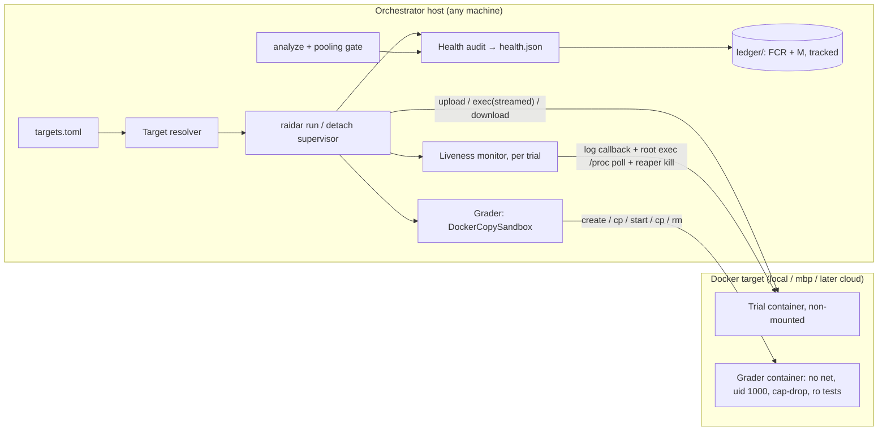

# Raidar mechanics v1: target design and plan

Status: **DRAFT r2, 2026-10-23.** Nothing here is approved or built. r1 went through Innovation Council review, which returned *rework* (the transcript is `agent://MechanicsV1Council`). This revision folds in that review and weighs `split-exploration.md` as an independent second opinion; it is not the defined path.

Sources:
- `prompts/session-handoff-2026-10-23.md` (§2.2 execution-target proposal)
- `prompts/raidar-fxl-fx-split.md`
- `split-exploration.md` (K1–K8)
- scout reports on factory-x-loops (fxl) supervision and journal
- the Innovation Council review

Tags: **[OBS]** observed in code or docs, **[INF]** inference, **[PROP]** proposal.

## 1. Objective and scope

**Objective.** Get Raidar's *mechanical process* (run a locked experiment, grade it, judge whether each run counts, record what happened, analyse it) back to a deployable **v1**:

1. It runs on any configured Docker target (local, another host, later Harbor cloud), selected per machine by any user, through one copy-only data path.
2. It adopts the fxl practices that decide *whether a run counts*: liveness/idle detection, a run-health audit, tamper checks, smoke-before-measure, provenance-gated pooling, and a minimal tracked fault ledger.
3. It is proven end to end on the new target before any experiment resumes.

**Dividing rule** (borrowed from split-exploration K1, and agreed on its merits): *if it changes what the agent does, it is subject method; if it decides whether a run counts or how good it was, it is a Raidar mechanic.*

**In scope:**
- execution target and data path, and the grader sandbox;
- shared-host safety;
- run-health (idle detection, audit, tamper) and provenance/pooling;
- a minimal ledger;
- the epoch and versioning policy;
- the subject seam (interfaces only);
- disposition of in-flight work.

**Post-v1 (named, not built):**
- new scorers (hollow tests, changed-line coverage), assurance, Wilson / root-miss stats, solvable sets, checkpoint replay, dashboard items (split K2/K7);
- the fxl subject adapter (split K5);
- the cloud route.

These are prerequisites of the *next experiment*, not of deployable mechanics.

**Objective class:** explore. Every validation run here is a process check, not citable.

## 2. Current state

| Item | State | Evidence |
|---|---|---|
| Docker | Off on the work Mac; OrbStack runs on `adams-macbook-pro` (mbp) over Tailscale, shared with other projects' `native-*` containers, load average ≈ 3.5 | handoff §2.1 |
| Harbor docker env | `mounted=True` hard-coded | [OBS] `harbor/environments/docker/docker.py:323` |
| Harbor ssh environment | None; `design-memo.md:284` is wrong | [OBS] `harbor/environments/` |
| Harbor exec output | **Streams to the host** via `on_output=self._output_callback()` and `add_log_callback`. There is no live view of the session's files. | [OBS] `docker.py:1326-1330`, `trial/trial.py:364` |
| Scorer identity | `implementation_digest` is the transitive closure of `raidar.*` imports; `verifier/records.py:20` imports `verifier/grader.py`, which reaches `sandbox.py`. **Any grader sandbox edit re-keys every scorer.** | [OBS] `scorers/catalog.py:125-144`, `verifier/records.py:20` |
| Component identity | Manifest `fingerprint` tuples are themselves hashed; `COMMON_FINGERPRINT` already includes mechanics (`step_reset.sh`, `setup_script.py`) | [OBS] `components/registry.py:110-121`, `builtins/_common.py:17-26` |
| Docker-context sites | 20 files (15 src, Makefile, 4 tests); `problems/native.py:132-133` still uses `DOCKER_HOST` | state scan, council |
| Run scope | `run_scope` hashes only the job path, so two orchestrators with the same checkout path collide on one daemon | [OBS] `execution/environment.py:83-85` |
| Secrets in containers | codex writes `/tmp/codex-secrets` inside the trial container | [OBS] `harbor/agents/installed/codex.py:82` |
| Phase 1 N1 criterion | Fixture fixed; the real-agent rerun was never done | [OBS] `gate-packet.md:30-51` |
| Forge work | Errata, spec-determinacy and `randomness` sensitivities are code-complete and recorded. The guardrails iteration-4 *effect* question is open; the mechanics question is not. | [OBS] `gate-packet.md:1440-1535` |
| Fault catalogue | Skill schema, no tracked home; `analysis/` is git-ignored | [OBS] `fault-category-record-schema.md:8-18` |

## 3. Target architecture

### 3.1 Execution target and copy-only data path

- **Per-machine config** in `~/.config/raidar/targets.toml`, with no secrets, selected by `TARGET=`. `make target-init` writes a commented example; `make target-status` probes it.
  - Fields: `kind` (`docker`, later `harbor`), `docker_context`, `max_concurrency`, `cpu_limit` / `memory_limit` per trial (Harbor already supports these, `docker.py:309-310`), `data_check` (optional; the work Mac keeps `orbstack-data-status`) and a `grader` target (default `local`, else the trial target).
  - The target *name* is a mutable alias. Provenance records the resolved facts, not the name alone.
- **Trials** run in Harbor docker non-mounted mode: `capabilities.mounted=False`, empty compose volumes, and `prepare_logs_for_host` a no-op. Harbor downloads `/logs/agent` after each phase and `/logs/verifier` after verification [OBS] `trial.py:572-642`, `verifier.py:234-255`.
- **Grader:** `DockerCopySandbox` implements `GradingSandbox` (`verifier/sandbox.py:86-92`). It creates the container with today's lockdown flags and copies in a tar (app owned by uid 1000; tests and runtime root-owned and read-only), then runs `start -a`, copies the result out and removes the container. On orchestrator start it sweeps orphaned grader containers by label. Raidar stops calling `make_world_writable`; the function stays until the epoch re-key (§3.4).
- **Transport, decided by the spike:**
  - Option (a): forwarded unix socket plus a docker context, under a small tunnel supervisor.
  - Option (b): an `ssh://` docker context with ControlMaster, with PATH fixed via `~/.ssh/rc` or a non-login PATH. This needs zero Raidar reconnect code.
  - Either way, losing the target classifies in-flight trials as `infra:target_lost`. **On reconnect, Raidar reaps those trials' containers**, so a remote agent doesn't keep spending credit. No new trials start until `target-status` is healthy.
- **Shared-host safety:**
  - `run_scope` salts the hash with an orchestrator host ID;
  - every Raidar container and image carries a `raidar.*` label;
  - cleanup touches labelled objects only, never `native-*`;
  - `make target-prune` removes Raidar images and volumes older than N days.
- **Delete:** the stale-name workaround, the chown pass, the grader's `-v` mounts, the DOCKER_HOST stripping and `native.py`'s `DOCKER_HOST` use, every hard-coded `"orbstack"` default, and the global UGREEN precondition (it moves to the per-target `data_check`).
- **Moved to Later (cloud row):** baking `init` into the pack image. It couples to `materialise.py:110`, `budgets.py:61-66` and `phases.py:175`, and only matters for Modal and Daytona.
- **Not v1:** running Raidar itself on a remote host (fxl `evaluation/remote.py` style).

### 3.2 Run-health

**Liveness and idle detection run on the host, not as a container daemon.** r1 proposed a root watchdog inside the container. The council rejected it:
- its record would sit in agent-writable `/logs/agent`, which non-mounted mode empties per step (`harbor/trial/multi_step.py:253-265`);
- it depends on `provision_v2.py`, a candidate for the strip list;
- process-group kills miss children started with `setsid`;
- it is doubtful on cloud sandboxes.

| Mechanism | Design | Decision |
|---|---|---|
| **Idle detection** (fxl `engine/supervision/activity.py`: idle needs all signals quiet) | A per-trial host task, armed only during the agent phase (`AGENT_START`/`AGENT_END` hooks). **Signal 1:** output liveness from Harbor's log callback. **Signals 2–3:** a root `exec` every ~15 s reads `/proc` for the agent uid's per-process CPU and the container's netns rx/tx bytes. A failed poll counts as `unmeasured`, never as idle. Idle means all signals quiet for `idle_timeout_sec`. The kill uses the existing reaper script (uid-based, catches `setsid` children, `reaper.py:111-123`). The record goes to the host trial dir (`raidar-liveness.json`: samples, per-process CPU, decision, limit), so the rule can be re-derived. | **Adapt** |
| **Precedence** | Harness and treatment limits win inside their own windows. Examples: Claude Code stream-idle surfaces as `ApiResponseStalledError`, which `transient-retry@1` reruns (`harbor/agents/installed/base.py:484`); Codex has its own stream-idle retries; an fxl subject runs its own supervisor inside the container. Raidar's limit is the pre-registered **outer backstop**: it terminates and classifies, and **never retries**. Retry-on-stall is method (fxl's watchdog, `continue-on-stall`). | **Rule** |
| **Mode** | `liveness: observe` (record only) through v1 declaration. Enforcement needs a threshold calibrated from main-03/04 gaps between codex rollout events, and user acceptance. | **Rule** |
| **Wall-clock budgets** | Harbor phase timeouts (agent default `spec/schema.py:133`; verifier `runs × grader_timeout + 600`, `trial_config.py:24-70`). Add: record the *effective* limits per phase. | **Covered + record** |
| **Post-phase reap** | `execution/reaper.py` (`agent-reap.json`; residual processes mean infra-invalid) | **Covered** |
| **Health audit** | `raidar health` runs per trial after collection and writes `health.json` (host trial dir); checks without evidence return `pass` / `violation` / `unmeasured`. `collect.py` validity reads it instead of re-deriving. Subset: **V1–V3** (timed-out evaluator is not a pass, count agreement, evaluated tree = final tree), **H1, H3–H6** (record completeness, budget provenance, deadline/wall time, plus `target_lost`), **L** (effective limits, liveness kills), **P2–P3** (batch/concurrency, comparison warnings), **T1–T3**. **T4** is advisory only, where command records exist. | **Adopt the subset** |
| **Tamper** | **T1:** hash `/opt/raidar-tools` and the provisioned config before and after each step, against a host-held manifest. **T2:** hash trial records on download; store the manifest in `job.json`. **T3:** the reaper's residual scan. | **Adapt** |
| **Smoke-before-measure** (fxl `cohort_smoke.py`) | `experiment-execute` for non-smoke kinds refuses unless a clean smoke matches on: the lock toolchain `raidar` hash (`lock.py:70`), pack and grader recipe digests, agent/model/effort, and the resolved target facts. `ALLOW_UNSMOKED=1` overrides, and the override is recorded. | **Adopt** |
| **Pooling gate** (fxl `comparable.py:84-174,304-340`) | Refuse on: mechanics epoch; toolchain hash; dirty runner tree; pack/grader **recipe** digests (image IDs are provenance only, since they differ per daemon); subject digest; budget; tamper **violation** (this refuses even with an override). `unmeasured` tamper checks warn and label the pool. Timing and cost metrics also refuse across resolved target hardware. `POOL_OVERRIDE=<field>` covers everything except tamper violations. | **Adopt** |
| Capability parity | Harness concern | **Skip** |

### 3.3 Ledger (minimal)

The user wants fxl's ledger-plus-analysis approach. The two opinions diverge:
- r1 imported 7 fxl record types;
- split-exploration K2 imports "the idea only" via the `research-loop` kind.

The council judged r1 too heavy and the split's version too thin for what the user asked for. v1 builds only what v1 produces or consumes:

| Record | v1 | Notes |
|---|---|---|
| **T** candidate occurrence | Yes, in the **job dir** | The health audit writes provisional candidates; the `experiment-observations` skill confirms or rejects them. They are not tracked: they live with the evidence. |
| **FCR** fault category | Yes, tracked in `ledger/faults/<id>.md` | The fault-catalog skill's existing Markdown schema, with a revisioned status block (this folds in fxl's FE events). Owner is `raidar:<area>` or `subject:<repo>`. |
| **M** remedy (fix proposal) | Yes, tracked in `ledger/remedies/<id>.md` | Lever, `home` (`raidar` or `subject:<repo>@<version>`), proof plan, linked proposed experiment/lock, outcome. **This is the seam for §7.** |
| E / Q / R / X | Deferred | R would duplicate `job.json` and point at git-ignored directories on other machines; E/Q are covered by rationale amendments. |

- **`make ledger-check`** in `make quality` checks link and status-transition integrity only. **Generated index:** `ledger/README.md`.
- **Seed** the open faults from `pilot-v2-fault-catalog.md` and gate-packet §16–§18. No backfill.
- **Not adopted:** fxl's Jev-assisted `journal analyse` (Jev is parked), its 30-module package, and its closed lever vocabulary.
- **`research-loop` kind** (split K2): post-v1. An M record that proposes an experiment is the natural input to it.

### 3.4 Epoch and versioning policy

The user's direction is to suspend per-change version discipline for mechanics while they're rebuilt. The council showed that the real constraint is **scorer keys, not component fingerprints**.

- **Step −1, isolate the scorer closure:** move `RunOutcome`/`StepGrade` (and any other types `records.py` needs) out of `verifier/grader.py`, so the scorer SDK no longer imports the grader runtime or sandbox. This is **one declared re-key**: every scorer's `implementation_digest` changes once, all locks are relocked, and stores are rescored with `make experiment-assess` (no agents re-run). After that, sandbox and execution edits don't touch scorer keys. This must land *before* any sandbox change, or every edit re-keys again.
- **Component fingerprints are not migrated.** Released manifests can't be edited (AGENTS.md). Edits to `COMMON_FINGERPRINT` sources (`step_reset.sh`, `setup_script.py`) or to `provision_v2.py` change component digests, so a relock changes `lock_sha256` for every component-bearing experiment (`lock.py:92`, "another experiment"). This is **expected under the epoch**: old jobs stay readable under their own `job.lock.json`, and intermediate locks hold no citable jobs.
- **Epoch tag:** tag HEAD `archive/pre-mechanics-v1`. Every job records `mechanics_epoch` and `execution_target` **from step 1**, and the pooling gate refuses to mix epochs.
- **At v1 declaration:** one relock of every tracked experiment, plus a rescore of a main-04 job under its own lock as a regression check that old Assessments stay readable.
- **N1 budgets:** the work-Mac budgets stay as reference. mbp budgets come from spike **B/C** (the copy path) and need user acceptance. The gate is strict only against accepted budgets for that target; otherwise report-only.
- **ADR amendment (`adr-002`):** mounted→copy, the hidden-test and secrets trust boundary, the epoch policy and the scorer re-key all touch frozen requirements F5/N4 (`requirements.md:62`).

### 3.5 In-flight work

| Work | Disposition | Basis |
|---|---|---|
| Guardrails ab-test | **Close the series as explore evidence** (keep jobs and locks), rather than park it. Its question (Raidar's 85% gate) is superseded by changed-line coverage and hollow-test refusal, and coverage refusals were 85–93% of fix cost. A future comparison is a new estimand, with a new rationale and lock. | Council agrees with split K6; **user decision** |
| Forge errata, sensitivities, spec-determinacy | Done; carried as-is. The upstream note stays unfiled pending your OK. | — |
| Phase 1 N1 real-agent criterion | Becomes a v1 exit criterion on the new target | — |
| Pilot experiments | Parked; relocked at v1 | — |

### 3.6 Subject seam (interfaces only)

So that the fxl adapter (split K5) and §7 don't need a second rework, v1 exposes:

1. a custom-agent config hook in `execution/agent_config.py:36-68`;
2. a lock **subject-identity block** (Harbor agent today, extensible to `fxl-workflow` with commit, workflow@vN, harness@vM, definition and manifest hashes);
3. per-step evidence export by convention: *the subject writes under `/logs/agent/<subject>/`*, which non-mounted download already retrieves (`trial.py:572-619`).

The liveness monitor senses the process tree and network, so it's agent-agnostic.

## 4. Where the opinions disagree

| Topic | r1 draft | split-exploration | r2 position and why |
|---|---|---|---|
| Ledger | 7 fxl record types in `ledger/` | Idea only → `research-loop` kind | Minimal T (job dir) + FCR + M tracked. This gives the fault catalogue a home and the fix seam, without duplicating `job.json`. |
| Idle detection | In-container root daemon | (FXL's watchdog is method, C2) | Host-side monitor; terminate and classify only; outer backstop; observe-only first |
| Health subset | L/H/P/V/T1–T3, no T4 | V1–V3, H1/H3–H6, P2–P3, T1/T2/T4 | Union minus T4 enforcement: T3 already exists (the reaper), and T4 parses commands, not kernel traces |
| Pooling | Image IDs, unmeasured refuses | + subject digest, budget, dirty runner, tamper refuses | Split's additions; recipe digests not image IDs; `unmeasured` warns |
| K2 lab capabilities | Not covered | Bring into Raidar | Agree on adoption, but **post-v1** |
| Guardrails | Park | Close as explore | Close (user decision) |
| `transient-retry@1` | Not covered | Decision needed (lab validity?) | Leave for the split; the liveness precedence rule works either way |

## 5. Migration plan

Every step needs `make quality` green. No real-LLM runs before step 7. Validation uses the no-LLM fixture.

| # | Step | Exit criteria | Est. |
|---|---|---|---|
| −1 | **Scorer-closure isolation and declared re-key** | `records.py` no longer reaches `grader.py`/`sandbox.py`; all locks relocked; stores rescored; a main-04 rescore matches its prior values | 0.5–1 d |
| 0 | **Spike** (branch `spike/copy-path`): non-mounted flag, prototype copy sandbox, prototype host liveness monitor. Raidar checkout on mbp. `make perf-fixture` at concurrency 1 and 3: **A** mbp mounted, **B** mbp copy, **C** work Mac → mbp, comparing transports (a) and (b). | A/B/C give identical ledgers; parity fixtures cover mode/case/symlink (`tree_digest` ignores owner/mode, `snapshot.py:63-66`); 5× regrade on A bounds nondeterminism; B/C have no bind sources; `raidar-reset.json` in every step; leak scans clean; grader copy time reported. **Falsifiers:** a blackholed model endpoint is flagged idle per harness; a `setsid` survivor is reaped; killing the tunnel mid-trial leaves no running remote agent (`docker top`) after reconnect; image IDs differ across daemons while recipe digests match; the largest healthy rollout gap in main-03/04 is below the proposed threshold. | 1.5–2 d |
| 1 | Target config, resolver, transport, `target-init/status/prune`; replace all `docker_context` and orbstack defaults; `run_scope` salt; labels; stamp `mechanics_epoch` + `execution_target` | All 20 files migrated; fixture reaches mbp via `TARGET=mbp`; a killed tunnel gives `infra:target_lost` + reap on reconnect | 1.5–2 d |
| 2 | Non-mounted subclass; environment deletions | Fixture passes on mbp; no bind sources | 0.5–1 d |
| 3 | `DockerCopySandbox`, grader deletions, orphan sweep, parity test against spike A ledgers | Fixture parity + one stored main-04 snapshot regrade | 1–2 d |
| 4 | Provenance: effective limits, T2 manifest; pooling gate | `analyze` refuses mixed epoch, dirty runner, recipe mismatch and tamper violation; `unmeasured` labels the pool | 0.5–1 d |
| 5 | Run-health: liveness monitor (observe), `raidar health`, `health.json`, T1/T3, `collect.py` reads it; smoke-before-measure admission (needs step 4) | Hung fixture → `agent_idle` *recorded* (observe mode); tamper fixture → T1 violation; unsmoked execute refused | 2–3 d |
| 6 | Ledger: `ledger/`, FCR/M schema, `ledger-check` in quality, skills rewired, seed open faults; T candidates from health (needs step 5 for T) | `ledger-check` catches a broken link and an illegal transition | 1–1.5 d |
| 7 | **v1 declaration:** relock all experiments; perf gate on mbp (per §3.4); `make orchestrator-smoke`; a **fresh, non-citable, multi-checkpoint forge smoke on vanilla codex** (gpt-6-luna low) | Smoke clean; `health.json` all pass or unmeasured-with-reason; liveness samples recorded; N1 real-agent criterion reported against accepted budgets; main-04 rescore regression passes | 1 d + run time |
| 8 | Docs: `adr-002`; AGENTS.md (targets, health, ledger; drop OrbStack/UGREEN rules); README; fix `design-memo.md:284` | `make quality` green | 0.5 d |
| — | Later: liveness enforcement (after calibration and your OK); cloud (`HarborEnvSandbox`, registry, `init` in image, `environment.type` lock bump); post-v1 K2 capabilities; fxl adapter | — | — |

Steps −1 → 0 → 1 → 2 → 3 run in sequence. Step 4 then step 5. Step 6's FCR/M part can start after −1; its T part needs step 5.

## 6. Risks

- **Re-key blast radius (step −1).** One rescore of every store. It's mechanical but touches every lock. Doing it once, deliberately, is cheaper than one re-key per sandbox edit.
- **Liveness false positives:** sleep-heavy tests, long local builds. Mitigations: all signals must be quiet, the mode is observe-only, and the threshold is calibrated from real rollout gaps.
- **Shared-host contention on mbp.** Per-target `max_concurrency` and resource limits; per-target budgets.
- **Trust boundary.** With grader or trial on mbp, hidden tests *and* agent credentials (`/tmp/codex-secrets`) reside on the other Mac during a trial. This is recorded in `adr-002`.
- **Overlap with the split.** The ledger schema stays fxl-compatible, and the subject seam is interface-only.

## 7. Open questions (deferred; seam only)

1. **Where fixes are executed.** Proposal: Raidar records faults and remedy proposals (`M.home`); execution happens in the subject's repo; Raidar re-measures it as a new subject version. Raidar never iterates harness primitives.
2. **Showing a harness's improvement.** A chain of ab-tests (incumbent vs candidate subject version) linked through M records; later, a `research-loop` kind and a version-trend view (split K7).
3. **Adding a stage (e.g. verify) to vanilla Claude Code or Codex.** Options:
   - (a) an fxl workflow wrapping that harness;
   - (b) a thin Raidar condition layer (today's delivery shims, split K4);
   - (c) a separate treatments repo.
   
   Decide with the split.
4. Should the ledger stay in Raidar, or be shared with fxl?

## 8. Decisions requested

1. The scope (§1), including putting K2 capabilities post-v1.
2. The epoch policy, including the step −1 scorer re-key and rescore of all stores (§3.4).
3. The trust boundary: hidden tests and agent credentials residing on mbp during trials.
4. Per-target budgets from spike B/C, report-only until you accept them.
5. UGREEN becomes a per-target `data_check`.
6. Close the guardrails series as explore evidence, or park it.
7. Liveness observe-only for v1; enforcement after calibration.
8. Go-ahead for steps −1 and 0.
