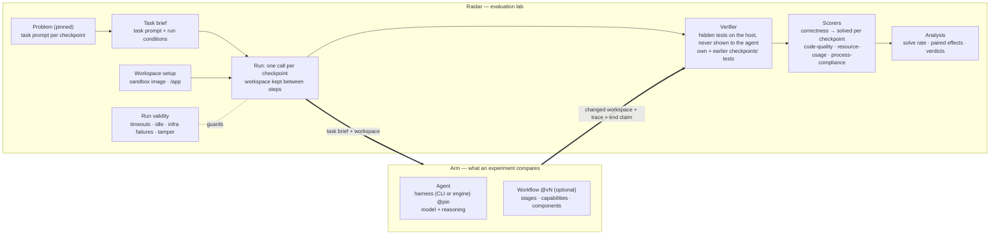

# Raidar as the evaluation lab: boundary, arms and measurement

Status: decisions agreed with the user on 2026-10-25 (section 1–4), open decisions (section 5) and a proposed migration order (section 6). Nothing here is implemented yet. Background: [split-exploration.md](split-exploration.md) (2026-10-23 findings; factory-x-loops facts there predate this record and are re-checked before use) and [versioned-items map](show-me-versioned-items-map.html).

## 1. The boundary (agreed)

Raidar is the evaluation lab. It owns everything that sets up a trial, runs it, decides whether the run counts, and measures how good it was. Everything that changes what the agent does belongs to the thing under test, the **arm**.



| Raidar owns | The arm owns |
|---|---|
| Problems: pinned import, errata, sensitivities, validation | Agent: harness (Codex CLI, Claude Code CLI, the factory-x-loops engine) at a pinned version, its settings, model and reasoning effort |
| Task brief: the problem's task prompt for the checkpoint plus the lab's run conditions | Workflow (optional): stages and stage prompts, capabilities (define, accept, verify, judge), components (skills, instructions, tool configs), the workflow's own internal limits |
| Workspace setup: the sandbox image, `/app`, carrying the workspace between checkpoints | |
| Run: one arm call per checkpoint | |
| Run validity: timeouts, idle/liveness, infrastructure-failure handling, reaper, tamper and health checks — the outer envelope, the same for every arm | |
| Measurement: the host-side verifier, scorers, metrics, analysis, review | |

## 2. Terms (agreed)

- **Agent**: a harness plus a model configuration. The common definition, and Harbor's (`AgentConfig`: harness, `model_name`, settings).
- **Workflow**: an optional sibling of the agent: stages, capabilities and components. Owned and versioned by its provider (for example factory-x-loops `one-shot-verify@5`).
- **Arm**: an agent plus an optional workflow, as used in one experiment, with its role (baseline or not). An arm with no workflow runs one session per checkpoint with the task brief passed through unchanged.
- Agents are defined once in an experiment and referenced by arms. An arm id is local to its experiment; anything compared across experiments (smoke admission, pooling) compares the arm's resolved agent and workflow identity, never the id.
- Experiment kinds: a `benchmark` compares arms that differ in agent; an `ab-test` compares arms that differ in workflow on the same agent. The factor guard enforces which part may differ.

```yaml
agents:
  codex-luna:
    harness: codex@1
    model: { provider: openai, id: gpt-6-luna, reasoning: low }
  fxl-codex-luna:
    harness: factory-x-loops@<commit> (driving codex@2)
    model: { provider: openai, id: gpt-6-luna, reasoning: low }

arms:
  - id: vanilla
    agent: codex-luna
  - id: verify
    agent: fxl-codex-luna
    workflow: one-shot-verify@5

analysis: { baseline_arm: vanilla }
```

## 3. What leaves Raidar (agreed direction)

- **Components.** Raidar stops delivering components. The 14 built-ins (`rules-file`, `workspace-files`, `lint-config`, `lint-tool`, `skills`, `harness-settings`, `stop-hook`, `mcp-server`, `prompt-wrapper`, `review-loop`, `guardrail-gate`, `python-guardrails`, `continue-on-stall`, `transient-retry`), the component definition/registry/compiler and the treatment runtime (`subject/treatment/`) leave with them. The experiment schema loses `conditions`, `components` and `shared_components`.
- **`prompt-wrapper` is not a component.** Its text splits in two: the run conditions ("working non-interactively in /app, which may start empty; nobody will answer questions") become the lab's task brief; `{{ instruction }}` is the problem's own task prompt. Any further framing is a workflow's stage prompt (factory-x-loops already wraps `%%%TASK%%%` this way).
- **`transient-retry` becomes run validity.** The lab classifies provider and infrastructure failures (the trial or step does not count against the arm); it never retries inside the arm's session.
- Lab mechanics currently filed under `subject/` stay in Raidar under lab owners: the sandbox image, per-step reset, provisioning, setup script, evidence capture and integrity flags.

## 4. Measurement: solve rate (agreed)

Raidar keeps its definition of solved and adds two of factory-x-loops' figures.

| | Agreed rule |
|---|---|
| Solved checkpoint | Every graded hidden test passed: the checkpoint's own tests and every earlier checkpoint's (forge checkpoint 3 runs `test_checkpoint_1..3`); skipped tests leave the count, as in SCB's native runner (`grading/models.py`). This matches factory-x-loops' "solved+retained", not its headline. |
| Unreached checkpoint | Unsolved: the solve rate is solved checkpoints ÷ planned checkpoints per trial (`checkpoint_solve_rate`). |
| Grader timeout, agent error | Unavailable: an infrastructure failure of the trial (run validity), never a zero. |
| Variants | `*_errata` (pinned exclusions, existing); **add** a solvable-set rate (only tests the reference solution passes in the lab's environment), from factory-x-loops `evaluation/analysis/solving.py` and `benchmark/solvable/`. |
| Intervals | Paired effects between arms as today; **add** Wilson 95% intervals for single-arm solve rates (factory-x-loops `analysis.wilson_interval`). |

Earlier agreements this record also carries:

- Format versions (Appendix B of the versioned-items map) may restart at 1.
- Scorers and headline metrics restart at `@1` from their current latest version, under naming and versioning rules still to be agreed (section 5).
- Generated data under `var/` may be cleared, except what section 5 keeps.

## 5. Open decisions

| # | Decision | Recommendation |
|---|---|---|
| O1 | Run conditions: one lab-wide versioned task-brief template, or part of each problem | Lab-wide template |
| O2 | Infrastructure failures: classify and exclude only, or also a recorded rerun policy | Classify and exclude first |
| O3 | Vanilla harness definitions (`codex`, `claude-code`): Raidar-owned now, or one shared provider owns all harness definitions | Raidar now, shared provider later |
| O4 | An engine harness (factory-x-loops) and the CLI it drives: one harness entry, or the inner CLI as its own field | One harness entry |
| O5 | "Vanilla CLI + an AGENTS.md": only through a workflow (for example `single-session@1` with an instructions component), or components directly on an agent-only arm | Only through a workflow |
| O6 | Sandbox image: language toolchain only, harness CLI installed by the harness definition (a pack release with re-validation of both problems) | Yes |
| O7 | Scorers that read method records (`gate-effort@11`, the stall metrics of `process-compliance@7`): a neutral evidence format any arm may emit, or retire them | Neutral evidence format |
| O8 | Naming rules N1–N5 and versioning rules V1–V4 for scorers and metrics (lowercase hyphenated names; one integer version per name in the tree; a committed release register checked by `make quality`; epoch-namespaced archive tags) | Adopt all |
| O9 | `var/archive/pre-v1` (4.5 GB, the only raw evidence behind ledger faults FCR-001…004) | Copy the cited files into the ledger, then clear |

## 6. Proposed migration order

Each step lands on its own, passes `make quality`, and is smoke-proved where it changes a run.

1. **Task brief and run validity.** Move the run conditions into a lab task-brief template; move infrastructure-failure handling into run validity. Remove `prompt-wrapper` and `transient-retry` from experiments. Exit: the forge smoke solves checkpoint 1 with no components.
2. **Arm schema.** `agents` + `arms { agent, workflow? }`; remove `conditions`/`components`; lock records the resolved agent and workflow identity; factor guard by kind. Exit: all experiments relocked; smoke admission and pooling compare arm identity.
3. **Strip the treatment layer.** Remove `subject/treatment/` and the 14 components; settle O7 for `gate-effort` and `process-compliance`. Exit: no component code or references remain.
4. **Measurement additions.** Solvable-set rate and Wilson intervals. Exit: both appear in analysis for the forge smoke.
5. **Clean slate.** Scorers and metrics to `@1` under O8, format versions to 1, release register written, archive tags namespaced, `var/` cleared per O9. Exit: fresh smokes on every experiment.
6. **First workflow arm.** factory-x-loops as an engine harness on codex (O4), `one-shot-verify` against vanilla codex on forge, after the factory-x-loops blockers recorded in the exploration (decoupled run entrypoint, git workspace, auth in a Linux container) are re-checked and resolved.
7. **Sandbox image split (O6),** as its own pack release with native-parity re-validation.
