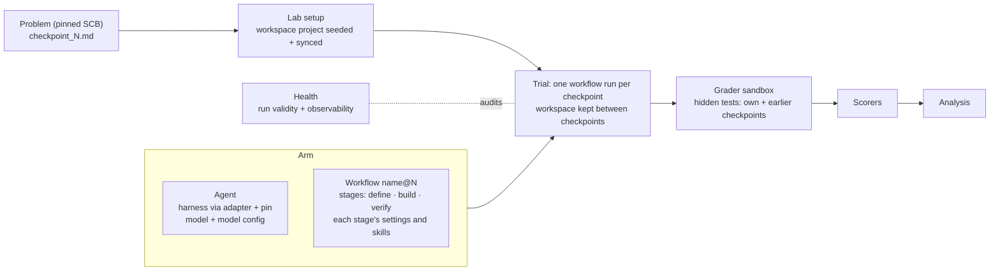

# Raidar as the evaluation lab: design and implementation plan

Status: design agreed with the user on 2026-10-25, revised after two independent reviews (Claude Opus 5.5 high, GPT-6.1 Sol xhigh; section 11); the review's decisions D1–D5 were settled the same day as recommended. Nothing here is implemented yet. It supersedes the earlier version of this file (open decisions O1–O9 and "arm = agent + workflow owned by its provider"). Background: [split-exploration.md](split-exploration.md) and the [versioned-items map](show-me-versioned-items-map.html). factory-x-loops (FXL) facts cite `/Users/adamjackson/Projects/inflight/factory-x-loops/factory-x-loops`, branch `feat/plan-gate` (read at `2408471`; the branch has since moved to `ac5db0f`, so each port re-reads its source at a pinned commit).

## 1. The boundary

Raidar is the evaluation lab. It owns the problem, the task text, workspace setup, the sandbox, running the trial, deciding whether the run counts (health), grading in its own grader sandbox, scoring, analysis and the ledger. The **arm** is what an experiment compares: an **agent** plus a **workflow**.



## 2. Terms

- **Agent**: a harness (an agent CLI Raidar has an adapter for) at a pinned version, a model and the model's configuration (reasoning level). Raidar defines agents.
- **Workflow**: a versioned, user-authored definition (`lab/workflows/<name>/`) of the stages a checkpoint runs through. Raidar ships the schema and three workflows; anyone may write more.
- **Stage**: a universal stage *type* (define, build, verify; review later) with one implementation in Raidar code and a schema. A **stage in a workflow** is that workflow's own settings for the type. Stage settings are never shared by reference between workflows; a workflow that wants the same setup copies it. A stage is never a step of its own: it contributes a prompt fragment, workspace setup and tools, skills, and checks run when the agent stops, to the checkpoint's session(s) (section 5.1).
- **Session**: one agent conversation with its own context. Each checkpoint has exactly one **primary** session, where the work happens and whose turns are resumed for repairs, fixes and rework. An **isolated** session (none planned yet; a future review stage) is a fresh session of the same agent with no history from the primary session, started by the runner, never by the agent, and briefed by the workflow's role prompt plus inputs the stage code assembles. Harness-native subagents are not isolated sessions. Each stage type fixes which session it uses; the workflow file never names sessions, and the resolved workflow in the lock shows them.
- **Turn**: one prompt and response inside a session; the first turn is fresh, later turns resume it.
- **Component**: a file the agent reads, owned by one stage of one workflow. The only kinds are **skill** and **instructions**. Prompts, checks, rules and the judge are stage settings, not components.
- **Arm**: an agent plus a workflow, as used in one experiment. An arm that names no workflow runs the default, `one-shot`.

## 3. The task text and workspace setup (R1)

- **Task text** follows FXL (`evaluation/benchmark/scb.py:169-186,421-445`, `evaluation/sequential.py:132-179`): for each checkpoint, read the pinned SCB `<problem>/checkpoint_N.md`, replace only `%%%ENTRYPOINT:entry_command%%%` and `%%%ENTRYPOINT:entry_file%%%`, keep everything else verbatim (the canary comment included). Checkpoint N is its own spec alone; earlier work carries through the workspace. The spec's hash per checkpoint is part of the problem pin. The entry-command value is the one Raidar's grader runs (`uv run --project /app <entry>`), recorded in the pin.
- **No Raidar framing.** `prompt-wrapper` goes. Framing belongs to a workflow's build prompt.
- **One-shot prompt (D1, decided).** `one-shot@1`'s build prompt copies FXL's measured baseline `one-shot/v1`: `Work the issue below per the repository's own rules.` + `%%%TASK%%%`. This is the workflow's wording, not lab framing. Raidar's own pilot recorded bare-task codex asking a question and writing nothing (pilot F1, `lab/experiments/smoke/python__forge__mechanics/experiment.yaml:5-7`).
- **Workspace seeding (D2, decided).** Before checkpoint 1 the lab writes the workspace's own `pyproject.toml` with the problem's declared dependencies and runs `uv sync`, outside every measured duration, as FXL does (`scb.py:385-423`), so an agent's code is graded in the environment it worked in (Raidar's FCR-004 is that fault).

## 4. Agents (R3)

Fields taken from FXL's harness definition (`config/harness/<cli>/vN.toml`, `docs/references/harnesses.md`); the values are Raidar's own pins and are proved, not copied:

```yaml
# lab/agents/codex.yaml   -> released as codex@2 (spike S1: FXL isolation; codex@1 kept as the earlier release)
adapter: codex
tool: { package: "@openai/codex", binary: codex, version: 0.156.1 }
settings:
  isolated_home: true
  ignore_user_config: true
  features_off: [...]            # FXL codex/v2 lists five; Raidar proves the set for its pin
  bundled_skills: [...]          # per-version list the P-family isolation check reads
placement: { skills: ".agents/skills", instructions: "{home}/AGENTS.md" }
resume: true                     # verifying workflows need session resume
models:
  gpt-6-luna: { canonical: gpt-6-luna, reasoning: [low] }   # what the adapter allows today
```

- Agent pins replace the harness pins in `lab/environments/python/pack.yaml` (one source of truth; RT5 moves to read agents).
- Adapters: keep `codex_cli`, `claude_code_cli` and their base `harbor_cli`; delete `gemini_cli`, `cursor_cli`, `copilot_cli`, `pi_cli`, `external_cli` (and their tests, registry entries and `TYPECHECK_TARGETS` in `cli/quality.py`).
- **Scope (user decision 2026-10-25):** phases 1–9 are built and proved on the codex adapter only. `claude_code_cli` stays as it is and gets its agent definition, resume proof and smokes once the codex end-to-end path works.

## 5. Workflows and stages

### 5.1 Stage types

Every stage type implements one interface. All of it happens inside the checkpoint's primary session (agreed 2026-10-26): there are no separate pre- or post-execute events and no extra sessions for define, build or verify.

| Stage | Settings | Before the agent starts | Prompt fragment | Checks when the agent stops | Outputs |
|---|---|---|---|---|---|
| define | prompt, unit rules version, skills | number the spec into units (`U<n>`, `C<n>`), mark the required ones (code); install the `define` tool and its state under `/app/.raidar/define/` | intake instructions + numbered units at `%%%UNITS%%%` | re-run the deterministic checks on the sealed draft (every required unit cited, quotes verbatim, aspects well-formed, examples carry a literal); write `feature-definition.md`; one repair resume if not sealed and passing | the feature definition (read by verify's judge); every `define` call |
| build | prompt, skills, instructions | place its skills and instructions | the build prompt with `%%%TASK%%%` | structured reply checks where the workflow asks (define-build-verify: `account`, `ac_tests`, `adrs`, one repair) | per-turn records |
| verify | see 5.2 | install the gate as the workspace pre-commit hook, seed the rules file, check tools root-owned outside the workspace | verify instructions at `%%%VERIFY%%%` | commit leftovers through the gate; judge (if set); refusal or open criteria → resume with fixes or rework (≤ `max_fix_rounds`, `max_passes`) | gate runs, hook runs, judge calls |

- **define is the builder's own work** (FXL's `define` tool and checks, unchanged in contract): the agent writes the definition with `define put` / `check` / `done` in the primary session, then builds against it. Questions are auto-accepted and recorded (FXL `run-suite`). No model checks the definition during the run. This differs from FXL's measured define-build-verify, whose intake is its own session.
- **The tool belongs to the trial**: the `define` tool and its state live in the trial's container; the define stage re-runs the checks after the seal, so a hand-edited draft fails like any other.
- `build` is always on; `define` and `verify` are off unless enabled. A disabled stage's prompt, skills and instructions never reach the sandbox.
- **Instructions**: each enabled stage's instructions are joined in stage order into one file at the agent's `placement.instructions`; never written over the task's own `AGENTS.md`.
- **A workflow's own tools and files are never scored** (rule): skills dir, rules file, decisions file, `/app/.raidar/` (define state, feature definition), gate state. They are excluded from the graded snapshot, every diff, the gate's commit and code-quality scoring (`contract/snapshot.py` `SNAPSHOT_EXCLUDES` grows), and their digests are recorded. Their effect shows only through how the trial does.
- **Graded tree on interruption**: when a deadline, cancellation or gate error cuts a verifying run, the workspace is restored to the last tree the gate decided on (FXL `engine/workflow/verified.py:630-642`), and the record says which gate it was. Exhausted fixes grade the last sealed tree.

### 5.2 Verify stage settings

Everything FXL spreads across `[verification]`, the verify template, the gate policy and the Python pack (`docs/references/verify-gate.md:84-300`) is one block:

| FXL | Verify stage field |
|---|---|
| `template = N` → `workflow/templates/verify/vN.md` | `prompt` (the text; tokens filled from the stage's own fields) |
| `gate_policy = N` (including the per-test limit `rule.test`) | `rules`: rule families by name, plus `test_timeout` |
| pack tool pins, `requirements-tools.lock` | `checks`: name, category (lint, format, types, tests, coverage, other), tool pin, command, blocking; every tool pinned, the resolved lock hashed |
| `max_gate_fixes`, `max_passes`, `test_workers` | `max_fix_rounds`, `max_passes`, `test_workers` |
| hook + engine seal | `gate: { on_commit, after_turn }` |
| rules seeded into `AGENTS.md`; `.factory-x/decisions.md` | `rules_file`, `decisions_file` |
| `[judge]` | `judge` |
| `[probes]` | `probes` (phase 9; enabling it is a new workflow release) |
| idle limits `gate`, `tool`, `install` | lab-owned limits in the L registry |

`language: python` selects the stage code's rule implementation (most families are Python code built on pytest and the syntax tree). Raidar ships Python only.

**Authority of records**: the runner's root-run seal and its gate records, copied and hashed on the host after each turn, are authoritative. The hook's own records (written as the agent user on the agent's `git commit`) are evidence that must agree with them (FXL G1–G3).

### 5.3 Shipped workflows

```text
lab/workflows/
  one-shot/workflow.yaml                 build only (default)
  one-shot-verify/workflow.yaml          build + verify (gate, 2 fix rounds, 1 pass)
  define-build-verify/workflow.yaml      define + build + verify (gate + judge, 20 passes)
    skills/feature-definition/SKILL.md   define
    skills/aspect-writing/SKILL.md       define
    skills/test-per-aspect/SKILL.md      verify
    skills/pytest-templates/SKILL.md     verify
```

`define-build-verify@1` is **derived from** FXL `define-build-verify/v2` (v1 plus unit rules 2; adopted after FXL experiment B, `docs/experiments/ledger.md:357-407`), without probes. It is not a faithful port: the builder writes the definition in the primary session (FXL's intake is its own session), skills are delivered per stage (FXL gives all four to the whole run, `engine/lifecycle/workspace.py:215-226`) and limits are lab-owned, so FXL's measured results do not transfer. Phase 8 writes its full field and token map before coding: the tokens `%%%UNITS%%%`, `%%%MODE%%%`, `%%%PRIOR%%%`, `%%%DEFINITION%%%`, `%%%PUSHBACK%%%`, `%%%GATE%%%`; the intake, build, rework and summary prompts; `max_refinement_rounds`, `aspects`, `anchored`, `audited`, `stated_literals`; judge `closed_at`, `open_at`, `settle_after`, `fit_rework`, `regression_needs_baseline`, `retries`, `context_tokens`, `timeout_seconds`.

Judge: Jev through OpenRouter. Raidar's Jev client is parked and offline-first (`scoring/judge/session.py`); phase 8 adds a live mode that records raw responses and pins one model id (Raidar today requests `~typesafe/jev-latest` and checks `typesafe/jev-1.13-20260917`; FXL requests `typesafe/jev-1.13`). The key stays host-side and is proved absent from every sandbox environment and persisted output.

```yaml
# lab/workflows/one-shot-verify/workflow.yaml   -> one-shot-verify@1
schema: 1
name: one-shot-verify
stages:
  build:
    prompt: |
      Work the issue below per the repository's own rules.

      %%%VERIFY%%%

      %%%TASK%%%
  verify:
    enabled: true
    language: python
    prompt: |
      ## Verification
      ...   (FXL workflow/templates/verify/v1.md, tokens renamed)
    gate: { on_commit: true, after_turn: true }
    max_fix_rounds: 2
    max_passes: 1
    test_workers: 2
    test_timeout: 60
    rules_file: AGENTS.md
    decisions_file: .raidar/decisions.md
    checks:
      - { name: lint,   category: lint,     tool: ruff==0.8.6,       run: "ruff check",          blocking: true }
      - { name: format, category: format,   tool: ruff==0.8.6,       run: "ruff format --check", blocking: true }
      - { name: types,  category: types,    tool: mypy==2.3.1,       run: "mypy --strict",       blocking: true }
      - { name: tests,  category: tests,    tool: pytest==<pin>,                                 blocking: true }
      - { name: cover,  category: coverage, tool: pytest-cov==<pin>,                             blocking: false }
    rules: [quality, project, against-base, tests-that-cannot-fail, coverage-exclusions]
```

### 5.4 Identity

The lock records, per arm: the agent release and pin; the workflow release; the workflow's resolved content hash (definition with every default filled; every skill and instruction file's path and content; the resolved check-tool lock); and the **stage code digest** of each enabled stage type. The stage code digest covers the stage's modules, the verify rule implementation, the `define` tool and unit rules, the Jev client and the adapter. Pooling and smoke admission compare the full arm identity (agent + workflow + stage code digests); a stage code difference cannot be overridden. Admission today compares only agent name, model and effort (`engine/health/admission.py:3-5`) and grows to this identity.

### 5.5 How a workflow runs inside a trial

- **Runner**: a Harbor `BaseAgent` that drives the native adapter for one checkpoint, host-side, through `environment.exec`. It keeps one agent phase per checkpoint for the reaper and health hooks. It reuses lab infrastructure that today lives under `subject/treatment/` (`provision`, `setup_script`, `session_chain.create_inner`, `HARBOR_AGENT_NAMES`), moved, not rebuilt.
- **Session resume**: the active session store is kept apart from the immutable per-turn logs (Harbor codex resume needs the root `sessions` dir, `harbor/agents/installed/codex.py:1415-1475`; proved in phase 1). Define repairs, gate fixes and rework all resume the primary session.
- **Accounting**: per-turn token deltas, not sums of cumulative contexts (Harbor codex contexts carry cumulative totals; FXL de-duplicates by session, `harness/codex.py:101-159`); session totals kept to reconcile.
- **Liveness**: stage-aware. Agent turns keep the idle rule; host-side judge passes and root-run gate work are marked windows with their own registered limits (`idle.gate`, `idle.tool`, `idle.install`, `request.judge`), never counted as agent idleness.
- **Time budget (D4, decided)**: one equal per-checkpoint budget for every arm of an experiment, set by the experiment (Raidar caps each checkpoint's agent phase, `agent_timeout_sec`, 1800 s on forge; FXL's measured runs were unbounded, so its results do not transfer). The runner reads the deadline and starts a fix or rework turn only when the last turn of its kind plus the last gate (and judge) fit (FXL `fit_rework`); a cut ends with a recorded `deadline` ending.
- **Tools in the sandbox**: the verify gate's pinned tools and the `define` tool are a stage-tool layer of the image, keyed by stage code digest, installed root-owned outside the workspace; agent turns run as the agent user. `define` runs on the layer's own interpreter, not the agent's or the project's.

## 6. Health (R2)

FXL's model (`docs/references/run-health.md`): an audit after the run over recorded evidence; each check is `pass`, `violation` or `unmeasured` (missing evidence is never `pass`). Live controls only act and record; readings never invalidate. One health report per trial is the **only** producer of validity: today's execution checks (`engine/trial/collect.py:336-381`, `finish.py:50-59`) move into it. Phase 4 writes the full per-check table (`pass` / `violation` / `unmeasured` → `invalid` / `warning` / none) before coding, distinguishing instrument failures (a broken `define` tool, a gate error) from agent outcomes (an unusable definition).

| Family | Checks |
|---|---|
| H run record | today's H checks; records integrity (was T2); residual processes after the reaper (was T3) |
| L limits | every lab limit registered once; every kill names a registered limit; today's L1/L2 (liveness record) keep their meaning under L |
| V verifier | today's V checks; V3 grows: the graded snapshot equals the last gate-decided tree for verifying workflows |
| P provenance | today's P2/P3 (concurrency, comparison warnings) keep their numbers; new: no key or proxy variable names in sandbox records (FXL P6); the agent saw only its workflow's skills and instructions, read against the agent's `bundled_skills` list (FXL P8) |
| G gate (verify on) | gate tools unchanged across the trial (tool-tree hash, was T1, over the stage-tool layer); no bypass (`--no-verify`, hook settings changed); hook records agree with the runner's (FXL G1–G6); gate and define state paths not written by the agent (the protected-path part of FXL T4) |
| E workflow (verify or define on) | fix turns, endings, structured-reply repairs, definition present (FXL E1–E6) |
| J judge (judge on) | judge calls recorded, closure consistent with answers (FXL J1–J3) |
| readings | per-stage timings, provider calls and failures, idle time, stalls, tokens and cost; former `process-compliance` metrics (test commands never run, tests before finishing, tests after the last edit) |

- **Agent provider failures**: every attempt recorded; the step classified as an infrastructure failure; the trial excluded within the existing 20% cap; no retry. Exclusions are reported per arm, and analysis refuses when exclusion rates differ materially between arms (heavier workflows make more calls).
- **Judge failures (D3, decided)**: as FXL, a Jev request is retried up to 3 times and an unanswered aspect is recorded as undecided, which counts as open (`capability/judge/jev.py:250-344`). The judge is part of the workflow's method, not the agent's provider, so the no-retry rule above does not apply; recorded under J.
- **Tamper (D5, decided)**: the earlier "drop T4" assumed nothing of the lab's sat in the agent's container. With verify and define, gate and define state do; the G family restores the protected-path part of T4 for those paths only.

## 7. Measurement

- Solved checkpoint, unreached checkpoint and grader failures as agreed (unchanged).
- **Solvable-set rate**: needs reference-passing test sets per problem revision, regression sets included (FXL `evaluation/analysis/solving.py:34-46,163-178`, `benchmark/solvable/`). Raidar generates them in its grader sandbox from the reference solution, pins them beside the errata, and reports "unavailable" when a set is missing. Errata exclusions apply first.
- **Wilson 95% intervals** for single-arm solve rates (FXL `evaluation/analysis/stats.py:35`).
- `process-compliance` stops being a scorer (its metrics are health readings).
- `gate-effort` becomes `verification-effort@1`: reads the runner's gate records; `not_applicable` when verify is off.
- **`definition-coverage@1`** (FXL's offline process audit, stage A): per required unit, Jev judges whether the criteria citing it, through their aspects and examples, capture what it requires; reads the recorded `feature-definition.md` and units; `not_applicable` without define.
- **`test-coverage@1`** (FXL's stage B): per criterion, Jev judges whether the builder's mapped tests exercise it; reads the final tests and `ac_tests`.
- Both run host-side at assessment time (the key never enters the sandbox) and start as recorded readings: FXL's own review (`docs/design/jev-review.md`) found its audit cut-offs never validated against labels, so they become headline metrics only after calibration.
- Naming and versioning (R8): lowercase hyphenated names of at most three words; package directory equals the scorer name; metric names `<benchmark>-<policy>[-<shape>]`; no versions in Python names; integer versions from 1; one version of each name in the tree; release register `lab/releases.yaml` (name@N → hash) checked by `make quality`; epoch-namespaced archive tags. Applies to scorers, metrics, agents and workflows; the register lands with the first agents and workflows (phase 2).

## 8. Ledger (R9)

Adopt FXL's journal model (`docs/references/journal.md`, `src/factory_x_loops/evaluation/journal/`): append-only JSONL records in git; run records (availability `local`, `fetchable`, `gone`, plus digests); occurrence records carrying a short redacted excerpt; fault events from which status is folded; generated views; a check that reads no run data. Migration, in order:

1. Inventory every cited run and source in FCR-001…004 and M-001 (pilot jobs, guardrails main and smoke jobs, removed experiment prose).
2. Register each run with its digests; capture each citation as an occurrence excerpt; re-point removed prose to `archive/pre-structure-reset:<path>`; cite hidden tests by upstream location (`scb-problems@<commit>:<path>`).
3. The ledger check verifies the migration is complete (every citation resolves to an excerpt, an archive ref or an upstream ref).
4. Only then clear `var/`; runs whose data is deleted are marked `gone`.

## 9. Implementation plan

Each phase lands as one cutover, keeps `env -u AGENT make quality` green (coverage ≥ 95%, import-linter contracts, structure allowlist `scripts/checks/check-structure.py`, experiment locks), re-pins errata and sensitivities and relocks every experiment in the same commit whenever an identity changes, and is smoke-proved where it changes a run (real runs: codex `gpt-6-luna` at `low`, `DETACH=1`).

| # | Phase | Main work | Exit |
|---|---|---|---|
| 0 | Review | Two independent reviews; D1–D5 settled (done) | Agreed revision |
| 1 | Session spike | Codex runs a build turn plus a resumed turn under Harbor through a throwaway runner, on two forge checkpoints; per-turn token deltas; next checkpoint fresh | Done 2026-10-25: same session id across turns; the resumed turn answers from the earlier turn; deltas reconcile with session totals ([evidence/session-resume-spike.md](evidence/session-resume-spike.md)) |
| 2 | One-shot cutover | Move lab infrastructure out of `subject/treatment/` (`provision`, `setup_script`, `session_chain`/`create_inner`, `HARBOR_AGENT_NAMES`, `integrity` consumers); add `lab/agents/`, `lab/workflows/`, schemas, loader, `lab/releases.yaml` + check; runner with build stage; `one-shot@1`; workspace seeding (D2); lock identity (5.4); admission identity; snapshot excludes. Then delete the catalogue, component definitions, `lab/treatments/`, component entry points (`orchestrator/pyproject.toml`), experiment `conditions`/`components`/`shared_components`/`manipulation_checks`, factor guard, `component_hosts`, the `component_probes` validity check, review projection of conditions, 5 adapters; rewrite every experiment as `one-shot` arms and relock | Done 2026-10-26 (`b55b6eb`): `make quality` 1658 passed, coverage 96.01%; forge smoke `phase2-forge-01` valid, every step changed `/app`, prompts exact, per-turn records, seed present before checkpoint 1 |
| S | Workflow spike (2026-10-26, user decision: phases 3–9 wait for the spike's outcome) | S1 isolation and parity (`codex@2`, capability declaration, parity record, P8, seeding perf phase); S2 verify in the primary session; S3 define in the primary session; S4 `define-build-verify` end to end on forge, then the two coverage scorers on its jobs | S1 done (`7e5c834`): smoke `s1-forge-01` valid, P8 pass, no plugin or bundled-skill content in rollouts, `make perf-gate` passed on mbp. S2–S4 pending; then the user decides whether the spike becomes the implementation |
| 3 | Task text | Importer reads `checkpoint_N.md` with entrypoint substitution; spec hash per checkpoint; re-import and re-validate forge and circuit_eval; re-pin errata | Spec bytes equal SCB's plus the two substitutions |
| 4 | Health | Full outcome table (section 6) written first; health sole validity producer; L registry; provider-failure classification without retry; per-arm exclusion report; readings incl. former process metrics; delete `process-compliance` and its analysis and review consumers | A forced provider failure is excluded, not retried; table rows each covered by a test |
| 5 | Image split | Toolchain image; per-agent CLI layer keyed by agent hash; stage-tool layer keyed by stage code digest; problem pins bind the toolchain image only | `make perf-gate` within budget; cold and warm real-agent runs prove both CLIs' versions and auth; problem identity unchanged |
| 6 | Clean slate | Scorers and metrics to `@1`; formats to 1; archive tags; solvable sets generated and pinned; Wilson intervals; ledger migration (section 8); clear `var/` | Fresh smokes on every experiment; ledger check passes with no run data |
| 7 | `one-shot-verify@1` | Verify stage type ported from FXL `capability/verify` and `packs/python` at a pinned commit; gate hook, root seal, fix rounds in the build session, restore-to-last-gated-tree; G and E families; stage-aware liveness; time-budget fit rule (D4); `verification-effort@1` and its analysis and review consumers (replacing `gate-effort`, `evaluation/review/quality/gate_view.py`, `grading/prefix`) | Fake-agent integration tests: clean pass, seeded refusal → fix turn → pass, gate error ≠ refusal, deadline mid-fix restores the gated tree, bypass and tool tampering detected; one real forge smoke |
| 8 | `define-build-verify@1` | Field and token map (5.3) first; define stage type (units, `define` tool, unit rules 2, auto-accepted questions); structured build replies; judge (Jev live mode, D3); rework passes; four skills copied; J family | Replays against FXL fixtures (unit numbering, unit rules 2, `define` checks, judge-input identity, as FXL `tests/test_define_compact_replay.py`); Jev key absent from every sandbox env and output; judge undecided vs closed exercised; one real forge smoke |
| 9 | Probes | `verify.probes` `derive: [golden]` in a new `one-shot-verify` release, then `[golden, example]` with deterministic closure in a new `define-build-verify` release | Probe records per accepted gate; a failing probe produces a rework turn; probe-no-fix-left ending exercised |

## 10. Risks

- Porting FXL's verify pack and define stage brings host-side assumptions (worktrees, the engine's interpreter for `define`); phase 5's stage-tool layer and phase 7/8 integration tests are the guard.
- FXL keeps moving; each port pins its source commit and records it.
- Golden probes run the spec's worked examples, which SCB's hidden tests largely exercise; probe arms are their own releases and arms.
- Stage code changes move behaviour without moving a workflow's hash; the stage code digest in the lock, with non-overridable pooling refusal, is the guard.
- An equal capped budget favours light workflows; experiments comparing verifying workflows set a budget large enough that budget endings stay rare, and report them per arm.

## 11. Independent review record

Reviews of the first version of this document, read-only, run as separate sessions: [evidence/split-design-review-opus.md](evidence/split-design-review-opus.md) (Claude Opus 5.5, high) and [evidence/split-design-review-sol.md](evidence/split-design-review-sol.md) (GPT-6.1 Sol, xhigh). Both: "sound with changes". Their shared blockers (phase 1 deleting live infrastructure; deleting the `harbor_cli` base class) and major findings (resume, accounting, liveness, budget, graded tree on interruption, health table, identity, records authority, snapshot excludes, ledger inventory, define-build-verify fidelity, solvable sets, per-phase quality) are folded into sections 3–9. The decisions they raised, D1–D5, were settled as recommended.
