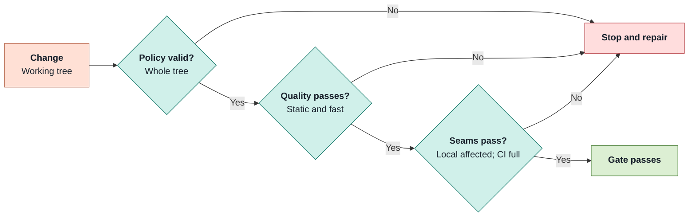

# Contributing

A contributor guide that takes repository changes through local gates and registered releases.

| Does                                                                                                                        | Does not                                                                                 |
| --------------------------------------------------------------------------------------------------------------------------- | ---------------------------------------------------------------------------------------- |
| **Gates:** checks changes before commit and in CI.<br/>**Releases:** preserves prior identities and pins distributed bytes. | **Contract build:** never publishes artifacts.<br/>**Checks:** never fix or stage files. |

## 1 · Gate a change

_Local gates select affected seams; CI runs the full slow and quality tiers._



```bash
env -u AGENT uv run --project orchestrator --extra dev pre-commit install --hook-type pre-commit
env -u AGENT make gate-commit
# CI uses: env -u AGENT make gate-ci
```

| Change                 | Automated evidence                                                                                          | Contributor action                                                                                          |
| ---------------------- | ----------------------------------------------------------------------------------------------------------- | ----------------------------------------------------------------------------------------------------------- |
| Tests and capabilities | Ownership, tier, changed-behavior evidence and duplicate-case checks block changes that fail their requirements. | Declare each new behavior and capability's owner; map added tests and parameter cases to changed source.    |
| Python and analysis    | Ruff, strict mypy, import contracts, complexity, policy and I/O boundary checks block new or stale debt. | Use owning seams and remove resolved baseline entries; never refresh baselines to make a change pass.       |
| Guardrails             | `rule-coverage` blocks missing passing/violating evidence; timing checks consume the fast-tier JUnit report. | Follow [test profile](../../.omp/test-profile.md) for machine budgets, reference exceptions and test tiers. |
| Toolchain              | Exact tool-pin, installer/lock agreement and maintained Markdown/YAML formatting checks block changes that fail their requirements. | Use the locked formatter; dependency changes also run the pinned audit (CI always audits).                  |

> [!IMPORTANT]
> **Owning policies:** [test profile](../../.omp/test-profile.md) defines budgets and exceptions; [ownership map](../../scripts/checks/repository-owners.json) defines tiers and seams. Unknown local ownership runs all T2 seams rather than skipping tests. Docker, performance and security checks are separate gates.

Sources: [.omp/gate.json](../../.omp/gate.json); [Makefile](../../Makefile) (`quality`); [scripts/checks/repository-owners.json](../../scripts/checks/repository-owners.json); [.omp/test-behavior-map.json](../../.omp/test-behavior-map.json); [.omp/test-profile.md](../../.omp/test-profile.md); [scripts/checks/check-python-quality.py](../../scripts/checks/check-python-quality.py); [scripts/checks/check-analyzer-scope.py](../../scripts/checks/check-analyzer-scope.py); [.omp/rule-coverage.json](../../.omp/rule-coverage.json).

## 2 · Find the owning source

_Follow enforced package boundaries instead of adding another extension path._

- **Import direction:** `cli` → `evaluation` → `engine` → `design` → `scoring` → `grading` → `subject` → `judge` → `contract`; consult import contracts for subtiers.
- **Extensions:** author [stage packages](../../lab/stages/README.md) and [runtime packs](../../lab/environments/README.md), not stage types in the orchestrator.

- **Lab:** `experiments/`, `problems/`, `agents/`, `workflows/`, `stages/`, `environments/`, `judge/` and `ledger/` hold tracked definitions.
- **Decisions:** [binding design](../../split-design.md), [ADRs](../adr/) and [reboot evidence](../reboot/) retain normative and historical records.
- **Review UI:** [development and projection contract](../../review-surface/README.md) live with the surface.

Sources: [split-design.md](../../split-design.md) (`sections 1,5,7`); [orchestrator/.importlinter](../../orchestrator/.importlinter) (`tiers`); [orchestrator/src/raidar/contract/paths.py](../../orchestrator/src/raidar/contract/paths.py); [review-surface/README.md](../../review-surface/README.md).

## 3 · Update releases in place

_Edit the definition in place and update its registered digest; relock and rerun affected experiments._

- **Agent, workflow or stage:** edit in place and update the registered digest of its existing `@N` in `lab/releases.yaml` (`make releases-check` prints the line); update dependent workflow digests the same way. `make release-archive REF=<name>@<N>` is optional history.
- **Stage evidence:** run `stage-check NAME=<namespace/name>` for the current installed tree and declared stop/output obligations.
- **Application version:** fetch origin, branch from `origin/main`, then run `env -u AGENT make version-release`; commit its three generated files in the printed release subject through normal gated review. Regenerate after rebasing onto newer main.
- **Version-only release:** does not require experiment relocks; execution toolchains pin result-affecting versions separately.
- **Invalidating code change:** rerun affected experiments. Experiment locks and problem validations still pin grader and `primitive_code` digests and refuse mismatches: relock through `make experiment-lock`, re-validating any problem RT7 refuses, then rerun. There is no repository identity record or revalidation ceremony; `job.json` retains `runner.commit` and `runner.dirty`.

Sources: [Makefile](../../Makefile) (`release-archive,version-release`); [split-design.md](../../split-design.md) (`5.6; 9 · Rules for every phase`); [lab/stages/README.md](../../lab/stages/README.md); [scripts/release/bump-version.py](../../scripts/release/bump-version.py); [orchestrator/src/raidar/design/experiment/lock.py](../../orchestrator/src/raidar/design/experiment/lock.py) (`execution_section, seal_lock`); [runtime_gate.py](../../orchestrator/src/raidar/design/experiment/runtime_gate.py) (`_binding_validation_issues`); [primitive/registry.py](../../orchestrator/src/raidar/subject/primitive/registry.py).

## 4 · Build the portable contract

_Distribute exact wheel and sdist bytes, not a build from a Git tag._

```bash
env -u AGENT make contract-build CONTRACT_DIST_DIR=var/contract/v<version>
# In the consumer environment with the exact hash-pinned artifact installed:
python -m raidar_contract.conformance.check
```

- **Build:** refuses existing output, writes wheel/sdist and prints their SHA-256 hashes; publication is a separate owner action.
- **Artifacts:** private releases live under `var/contract/v<version>/`; [`contract/releases/`](../../contract/releases/) supplies exact-version/hash requirements.
- **Install:** require the recorded version and hash; a tag does not establish installed-byte identity.
- **Conformance:** portable parse/refusal/digest vectors run without Raidar or Harbor; package dependencies are Pydantic and PyYAML.

> [!IMPORTANT]
> **Distribution ≠ contract id:** `raidar-contract 2.0.0` separates lab policy while retaining `stage/1`, workflow schema 2, `criteria/1`, `stage-tree/1` and `agent/1`. Contract and package identity rules remain in the [authoring contract](../../lab/stages/README.md).

Sources: [split-design.md](../../split-design.md) (`section 5.8`); [contract/pyproject.toml](../../contract/pyproject.toml); [Makefile](../../Makefile) (`contract-build`); [contract/conformance/check.py](../../contract/conformance/check.py); [contract/releases/1.0.0.requirements.txt](../../contract/releases/1.0.0.requirements.txt); [contract/releases/1.1.0.requirements.txt](../../contract/releases/1.1.0.requirements.txt); [contract/releases/2.0.0.requirements.txt](../../contract/releases/2.0.0.requirements.txt); [`contract/src/raidar_contract/__init__.py`](../../contract/src/raidar_contract/__init__.py).
