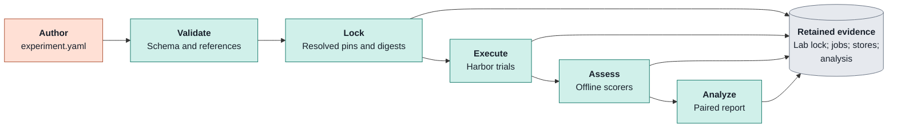
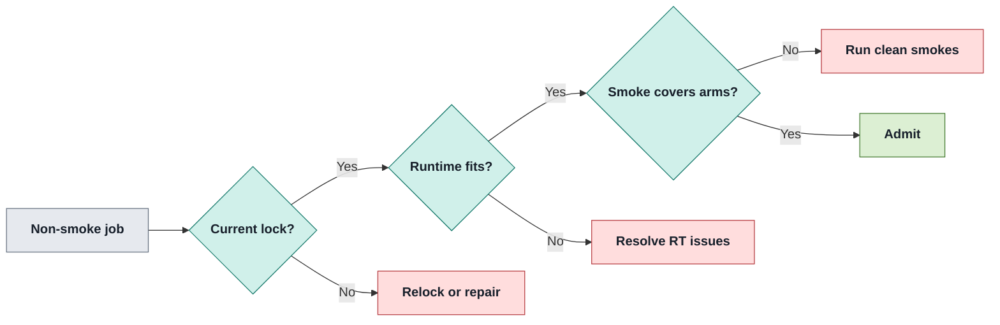

# Experiment workflow

A locked path from a comparison design to stored trials, Assessments and reviewable results.

| Does                                                                                                                            | Does not                                                              |
| ------------------------------------------------------------------------------------------------------------------------------- | --------------------------------------------------------------------- |
| **Design:** compare paired arms on pinned problems.<br/>**Evidence:** keep execution, assessment and analysis outputs separate. | **Smoke:** operational success is not citable effectiveness evidence. |

## 1 · Choose the question

_Set the objective before collecting evidence._

| Objective         | Collection rule                                                                                                                                                            | Interpretation                                                            |
| ----------------- | -------------------------------------------------------------------------------------------------------------------------------------------------------------------------- | ------------------------------------------------------------------------- |
| Explore (default) | Smallest case first; at most 4 attempts per arm, one problem, codex / `gpt-6-luna` / low; lock and pre-register; stop on process defects.                                  | Exploratory signals and cost; below `min_pairs` is `insufficient`.        |
| Confirm           | Clean explore first; primary outcome in `rationale.md`; size attempts from J2 projection; all arms unchanged under one lock; at most one infrastructure exclusion per arm. | Only confirm is citable; report intervals, cost, gate effort and quality. |
| Smoke             | Same engine; operational health only.                                                                                                                                      | Never citable.                                                            |

> [!IMPORTANT]
> **Change boundary:** a Raidar or workflow change starts a new confirm experiment. Objectives are separate from `ab-test` and `benchmark` kinds.

Use [README](../../README.md) for installation, [problem onboarding](problem-onboarding.md) for bindings, and `make help` for options. Real-model runs require owner approval.

Sources: `README.md@52441c363fb1a1f076df6b87bd455d925d783b0c (historical)`; [lab/stages/README.md](../../lab/stages/README.md) (`Contract history`).

## 2 · Author and pin

_The initializer supplies structure, not your treatment or attrition policy._



```bash
E=lab/experiments/ab-test/python__circuit_eval-cp1__review-trial/experiment.yaml
make experiment-init EXPERIMENT=$E
# Edit the treatment arm and pre-register the analysis plan.
make experiment-validate EXPERIMENT=$E
make experiment-lock EXPERIMENT=$E
make experiment-plan EXPERIMENT=$E
```

- **Starter:** current Codex and one-shot releases, two identical arms, one pinned checkpoint; set the treatment to the registered workflow or agent under test.
- **Variants:** add an arm to an existing design; initialization refuses an existing path.
- **Experiment id:** use `lab/experiments/<kind>/<runtime>__<subject>__<intent>/experiment.yaml`; the initializer defaults its id from the directory.

> [!IMPORTANT]
> **Attrition:** pre-register `analysis.max_exclusion_difference` in 0–1. An unset bound yields descriptive-only `insufficient` verdicts; refuse when the largest minus smallest arm exclusion rate exceeds it (equality passes). The independent 20% paired-exclusion cap still applies.

<details>
<summary>Starter details</summary>

- **Defaults:** `analysis.attempts: 5`, `min_pairs: 5`, `max_exclusion_fraction: 0.2`, `alpha: 0.05`. An explore design must deliberately choose its smaller attempt count.
- **Metric:** the starter omits the headline metric; locking chooses it by checkpoint count.
- **Problem:** `PROBLEM=` replaces the default `scb/circuit_eval.checkpoint_1@38d627ecf668`; `EXPERIMENT_ID=` overrides the directory-derived id.

</details>

Sources: [orchestrator/src/raidar/cli/experiment_init.py](../../orchestrator/src/raidar/cli/experiment_init.py) (`render_starter,_STARTER`); [Makefile](../../Makefile) (`experiment-init,experiment-validate,experiment-lock,experiment-plan,experiment-execute,experiment-assess,experiment-analyze,review-surface-quality-data,review-surface-serve`); [split-design.md](../../split-design.md) (`6 Health, attrition pre-registration`).

## 3 · Pass admission

_A runnable lock and matching clean smoke evidence are separate gates._



| Gate                  | Verifies                                                                                                                                                         | Failure action                                                   |
| --------------------- | ---------------------------------------------------------------------------------------------------------------------------------------------------------------- | ---------------------------------------------------------------- |
| Runtime compatibility | `RT0` validation; `RT1` binding runtime; `RT2` pack contract; `RT4` scorer/metric support; `RT5` agent CLI pin; `RT6` pack exists; `RT7` grading implementation. | Lock refuses; issues are reported together.                      |
| Clean smoke coverage  | Match the identity and cleanliness rules below.                                                                                                                  | Run matching smokes; separate clean jobs may jointly cover arms. |

> [!IMPORTANT]
> **Confirm safety:** never use `ALLOW_UNSMOKED=1` for confirm. It is an explicit admission override recorded in `job.json`, not clean smoke evidence.

- **Match:** recorded `runner.execution_sha256` / `runner.toolchain_sha256`, pack recipe, target name and Docker facts, plus each arm’s agent/tool, model/reasoning, workflow and package/primitive pins must be covered.
- **Clean:** a finished smoke must retain valid trials and violation-free `health.json`, and change `/app` at every executed checkpoint relative to its parent snapshot; checkpoint 1 compares with the seeded workspace.
- **Refusal:** draft locks, agent overrides and no-work trials cannot clear admission. Grader-recipe matching belongs to pooling, not smoke identity; an admission override cannot lift capability incompatibility.
- **Choose:** `make orchestrator-smoke` exercises the default agent; `make agent-smoke RELEASE=… MODEL=…` selects a release; `make smoke-agents` covers registered smoke arms. `make help` owns options.

Use [health and pooling](health-and-pooling.md) after execution.

Sources: [orchestrator/src/raidar/design/experiment/runtime_gate.py](../../orchestrator/src/raidar/design/experiment/runtime_gate.py) (`runtime_gate_issues`); [orchestrator/src/raidar/engine/health/admission.py](../../orchestrator/src/raidar/engine/health/admission.py) (`admit_jobs,identity`); `README.md@52441c363fb1a1f076df6b87bd455d925d783b0c (historical)`.

## 4 · Execute and retain

_Launch long jobs detached and wait for completion before assessment._

```bash
make experiment-execute EXPERIMENT=$E JOB_ID=first DETACH=1
J=var/jobs/python__circuit_eval-cp1__review-trial/first
make experiment-status JOB=$J
```

- **Supervisor:** `DETACH=1` survives the launching shell; pid, log and exit record live in `<job>/detach/`.
- **Status:** reports `running`, `finished`, `failed` or `died` without changing the job.
- **Job:** retains step results, validity, N1 phases and executed `job.lock.json`.
- **Interrupted trials:** use `make harbor-cleanup JOB=$J` for leftover environments.

For report-only `perf-check`, enforced `perf-gate` and accepted budgets, see [health and pooling](health-and-pooling.md).

Sources: [Makefile](../../Makefile) (`experiment-execute,experiment-status`); `README.md@52441c363fb1a1f076df6b87bd455d925d783b0c (historical)`.

## 5 · Assess, analyze and review

_Offline interpretation never rewrites the executed job._

```bash
S=var/stores/review-trial
make experiment-assess JOB=$J STORE=$S \
  SCORERS="correctness@10 code-quality@9 resource-usage@8"
make experiment-analyze JOBS="$J" STORE=$S ANALYSIS_OUT=var/analysis/review-trial
make review-surface-quality-data QUALITY_JOBS="$J" QUALITY_STORE=$S
make review-surface-serve REVIEW_JOBS_ROOT="$J" REVIEW_STORE=$S
```

- **Assessment lock:** supply `LOCK=` or retain the experiment’s current lock with the job’s `lock_sha256`; assessment-only relocks may apply. The executed `job.lock.json` is not a fallback.
- **AS1:** supplied scorers must cover the locked runtime; a supplied bundle must belong to a locked problem.
- **Replay:** `REPLAY=1` requires byte-identical existing Assessment output.

<details>
<summary>Offline evidence details</summary>

- **Verification effort:** assessment grades not-yet-graded retained pre-fix trees into the store, using each step’s own verifier and target.
- **Coverage:** `code-quality@9` first produces deferred verifier coverage in the store; replay produces neither pre-fix grades nor coverage.

</details>

- **Analysis:** thresholds come from the lock; overrides are labelled; unreadable trial inputs are refused, not treated as unassessed.
- **Decision rule:** binary outcomes use exact McNemar; other outcomes use exact paired sign-flip tests, including equal-problem-weight aggregate effects.
- **Intervals:** describe uncertainty, never decide the verdict; `EXACT_STATE_LIMIT` is an execution-safety bound, not an approximation.
- **Excluded checkpoints:** under `halt_on_failure`, lock-pinned exclusions execute and retain workspace/budget, then advance without a fake pass or fail. Missing validation, infrastructure failures and unexplained missing rewards still halt.
- **Review locks:** `REVIEW_LOCK=` (or projection’s `QUALITY_LOCK=`) selects explicit locks; otherwise each experiment’s current lock must match execution. Smoke locks under `var/tmp/smoke/` need an explicit path.
- **Projection:** use the same jobs and stores for Quality and serving; rerun projection after `review-surface-test`, which rewrites fixture data.

See [health and pooling](health-and-pooling.md) for pooling constraints and [scoring](scoring.md) for measurement meanings.

Sources: [orchestrator/src/raidar/cli/assess.py](../../orchestrator/src/raidar/cli/assess.py) (`module contract`); [Makefile](../../Makefile) (`experiment-init,experiment-validate,experiment-lock,experiment-plan,experiment-execute,experiment-assess,experiment-analyze,review-surface-quality-data,review-surface-serve`); `README.md@52441c363fb1a1f076df6b87bd455d925d783b0c (historical)`; [split-design.md](../../split-design.md) (`7 Measurement and lab validation`).
