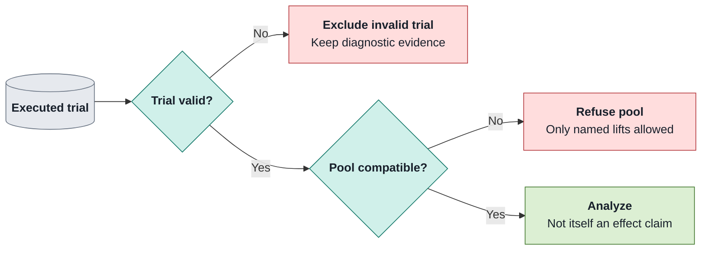
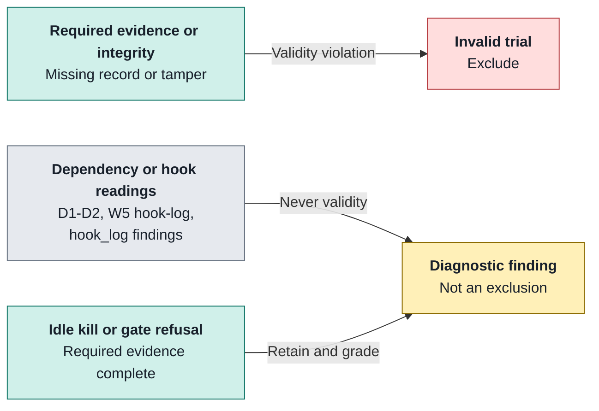

# Health and pooling

Operational evidence for deciding whether trials count and jobs can be compared.

| Does                                                                      | Does not                                                                                                           |
| ------------------------------------------------------------------------- | ------------------------------------------------------------------------------------------------------------------ |
| **Checks:** trial validity, comparable provenance and retained integrity. | turn an operational smoke into effectiveness evidence. make a real-job performance warning a validity verdict. |

## 1 · Keep the gates separate

_Admission, validity, comparability and overhead are independent decisions._

| Check                | What it establishes                                            | What failure means                                                          |
| -------------------- | -------------------------------------------------------------- | --------------------------------------------------------------------------- |
| Trial health         | Retained records support valid execution and grading.          | Validity violations exclude a trial; missing evidence is not a pass.        |
| Pooling              | Provenance, immutable identities and parity permit comparison. | Blocks analysis of incompatible jobs; some named differences can be lifted. |
| Real-job performance | Observed overhead against accepted target budgets.             | Advisory warnings; strict mode makes breaches fail.                         |
| Fixture performance  | No-LLM overhead at controlled concurrency 1 and 3.             | Blocks the overhead gate on a budget breach.                                |

Smoke admission is a separate pre-execution gate: see [experiment workflow](experiment-workflow.md#3--pass-admission).

Sources: [orchestrator/src/raidar/engine/health/admission.py](../../orchestrator/src/raidar/engine/health/admission.py) (`identity, job_problem, admit_jobs`); [orchestrator/src/raidar/evaluation/analysis/pooling.py](../../orchestrator/src/raidar/evaluation/analysis/pooling.py) (`check_pooling, NEVER_OVERRIDABLE, OVERRIDABLE`); [Makefile](../../Makefile) (`perf-gate`); [orchestrator/src/raidar/engine/health/audit.py](../../orchestrator/src/raidar/engine/health/audit.py) (`audit_report, CHECKS`); [orchestrator/src/raidar/engine/health/evidence.py](../../orchestrator/src/raidar/engine/health/evidence.py) (`ROWS, module evidence table`); [orchestrator/src/raidar/engine/perf/report.py](../../orchestrator/src/raidar/engine/perf/report.py) (`PerfReport, build_report`).

## 2 · Read health before scores

_Missing evidence is unmeasured unless a required primitive obligation makes it a validity violation._

- **Audit:** `make health JOB=…` recomputes `health.json` from host evidence; each check carries `pass`, `violation` or `unmeasured`.
- **Applicability:** W1–W11 use locked primitive ids and host-written config, not stage names; required missing, malformed or inconsistent artifacts fail closed. Legitimate refusal, closed stop and deadline cuts remain valid when their owed evidence is complete.
- **Workflow:** W3–W7 own `gate/1`, W8–W9 package calls/outputs and W10 reply/judge evidence; W11 owns independent integrity findings, not agent-writable hook-log findings.
- **Judge:** J1–J3 audit retained calls, answer/closure consistency and undecided aspects; undecided criteria cannot end `verified`.
- **Liveness:** `idle_killed` is graded like an agent timeout and remains a valid outcome; `kill_failed` is a violation.

Find the owning evidence

- **V / H:** verifier ledger and stored snapshots (V3 never reads live `/app`), expected records and recorded limits; H5 uses agent-setup limits.
- **P / T:** P2–P3 concurrency/context, P8 native session-isolation evidence, T1 tool hashes, T2 records manifest and T3 residual processes. T2 is unmeasured in-run; the health command verifies it.
- **Faults:** inspect `<job>/fault-candidates.jsonl` as provisional evidence, then reconcile with [fault/remedy records](../../lab/ledger/README.md), not an automatic remedy verdict.

Sources: [orchestrator/src/raidar/engine/health/audit.py](../../orchestrator/src/raidar/engine/health/audit.py) (`audit_report, CHECKS`); [orchestrator/src/raidar/engine/health/evidence.py](../../orchestrator/src/raidar/engine/health/evidence.py) (`ROWS, module evidence table`); [orchestrator/src/raidar/engine/health/signals.py](../../orchestrator/src/raidar/engine/health/signals.py) (`check_l2`); [orchestrator/src/raidar/engine/health/fault_candidates.py](../../orchestrator/src/raidar/engine/health/fault_candidates.py) (`module contract`); `README.md@52441c363fb1a1f076df6b87bd455d925d783b0c (historical)`.

## 3 · Pool only comparable evidence

_The analysis checks provenance even when the requested pool contains one job._

- **Provenance:** multi-job pools compare mechanics epoch, recorded `runner.toolchain_sha256` / `runner.execution_sha256`, dirty-runner state, pack/grader recipes, arm subject and effective limits in `job.json` and `plan.json`. These retained comparisons are not a repository identity-record process.
- **Never lift:** records-manifest tamper, package identities, primitive code, capability declarations and per-problem parity cannot be overridden.
- **Capabilities:** all nine declarations must be complete and equal unless every experiment declares `varies: [harness]`; model and reasoning must still match unless separately declared varied.
- **Parity:** every valid trial of a problem must share image, seeded workspace, limits, network policy and agent-process identity, including user, `PATH` and `TMPDIR`.
- **Named lift:** `POOL_OVERRIDE=<field>` records an allowed refusal override in analysis. Lifting `timing_cost` does not make cross-hardware timing/cost comparable; the report marks it non-comparable.
- **Old evidence:** jobs without a mechanics epoch are labelled `unmeasured`, not retroactively certified.

See [`pooling.py`](../../orchestrator/src/raidar/evaluation/analysis/pooling.py) for exact override fields and refusal details; the [experiment workflow](experiment-workflow.md) owns analysis commands.

Sources: [orchestrator/src/raidar/evaluation/analysis/pooling.py](../../orchestrator/src/raidar/evaluation/analysis/pooling.py) (`check_pooling, NEVER_OVERRIDABLE, OVERRIDABLE`).

## 4 · Diagnose overhead without rebaselining

_Real-job reports are advisory; the controlled fixture is the enforced overhead gate._

- **Real job:** `make perf-check JOB=…` reports budget breaches, insufficient samples and missing phases; `PERF_STRICT=1` makes breaches fail. Malformed or empty input is an error, not a successful report.
- **Interpret:** compare phase p95 only with enough samples; cold-start/build tripwires use a single-sample maximum. Between-step budgets are `not_applicable` for one-checkpoint trials.
- **Contention:** inspect configured/peak concurrency and overlapping jobs before attributing a breach; reports split breached p95 samples by contention level.
- **Enforced gate:** `make perf-gate` runs the no-LLM Docker fixture at concurrency 1 then 3 and fails on breaches; it is separate from `make quality`.
- **Budget owner:** the recorded target selects its accepted set; unknown targets use N1 reference, and jointly checked jobs must share a target. Budget changes need an explicit decision, not a rebaseline to pass.

Use the [accepted budget record](../reboot/overhead-baseline.md) for thresholds; `make help` and the owning sources above define options.

Sources: [orchestrator/src/raidar/engine/perf/report.py](../../orchestrator/src/raidar/engine/perf/report.py) (`module contract`); [Makefile](../../Makefile) (`perf-gate`); [orchestrator/src/raidar/engine/perf/budgets.py](../../orchestrator/src/raidar/engine/perf/budgets.py) (`check_budgets, budget_set_for`); [orchestrator/src/raidar/engine/perf/contention.py](../../orchestrator/src/raidar/engine/perf/contention.py) (`module contract`); [docs/reboot/overhead-baseline.md](../../docs/reboot/overhead-baseline.md) (`5, 5.1`).
