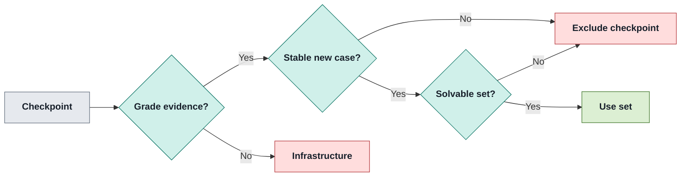

# Problem onboarding

A reference-based admission process that pins usable checkpoint tests before an experiment runs.

| Does                                                                                                                             | Does not                                                                                                                                          |
| -------------------------------------------------------------------------------------------------------------------------------- | ------------------------------------------------------------------------------------------------------------------------------------------------- |
| **Admission:** import, validate and bind pinned SCB tasks.<br/>**Scoring basis:** retain repeat-stable reference-solvable cases. | **Meaning:** reference-solvable success is not specification compliance.<br/>**Repeatability:** no variation observed does not prove determinism. |

## 1 · Import to binding

_Commit generated problem pins and validation reports; keep materialized content outside tracked definitions._

```bash
make problem-list SOURCE=scb@38d627ecf668
make problem-import SOURCE=scb@38d627ecf668 PROBLEMS=dag_execution,log_query
make problem-validate PROBLEMS=dag_execution,log_query REPEATS=5 TARGET=mbp
make problem-list
make pack-build
```

- **Discovery:** `problem-info SOURCE=scb@<commit> PROBLEM=<ref>` inspects a candidate; without `SOURCE`, `problem-list` reports registered verdicts, solvable sizes and varying-case counts.
- **Records:** commit generated manifests, dependency locks and validation records under `lab/problems/registry/`; content stays under `var/`.
- **Task text:** retain pinned `checkpoint_N.md`, including its canary; substitute only entry-command and entry-file tokens. `instruction_sha256` hashes rendered text.

Use [the runtime-pack contract](../../lab/environments/README.md) for another runtime; Python is the supported runtime today.

Sources: [split-design.md](../../split-design.md) (`3.2`); [Makefile](../../Makefile) (`problem-list,problem-import,problem-validate,pack-build`); `README.md@52441c363fb1a1f076df6b87bd455d925d783b0c (historical)`.

## 2 · Select scoreable cases

_Validation excludes unusable checkpoints without discarding their usable neighbours._



- **Solvable set:** cases passed by the checkpoint’s reference in every repeat, including regression cases; default `REPEATS=5`.
- **New evidence:** each checkpoint must add a previously uncollected test its own reference always passes; otherwise only that checkpoint is excluded as `no_new_scoreable_tests`.
- **Pooling:** byte-identical reference trees pool positive and negative repeats by test id; a varying case is removed wherever it appears.
- **Earlier reference:** the previous-reference comparison is a reading, not an exclusion; identical adjacent references are `not_informative`.

| Check             | Establishes                                                           | Does not establish                                                                 |
| ----------------- | --------------------------------------------------------------------- | ---------------------------------------------------------------------------------- |
| Reference repeats | “No variation observed in N runs” for this reference and environment. | A deterministic case; agent submissions are graded once.                           |
| Native parity     | Case-by-case agreement with SCB’s native runner when supplied.        | Full validation when parity did not run: missing checks yield `validated_partial`. |

For outcome interpretation and audit coverage, see [scoring](scoring.md#3--separate-outcome-from-headline).

Sources: [orchestrator/src/raidar/design/problem/validation.py](../../orchestrator/src/raidar/design/problem/validation.py) (`solvable_sets,varying_cases,check_reference_reading,run_checks,verdict`); [orchestrator/src/raidar/design/problem/validator.py](../../orchestrator/src/raidar/design/problem/validator.py) (`ValidateOptions`); [split-design.md](../../split-design.md) (`7.1`).

## 3 · Pin dependencies

_Reference validation and agent grading use the same declared-wheels policy._

| Policy     | Bound / behaviour                                                                                                                    | Failure meaning                                                                                                  |
| ---------- | ------------------------------------------------------------------------------------------------------------------------------------ | ---------------------------------------------------------------------------------------------------------------- |
| Resolution | Python 3.12; PyPI only; wheels only; both `x86_64-manylinux_2_28` and `aarch64-manylinux_2_28`; UTC import cutoff.                   | Unresolvable reference set or architecture-version divergence excludes the problem as `dependency_unresolvable`. |
| Caps       | 200 packages; 1 GiB wheels; 120 seconds per attempt per declared set and architecture.                                               | One immediate identical timeout retry only; second timeout is `dependency_resolver_unavailable` infrastructure.  |
| Agent seed | Resolve only `test_dependencies`, never reference dependency sets; seeded project plus uv/pip enforce cutoff and wheels-only policy. | Reference packages must not hint at the solution.                                                                |
| Regrades   | Reinstall the recorded dependency lock, never resolve again.                                                                         | Resolver / PyPI outages are infrastructure, never an agent score.                                                |

<details>
<summary>Provisioning and refusal detail</summary>

- **Acquisition:** trusted networked host work sees neither hidden tests nor reference code; verify hashes, install wheel-only offline with `--require-hashes --no-deps`, keyed by base image and lock digest.
- **Grader:** offline, non-root and capability-dropped; its tools plus `test_dependencies` have a separate pin.
- **Submission declarations:** reuse the pin when the set digest matches; otherwise resolve under the pinned policy and caps. Unsupported declarations report `no-wheel`, `after-cutoff`, `unresolvable`, `direct-reference`, `unparseable` or `cap-exceeded`.
- **Infrastructure:** malformed resolver version output or lock data is not a dependency refusal.
- **Dependency pins:** changed manifest dependency records must pass validation before relocking and rerunning affected experiments; the lock retains `dependencies_sha256`.

</details>

**D1 / D2:** `unprovided` and `undeclared_import` are descriptive readings, not trial invalidity; the import reading is heuristic. Analysis reports affected-step shares per arm.

Sources: [split-design.md](../../split-design.md) (`3.2 declared-wheels/1`); [orchestrator/src/raidar/design/problem/dependencies.py](../../orchestrator/src/raidar/design/problem/dependencies.py) (`resolve_dependencies`); `README.md@52441c363fb1a1f076df6b87bd455d925d783b0c (historical)`.

## 4 · Keep grader pins current

_RT7 still refuses mismatched grader digests; an invalidating change requires fresh runs, not an identity-record ceremony._

> [!IMPORTANT]
> **RT7:** validation still pins immutable grader image content and `implementation_sha256`; lock-time and grading checks refuse mismatches. Re-validate affected problems, regenerate experiment locks with `make experiment-lock`, then rerun. Never hand-edit pins or locks.

- **Implementation digest:** covers executable grading imports and package initializers, explicit subprocess/plugin roots, shipped runtime bytes and host Python / packaging / pydantic versions; static distribution version metadata is outside the closure.
- **Crash attribution:** a grading crash or timeout runs a starter canary in the same sandbox; completion suffices. Passing canary attributes the failed grade to the submission; failed canary remains infrastructure.

Sources: [runtime_gate.py](../../orchestrator/src/raidar/design/experiment/runtime_gate.py) (`_binding_validation_issues`); [grading/identity.py](../../orchestrator/src/raidar/grading/identity.py) (`grading_execution_inventory`); [split-design.md](../../split-design.md) (`9 · Rules for every phase`); `README.md@52441c363fb1a1f076df6b87bd455d925d783b0c (historical)`.

## 5 · Bind the intended checkpoints

_Checkpoint scope belongs in the experiment lock's problem binding, not a late run-time filter._

```yaml
problems:
  - ref: scb/dag_execution@38d627ecf668
    checkpoints: 2
```

- **Prefix:** first `k` checkpoints form one task with a persistent workspace; Assessment and analysis follow the retained bound plan.
- **One-shot:** `scb/circuit_eval.checkpoint_1@38d627ecf668` binds one checkpoint alone.
- **Override:** `MAX_CHECKPOINTS` is smoke/dev-only; later planned checkpoints become `not_attempted`, not removed. Other kinds must bind their prefix.

Continue with the [experiment workflow](experiment-workflow.md); consult [scoring](scoring.md) for outcome interpretation.

Sources: [split-design.md](../../split-design.md) (`3.2 Checkpoint subsets`); `README.md@52441c363fb1a1f076df6b87bd455d925d783b0c (historical)`.
