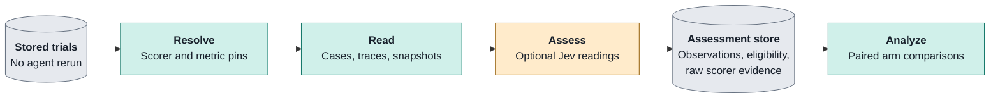

# Scoring

Offline measurements that turn retained trial evidence into interpretable Assessments.

| Does                                                                                                                                              | Does not                                                                                                    |
| ------------------------------------------------------------------------------------------------------------------------------------------------- | ----------------------------------------------------------------------------------------------------------- |
| **Measures:** correctness, quality, resources and workflow diagnostics. **Retains:** observations and the evidence behind uncertain readings. | equate the headline score with checkpoint solve rate. treat workflow judgement as proof of correctness. |

## 1 · Read stored evidence

_Scorers observe trials; analysis compares arms._

- **Offline work:** deferred verifier coverage and pre-fix grading use retained snapshots and a Docker target, not a fresh agent run.
- **Next step:** use the [experiment workflow](experiment-workflow.md) for the command sequence; `make help` owns assessment and regrade options.

Sources: [orchestrator/src/raidar/scoring/framework/builtin_manifests.py](../../orchestrator/src/raidar/scoring/framework/builtin_manifests.py) (`CORRECTNESS, CODE_QUALITY, RESOURCE_USAGE`); [orchestrator/src/raidar/scoring/coverage_inputs/scorer.py](../../orchestrator/src/raidar/scoring/coverage_inputs/scorer.py) (`CoverageScorer, _readings_bytes`); [Makefile](../../Makefile) (`experiment-assess, assess-regrade`).

## 2 · Choose the reading

_The experiment and lock select versions; this matrix is not a substitute for those pins._

| Scorer pin              | Evidence read                                               | Interpretation                                                                                                             |
| ----------------------- | ----------------------------------------------------------- | -------------------------------------------------------------------------------------------------------------------------- |
| `correctness@10`        | Hidden verifier cases and lock-pinned solvable sets         | Reference-solvable success beside raw SCB results, strict case rates and regression failures.                              |
| `code-quality@9`        | Graded current/prior Python snapshots and verifier coverage | V verbosity, E erosion, H architecture, R rework, G regression breadth; eligibility travels with the reading.              |
| `resource-usage@8`      | Retained accounting trace                                   | Tokens, agent model cost plus host judge spend, turns and agent wall time.                                                 |
| `process-compliance@12` | Work-session trace and snapshot                             | Actual tests, tests after edits, requested plans and stalls; undecidable checks are insufficient, never model-adjudicated. |
| `verification-effort@1` | Host-written `gate/1` records and offline pre-fix grades    | Seals, first-pass/final cleanliness, failed blocking checks, fix turns and their cost; no gate means not applicable.       |
| `definition-coverage@6` | Required issue units and citing sealed criteria             | Jev reads how fully the criteria capture each required unit; no define means not applicable.                               |
| `test-coverage@6`       | Sealed criteria and final mapped tests                      | Jev reads whether tests detect wrong behaviour; includes regression criteria; no define means not applicable.              |

Sources: [orchestrator/src/raidar/scoring/catalog/builtin.py](../../orchestrator/src/raidar/scoring/catalog/builtin.py) (`REGISTERED_MANIFESTS`); [orchestrator/src/raidar/scoring/framework/builtin_manifests.py](../../orchestrator/src/raidar/scoring/framework/builtin_manifests.py) (`CORRECTNESS, CODE_QUALITY, RESOURCE_USAGE`); [orchestrator/src/raidar/scoring/process_checks/manifest.py](../../orchestrator/src/raidar/scoring/process_checks/manifest.py) (`PROCESS_COMPLIANCE`); [orchestrator/src/raidar/scoring/verification_effort/manifest.py](../../orchestrator/src/raidar/scoring/verification_effort/manifest.py) (`VERIFICATION_EFFORT`); [orchestrator/src/raidar/scoring/definition_coverage/manifest.py](../../orchestrator/src/raidar/scoring/definition_coverage/manifest.py) (`DEFINITION_COVERAGE`); [orchestrator/src/raidar/scoring/test_coverage/manifest.py](../../orchestrator/src/raidar/scoring/test_coverage/manifest.py) (`TEST_COVERAGE`).

## 3 · Separate outcome from headline

_A checkpoint solve rate and the canonical score answer different questions._

- **Primary outcome:** `solve_rate_solvable` counts checkpoints passing every lock-pinned solvable case over non-excluded checkpoints; it is reference-solvable SCB success, not specification compliance.
- **Context:** keep raw SCB outcomes, spec-determinacy flags and assertion-audit coverage beside the primary outcome; zero audited is `unmeasured`. Errata require explicit pre-registration.
- **Headline:** `S = 100 × C × (0.70 + 0.30 × I)`; `C` is the mean hidden-case pass rate across planned checkpoints, not the checkpoint solve rate.
- **Weights:** multi-checkpoint `I` uses V/E/H/R/G = 0.15/0.15/0.20/0.30/0.20; one-shot uses V/E/H = 0.30/0.30/0.40, with R/G not applicable.
- **Missingness:** unreached checkpoints contribute zero to `C`; a reached checkpoint with no graded cases is ineligible. Missing components are not imputed as zero.

> [!IMPORTANT]
> **Version rule:** canonical `@2` metrics return `S = 0` for measured `C = 0` even when quality evidence is missing; `@1` does not.

Sources: [orchestrator/src/raidar/scoring/framework/metrics.py](../../orchestrator/src/raidar/scoring/framework/metrics.py) (`Metric.score, SCB_CANONICAL, SCB_CANONICAL_ONESHOT`); [split-design.md](../../split-design.md) (`3.2 Onboarding any SCB problem`); [orchestrator/src/raidar/scoring/framework/builtin_manifests.py](../../orchestrator/src/raidar/scoring/framework/builtin_manifests.py) (`CORRECTNESS, CODE_QUALITY, RESOURCE_USAGE`).

## 4 · Diagnose coverage readings

_Coverage scorers retain uncertainty rather than inventing a pass/fail threshold._

- **Levels:** `mean_best_expected_level` summarizes probabilities on a 0–2 scale; these uncalibrated readings are neither line coverage nor headline scores.
- **Test evidence:** retained test source plus one hop of helpers is read; skipped tests or tests without a real assertion are capped at level 1.
- **Evidence:** inspect Assessment `readings.json` for probabilities, gaps and undecided questions, then `jev/<step>/call-NNNN.*` for raw request, response and interpretation; credentials are never retained.
- **Provisional:** undecided questions leave `awaiting_answers`; a later rescore can complete the Assessment.
- **Boundary:** active offline coverage judging is separate from parked policy/calibration machinery; a workflow’s `verified` judgement is treatment evidence, not hidden-grader correctness.
- **Credentials:** `OPENROUTER_API_KEY` supplies host workflow judges and offline coverage scorers; it must never enter the agent sandbox.

Sources: [orchestrator/src/raidar/scoring/coverage_inputs/scorer.py](../../orchestrator/src/raidar/scoring/coverage_inputs/scorer.py) (`CoverageScorer, _readings_bytes`); [orchestrator/src/raidar/scoring/definition_coverage/manifest.py](../../orchestrator/src/raidar/scoring/definition_coverage/manifest.py) (`DEFINITION_COVERAGE`); [orchestrator/src/raidar/scoring/test_coverage/manifest.py](../../orchestrator/src/raidar/scoring/test_coverage/manifest.py) (`TEST_COVERAGE`); [split-design.md](../../split-design.md) (`5.1 Judge validity`); `README.md@52441c363fb1a1f076df6b87bd455d925d783b0c (historical)`; [Makefile](../../Makefile) (`experiment-assess`); [orchestrator/src/raidar/judge/secrets.py](../../orchestrator/src/raidar/judge/secrets.py).
