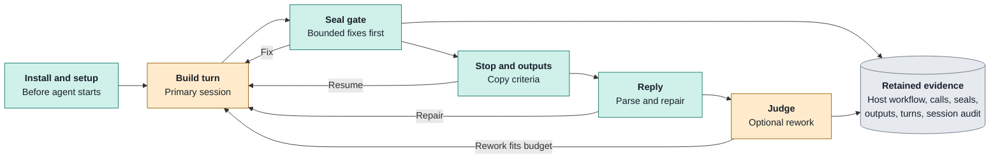
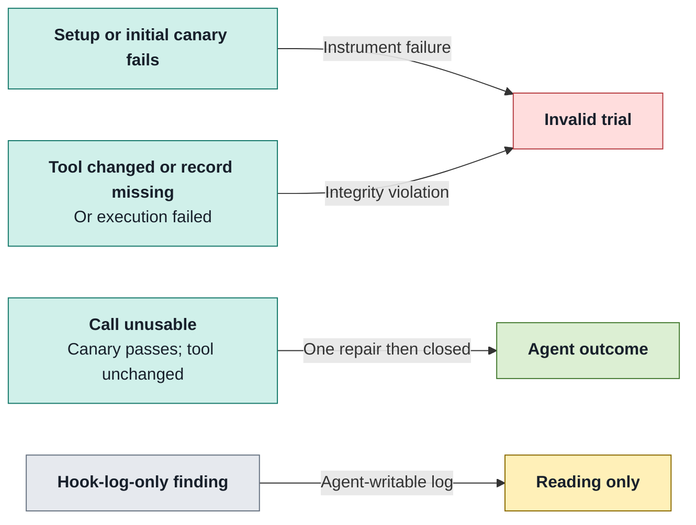

# Workflows and stages

A package-driven checkpoint lifecycle inside one primary agent session.

| Does                                                                                                                                                   | Does not                                                                                                                                       |
| ------------------------------------------------------------------------------------------------------------------------------------------------------ | ---------------------------------------------------------------------------------------------------------------------------------------------- |
| **Packages:** contribute prompts, calls, checks and declared outputs.<br/>**Primitives:** Raidar owns execution guarantees and authoritative evidence. | **Boundary:** packages are not host plugins, scorers or separate steps.<br/>**Verdict:** workflow verification is not hidden-test correctness. |

## 1 · Choose or author packages

_Workflow data composes registered package releases with a build frame._

| Workflow                       | Packages / policy                                                                                   | Role                                                |
| ------------------------------ | --------------------------------------------------------------------------------------------------- | --------------------------------------------------- |
| `raidar/one-shot@2`            | No stages.                                                                                          | Default for an arm with no workflow.                |
| `raidar/one-shot-verify@2`     | `raidar/verify@1`; zero gate fixes.                                                                 | Default `workflow-new` source.                      |
| `raidar/define-build-verify@2` | Define then verify; two gate fixes; `acceptance-reply/1`, `criteria/1`, judge at most three passes. | Method judgement, separate from hidden correctness. |

```bash
make stage-new NAME=acme/my-check
# FROM=ns/name selects another real source package.
make stage-lock NAME=acme/my-check
make stage-check NAME=acme/my-check TARGET=local
make workflow-new NAME=acme/my-workflow
```

> [!IMPORTANT]
> **Scaffolding:** `stage-new` copies `raidar/docs-check` by default. `FROM=<ns>/<name>` selects another source. It preserves bytes and modes, changing only the manifest name scalar—not commands, skills, prompts, modules, state paths or fixtures.

- **Safety:** creation refuses overwrites, traversal, symlinks and special files, including unsafe fixture trees; the source remains untouched.
- **Frame:** include `%%%TASK%%%` and exactly one slot per enabled package; disabled packages leave no sandbox files.
- **Release:** changed packages require a new package release, dependent workflow release, experiment relock and fresh runs; references use `ns/name@N`, not paths, branches or `latest`. Follow the [invalidating-change rule](contributing.md#3--preserve-released-bytes).

Use the [stage authoring contract](../../lab/stages/README.md) for manifest fields, fixtures, identity and imports; use `make help` for the full command catalogue.

<details>
<summary>Upstream package limits</summary>

- **Verify:** lint, format, strict types and individual pytest outcomes; default per-test timeout 60 seconds, overridable via `test_timeout`; whole checks at most 300 seconds; empty test collections refuse.
- **Define:** setup, sealing prerequisite and stop have 60-second timeouts; stop permits at most three resume turns; unusable draft receives one repair, then closes.
- **Docs check:** real codespell 2.4.1 checker over repository text, not a placeholder.

</details>

Sources: [lab/stages/README.md](../../lab/stages/README.md) (`Params, tokens and frame`).

## 2 · Run one checkpoint

_Repairs, gate fixes and rework resume the same conversation._



- **Turn order:** seal gate, run stops, load copied criteria, check reply, then judge; the first requested resume wins. Gate fixes precede reply repair.
- **Stop:** `done` requires declared outputs; `resume` needs a nonempty message and stays within its round bound; `closed` is terminal for the checkpoint.
- **Seal:** rerun checks as the agent user, recording the workspace without committing, staging, restoring or repairing it. `max_fix_rounds` defaults to zero.

> [!IMPORTANT]
> **Grade what remains:** refusals, deadlines and cancellation still grade the workspace the agent left. Extra turns must fit the equal checkpoint deadline; a missing `first_build` estimate schedules no first rework, with no fallback floor.

<details>
<summary>Reply and judge details</summary>

- **Reply:** `{account, ac_tests, adrs}`; each builder turn gets one syntax and one semantic repair; criterion/test mappings merge across turns.
- **Judge input:** mapped tests and one hop of helpers, never production code; criteria close at probability ≥0.8, open at ≤0.3, otherwise undecided.
- **Rework:** open/undecided aspects yield pushback in the same session only when predicted turn, gate and judge fit. Zero or unusable criteria cannot yield `verified`.
- **Endings:** distinguish `verified`, `pass_limit`, `no_progress`, `budget_exhausted`, `deadline`, `gate_refused` and `gate_error`.

</details>

Sources: [lab/stages/README.md](../../lab/stages/README.md) (`Setup, gate and stop`); [split-design.md](../../split-design.md) (`5.1`); `README.md@52441c363fb1a1f076df6b87bd455d925d783b0c (historical)`.

## 3 · Separate trust and judgement

_Authoritative evidence lives outside the agent-writable workspace._

| Concern      | Raidar guarantee                                                                                                        | Limit                                                                                                      |
| ------------ | ----------------------------------------------------------------------------------------------------------------------- | ---------------------------------------------------------------------------------------------------------- |
| Calls        | UID/GID 1000, clean `env -i`, fixed package/pack `PATH`, fresh `HOME`/`TMPDIR`, no network; package code never on host. | Same-user tools are not promised secrecy from harness credentials available to the agent.                  |
| Installation | Root copies immutable tools and hash-checks offline wheels; authored code never runs as root.                           | No root hook broker; hooks and their log are agent-writable.                                               |
| Records      | Calls and output digests copied host-side; judge key never enters container; hidden grading is separate and offline.    | Tools, skills and `.raidar/` state are excluded from graded snapshots, diffs, commits and quality scoring. |
| Health       | Required primitive evidence, setup failure and independently measured integrity violations can invalidate trials.       | Hook-log-only conditions and `hook_log_*` findings are readings, never validity.                           |

**Applicability:** host-written schema-2 configuration and locked primitive ids determine required evidence, not stage names. Missing or inconsistent package obligations fail closed.

<details>
<summary>Native session evidence</summary>

- **Agent boundary:** isolation, process facts, accounting, final text, resume storage, session audit, credential preflight and reset state belong to the native-agent protocol.
- **Accounting:** normalize Codex cumulative usage and Claude invocation usage into turn deltas and session totals; retain native session stores.
- **P8:** checks adapter audits and source-record hashes; absent isolation evidence is `unmeasured`, not a pass. Claude’s recorded partial proof is not full isolation assurance.

</details>

Sources: [lab/stages/README.md](../../lab/stages/README.md) (`Call protocol and evidence`); [split-design.md](../../split-design.md) (`6 Health`); `README.md@52441c363fb1a1f076df6b87bd455d925d783b0c (historical)`.

## 4 · Attribute failures

_A failed call alone cannot distinguish broken instrumentation from agent-authored state._



| Condition                                                   | Classification                           | Action                                          |
| ----------------------------------------------------------- | ---------------------------------------- | ----------------------------------------------- |
| Failed call + failed canary; resources above floors         | Instrument failure                       | Trial invalid.                                  |
| Same failure, but agent-writable disk / memory below floors | `environment_exhausted` agent outcome    | One repair, then closed.                        |
| Nonregular / oversized watched state                        | Agent outcome; tool not called           | Reject before opening; one repair, then closed. |
| Legitimate refusal, closed result or budget cut             | Valid when required evidence is complete | Do not confuse refusal with instrument failure. |

> [!IMPORTANT]
> **Publication:** replay every agent-attributed tool-failure count with `stage-check REPLAY=<trial>`. `agent_state` keeps the outcome; `tool_bug` removes that package version from every arm and requires a new release plus full reruns. Never selectively drop or rerun failed trials.

<details>
<summary>Call and state bounds</summary>

- **Calls:** default 60 seconds, hard maximum 300; stop round bound 0–5; one malformed/unusable repair per package per checkpoint.
- **State:** at most 64 MiB, 10,000 regular files and depth 32; reject symlinks, FIFOs, devices and special files before following/opening.
- **Stdout:** 1 MiB cap; overflow is unusable. Retain capped stdout and the last 8 KiB of stderr with call evidence.

</details>

See [health and pooling](health-and-pooling.md) for validity and pooling; see [scoring](scoring.md) for offline readings.

Sources: [lab/stages/README.md](../../lab/stages/README.md) (`Canary attribution and bounds`); [split-design.md](../../split-design.md) (`6–7`).

## 5 · Read retained evidence

_Stable wire names are evidence identifiers, not alternate public vocabulary._

- **Verifier:** `raidar-oracle/steps/<step>/record.json` and reward key `oracle_leak` remain wire names.
- **Scorers:** retain observation subject `trajectory`, input `oracle.cases` and hashed descriptions.
- **Problem store:** retains the pinned bundle’s `oracle/` directory.

For the external design → lock → job → Assessment → review sequence, use [experiment workflow](experiment-workflow.md).

Sources: `README.md@52441c363fb1a1f076df6b87bd455d925d783b0c (historical)`; [Makefile](../../Makefile) (`experiment-init,experiment-lock,experiment-execute,experiment-assess,experiment-analyze`).
