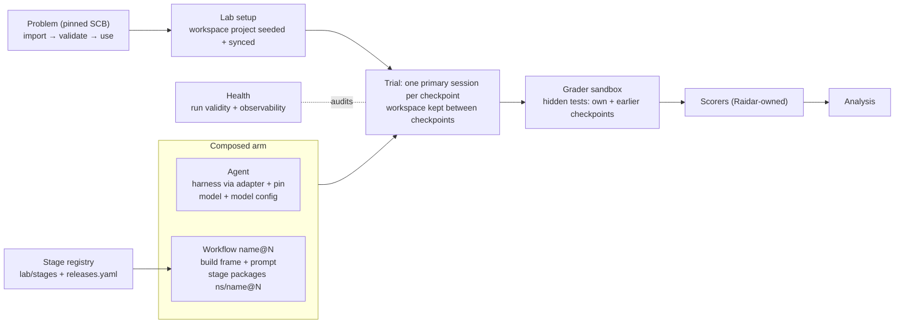

# Raidar as the evaluation lab: design and implementation plan

## Status

- **2026-10-25: design agreed.** The user agreed the design after two independent reviews (Claude Opus 5.5 high and GPT-6.1 Sol xhigh; see section 11). The reviews' decisions D1–D5 were settled the same day.
- **2026-10-26 to 2026-10-27: workflow spike, S1–S6.** The spike was built and run (section 9, row S).
- **2026-10-27: revised for the user's two product needs.**
  - **Need 1: problem-agnostic onboarding.** See section 3.
  - **Need 2: user-authored stages.** Stages become **packages** on one Raidar-owned contract, held in a shared registry (section 5).
  - **Evidence for Need 2:** the decisions rest on read-only design sessions, filed under [docs/reboot/evidence/](docs/reboot/evidence/):
    - stage authoring: `stage-authoring-opus.md` and `stage-authoring-astra.md`;
    - the registry: `stage-registry-opus.md` and `stage-registry-astra.md`;
    - stop-call failures: `stage-stop-failure-opus.md`.
  - **Phase-4 implementation 2026-10-28:** the public contract and generic package path coexist with the spike; Docker phase-exit proof is pending while `mbp` is offline.
- **2026-10-28: decision rule and voted decisions.** From 2026-10-28 every design or remediation decision is put to Claude Opus 5.5 and GPT-6 Astra as independent read-only votes, and the majority is adopted; GPT-6.1 Sol breaks a tie. The records are in `docs/reboot/evidence/decide-4b-*.md` and `decide-p4-*.md`, and the audits they rest on in `mechanism-audit-{opus,astra}.md`.
  - **Primary outcome** (Sol broke the tie for Astra): it stays the solvable-set rate, labelled "reference-solvable SCB success", not specification compliance. Determinacy flags and the audit's coverage are reported beside it; zero assertions audited is `unmeasured`, never "0 flagged". Errata stay an optional pre-registered override.
  - **Flakiness** (Sol for Astra): validation uses 5 repeats, and records say "no variation observed in N runs", never "deterministic". Agent submissions are graded once.
  - **Audit fixes** (Sol for Astra): all eleven land in phase 4b, before phase 9, with Astra's amendments (section 9).
  - **Hook broker** (both voters): removed. The hook runs the checks as the agent's user and appends to an agent-writable log, so hook-derived evidence (G1, G2, W5's hook-log condition and hook-log findings in W11) becomes readings. These stay validity checks: G3 (the gate tool-tree digest), the installed-tree digest, watched-path, protected-path and session-log findings, and the seal's own record-channel protection and call supervisor.
  - **Namespaces** (both voters): stage references require a namespace, and the folder is `lab/stages/<ns>/<name>/`, with upstream packages at `lab/stages/raidar/<name>/` under CODEOWNERS. Agent and workflow references keep their current form. The workflow half was reversed on 2026-10-31 (R5 below).
- **2026-10-28 voted decisions: phase-4b follow-up.** Records: `docs/reboot/evidence/decide-4b2-{opus,astra,sol}.md`.
  - **Per-arm exclusion bound** (Astra, tie-break by Sol): no default. Each experiment pre-registers `analysis.max_exclusion_difference = d` in its lock; an unset bound makes analysis descriptive-only, with comparative verdict `insufficient`. Refuse only when the largest arm exclusion rate minus the smallest exceeds `d`; equality passes. The independent 20% paired-exclusion cap remains.
  - **Resolver retries** (both voters): one immediate retry, at most two 120 s attempts per declared set and architecture, using identical requirements and the same pinned policy; record attempts. A second timeout is infrastructure (`dependency_resolver_unavailable`), never `cap-exceeded` or an agent score.
  - **First rework estimate** (both voters): retain refusal when `first_build` duration is unavailable; no fallback floor.
  - **Pinned-excluded halt steps** (both voters): execute normally, retain workspace changes and budget, then advance without treating exclusion as a pass or fail. Use a separate halt-gate signal, never a fabricated solvable score; missing validation, grading infrastructure failures and unexplained missing rewards still halt.
- **2026-10-31: FXL pivot decisions.** Records: `docs/reboot/evidence/decide-pivot-{opus,astra,sol}.md`. The votes cover the factory-x-loops pivot (R1–R10, C7) and the phase-5 plan. Where both voters agreed, the shared decision stands; where they differed, the tie-breaks T1–T5 (Sol) name the voter, and for the details of agreed items Opus's vote is the more specific. Phase 5 scope is in section 9; the contract package is section 5.8.
  - **Contract package, R1** (both; publication Astra by T2): `contract/` at the repository root, its own uv project: distribution `raidar-contract`, import `raidar_contract`, dependencies pydantic and pyyaml only. It is the single implementation of `stage/1`, schema 2, `criteria/1`, `stage-tree/1`, release references and the agent schema, and the orchestrator depends on it. Publication is immutable wheel and sdist artefacts under `contract/vX.Y.Z`, with exact-version and hash pins; a tag alone does not pin the installed bytes. Done in phase 5, step 1.
  - **Shipped defaults on schema 2, R2** (both): all three workflows, `one-shot` included (no stages, prompt byte-identical), move to schema 2 under `raidar/`, and the schema-1 loader is deleted. `docs-check` becomes the real package `raidar/docs-check`; `stage-new FROM=<ns>/<name>` copies package bytes. Schema 2 gains `build.reply` and `judge`.
  - **Enforcement homes, R3** (Opus by T1): changed-line coverage and hollow-test refusal are a separate package, `raidar/test-evidence`, built in phase 10. `raidar/verify` stays at spike parity as the control, so a later comparison varies only that lever. Phase 5 adds only a root-owned `base` to the `gate/1` context. M-001 is `proposed`, with no experiment or outcome; its contrast is with a gate that has no coverage rule, not 85%. `LIST.item-untested`, golden probes and example probes are `fxl/*` forks.
  - **Ownership, R4** (both): `raidar/*` are Raidar's baselines and controls; methods are developed in FXL as `fxl/*` and imported byte-identical. This resolves C1 and C2.
  - **Importing and namespaces, R5** (both): `make stage-import` and `make workflow-import` verify an exported folder against its digest, with provenance in `lab/imports.yaml`. Workflow references require a namespace (`ns/name@N`, folder `lab/workflows/<ns>/<name>/`), reversing the workflow half of the 2026-10-28 namespace vote. Shipped workflows start new series (`raidar/one-shot@1` and so on), and the bare entries stay as frozen history that never resolves.
  - **SDKs and CLIs, R6** (both; subscription by Astra, T3): measured runs stay on pinned CLI adapters in containers. Subscription support is recorded per provider and pinned adapter in documentation and credential-preflight evidence, with no new identity field. The SDK assessment is phase 7; an SDK adapter needs its own conformance evidence, and every imported release needs a Raidar smoke before a result counts (C4).
  - **Isolated sessions, R7** (both): not in this cutover. A Raidar-owned primitive comes in a later phase 11, on a `stage/2` cutover.
  - **Judges, R8** (Astra by T4): the arm judge is part of the treatment, not evidence that the treatment succeeded. Coverage scorers stay readings until validated on held-out independent labels, blind to arm and judge verdict. Calibration and `jev-actions` stay Raidar-owned.
  - **FXL lab history, R9** (both): FXL's records are adopted under `FXL-` identifiers, never renumbered (section 8).
  - **Agent pairing, R10** (both): each model runs on its maker's harness by default; cross-harness runs are declared `varies` robustness checks (section 4).
  - **Contract bumps, C7** (both; freeze detail Opus): `stage/1` freezes at contract `1.0.0` at phase 5 exit; later bumps follow section 5.6.
  - **Phase-5 plan** (Astra's nine steps, with the T1 adjustments, T5): section 9.
- **2026-11-01: package standard and systems under test.** Records: `docs/reboot/evidence/decide-standard-{opus,astra,sol}.md`. Both voters agreed Q2. For Q1, Sol chose Opus on ownership and timing (T1), and Astra on including the transport-neutral agent schema (T2).
  - The standard has separate content and version identity. It stays in this repository under Raidar's governance; a separate repository needs two votes and a named trigger (section 5.8). C7 and R4 are unchanged.
  - Contract `1.0.0` stays frozen. `1.1.0` adds portable stop-result/context models and shared conformance cases; `2.0.0` separates lab policy from the distribution. Contract ids and package digests stay unchanged. Grading-identity scope changes are batched with these releases; the orchestrator revalidates once afterward, before relocks and trials can pass RT7.
  - An arm denotes a system under test: composed (agent + workflow) or opaque (a pinned external system, not an agent). Every arm today is composed. The workflow execution engine is the executor; "interface" is not a Raidar term (section 2).
  - A same-agent workflow comparison measures the imported method under Raidar's executor, not FXL's deployed system (section 7.3). Opaque-arm support waits for a registered question (phase 12).
- **2026-10-27: enforcement review** ([docs/reboot/evidence/enforcement-review-opus.md](docs/reboot/evidence/enforcement-review-opus.md)). User decisions:
  - this file moves to the repository root, so contributors and coding agents can read it;
  - the branch merges to `main` once the spike is proved and the design approved, and CI then runs through `main`;
  - the `stage/1` contract page lives at `lab/stages/README.md`;
  - credential preflight and host auth join the agent protocol;
  - in-tree packages stay under `make quality` (ruff, mypy, coverage);
  - `make security-gate` is a required phase-exit check, run on `mbp`;
  - released versions are append-only, checked against `main`'s history.
- **Supersedes:** the earlier versions of this file, which lived at `docs/reboot/split-design.md`. The first version had open decisions O1–O9 and "arm = agent + workflow owned by its provider". The 2026-10-26 version had fixed stage types in code.
- **Background:**
  - [docs/reboot/split-exploration.md](docs/reboot/split-exploration.md);
  - the [versioned-items map](docs/reboot/show-me-versioned-items-map.html).
- **Citations to factory-x-loops (FXL)** point at `/Users/adamjackson/Projects/inflight/factory-x-loops/factory-x-loops`, branch `feat/plan-gate`. The branch has moved since it was read, so each port re-reads its source at a pinned commit.

## 1. The boundary

Raidar is the evaluation lab. It owns all of these:
- the problem and the task text;
- workspace setup;
- the sandbox, and running the trial;
- health, which decides whether a run counts;
- grading, in its own grader sandbox;
- scoring, analysis and the ledger;
- the primitives every stage package runs on.

The **arm** denotes the **system under test** (section 2). Every arm today is composed: an **agent** plus a **workflow**. A workflow has two parts:
- Raidar's fixed **build frame**, which carries the workflow's own build prompt;
- the **stage packages** it lists.



## 2. Concepts

- **System under test (SUT).** What an arm denotes. It has two kinds:
  - **Composed arm (white-box).** Agent + workflow, run by Raidar's runtime and primitives. Every arm today is composed.
  - **Opaque arm (black-box).** A pinned external system given the task and workspace inside the trial container. It leaves a workspace for grading. It is not an agent; opaque-arm support is deferred to phase 12.
- **Executor.** The workflow execution engine. Do not overload `runtime`, which names the language toolchain pack, such as Python.
- **Interface is not a Raidar term.** The CLI-as-interface is part of the agent: its pinned adapter (driver) and tool pin. There is no separate interface registry.
- **Agent.** A harness (an agent CLI Raidar has an adapter for) at a pinned version, plus a model and its configuration (reasoning level). Raidar defines agents.
- **Workflow.** A versioned, user-authored definition, `lab/workflows/<ns>/<name>/`. It holds:
  - the build prompt and its settings;
  - the ordered list of stage packages, by release;
  - each package's parameter overrides.
- **Build frame.** Raidar's fixed first stage, always present. It is not a package.
  - The workflow's build prompt carries `%%%TASK%%%` once, plus one slot per enabled package, each used exactly once.
  - Optionally, build asks for a structured reply such as `acceptance-reply/1`.
  - A user testing a new build approach edits only the workflow's build prompt and settings.
- **Stage package (stage).** A versioned folder, `lab/stages/<ns>/<name>/` (exactly two levels; upstream packages use `raidar/`), referenced as `ns/name@N` and written to the package contract `stage/1` (section 5.2). It holds:
  - a manifest;
  - a prompt fragment;
  - skills and instructions;
  - optionally, a tool with a closed dependency lock;
  - optionally, setup, gate checks and a stop call;
  - declared outputs;
  - test fixtures.

  A stage is never a step of its own. It contributes to the checkpoint's primary session (section 5.1). Define and verify are packages like any user's.
- **Primitive.** Raidar-owned code that a package switches on and configures, but never replaces. Each primitive has a contract version, `name/N`, e.g. `gate/1`, `stop/1`, `jev-judge/1` or `criteria/1`. Primitives are where the lab's guarantees live.
- **Release.** A frozen `name@N` mapped to a content digest in `lab/releases.yaml`. Agents, workflows and stage packages all use releases. Stage and workflow references require a namespace (`ns/name@N`) and the namespace `raidar/` is reserved for upstream packages; agent references stay `name@N`.
- **Session.** One agent conversation with its own context.
  - Each checkpoint has exactly one **primary** session. The work happens there, and its turns are resumed for repairs, fixes and rework.
  - An **isolated** session would be a fresh session of the same agent, started by the runner. It is a future primitive and not part of `stage/1`. Harness-native subagents are never isolated sessions.
- **Turn.** One prompt and response inside a session. The first turn is fresh; later turns resume it.
- **Component.** A file the agent reads. The only kinds are **skill** and **instructions**. A component belongs to the build frame or to one stage package.
- **Arm.** An experiment's SUT. A composed arm is an agent plus a workflow; one that names no workflow runs the default, `raidar/one-shot`.

## 3. Problems, task text and workspace setup (R1, Need 1)

### 3.1 Task text and workspace

- **Task text follows FXL** (`evaluation/benchmark/scb.py:169-186,421-445`, `evaluation/sequential.py:132-179`). For each checkpoint:
  - read the pinned SCB `<problem>/checkpoint_N.md`;
  - replace only `%%%ENTRYPOINT:entry_command%%%` and `%%%ENTRYPOINT:entry_file%%%`;
  - keep everything else verbatim, including the canary comment.

  Checkpoint N's spec stands alone, and earlier work carries over through the workspace. Each checkpoint's spec hash is part of the problem pin. The entry-command value is the one Raidar's grader runs (`uv run --project /app <entry>`), and it is recorded in the pin.
- **No Raidar framing.** `prompt-wrapper` goes. Framing belongs to a workflow's build prompt.
- **One-shot prompt (D1, decided).** `one-shot@1`'s build prompt copies FXL's measured baseline `one-shot/v1`: `Work the issue below per the repository's own rules.` + `%%%TASK%%%`.
  - This wording is the workflow's, not lab framing.
  - Raidar's own pilot recorded bare-task codex asking a question and writing nothing (pilot F1, `lab/experiments/smoke/python__forge__mechanics/experiment.yaml:5-7`).
- **Workspace seeding (D2, decided).** Before checkpoint 1, the lab writes the workspace's own `pyproject.toml` with the problem's declared dependencies and runs `uv sync`, as FXL does (`scb.py:385-423`).
  - Seeding happens outside every measured duration.
  - The agent's code is then graded in the environment it worked in. Raidar's fault FCR-004 is the failure this prevents.

### 3.2 Onboarding any SCB problem (Need 1)

**What exists (observed):**
- **Problem handling in code is already generic.** No problem-specific logic exists in `orchestrator/src/raidar`; forge appears only in docstrings and examples.
- **Reference grammar.** Problem references are `<dataset>/<problem>[.<checkpoint>]@<version>` (`design/problem/models.py:3-14`).
- **Make targets.** `make problem-import` and `make problem-validate` exist (`Makefile:493-505`). Validation checks four things per step (`design/problem/validation.py:3-21`):
  - the reference solution passes every graded case;
  - the previous step's reference fails;
  - repeats give identical outcomes;
  - SCB's native runner agrees case by case.
- **Lock gate.** RT0 refuses a binding that has no passing validation (`design/experiment/runtime_gate.py:8`).
- **Errata are optional today.** The errata-applied outcome is primary only when an experiment pre-registers `analysis.primary_outcome`, and it is always reported beside the raw outcome (`scoring/outcomes.py:78-82`). No current experiment does this. The past experiments that did were removed in the structure reset.
- **Committed per-problem records.** Two kinds:
  - **Generated pins:** the import manifest and the validation report, `lab/problems/registry/scb/<problem>/<version>.{json,validation.json}`.
  - **Hand-written files:** forge alone has errata and sensitivities (`…/forge/38d627ecf668.{errata,sensitivities}.yaml`).

**Design:**
1. **From pin to use, with `make` targets only.**
   ```text
   make problem-import PROBLEM=…  →  make problem-validate PROBLEM=… REPEATS=5  →  use in an experiment
   ```
   Both steps write **generated** pin records, which are committed like experiment locks: the lab must reproduce identity without the network. Nothing per problem is hand-written, and errata and sensitivities stay optional additions.
2. **Solvable sets and the randomness check move to validation time.** They are no longer phase 6, after phases 3–5.
   - Validation reruns the reference solution with repeats. A step must add at least one test id never collected by an earlier checkpoint that its own reference passes in every repeat. Otherwise that step alone is excluded as `no_new_scoreable_tests`; other steps remain usable.
   - Each step's **solvable set** contains the cases its reference passes in every repeat, including regression cases.
   - Positive and negative runs of byte-identical reference source trees (ignoring `__pycache__`) are pooled per test id. A varying outcome anywhere in a pool marks that case nondeterministic and removes it at every step where it appears.
   - The previous-reference check is a reading only, never an exclusion: byte-identical adjacent references are `not_informative`, with the pair named; other pairs record pass or fail. A spec-to-test audit is deferred.
   - The validation record pins each set's digest. An empty set excludes that step, not its usable neighbours.
3. **The primary outcome becomes the solvable-set solve rate.** A checkpoint is solved when every case in its solvable set passes.
   - The raw SCB outcome is always reported beside it.
   - Errata apply only when an experiment pre-registers them, and never by default.
4. **Bulk path.**
   - `make problem-import SOURCE=scb@<commit> PROBLEMS=all|a,b,c` imports every listed problem at one pin.
   - `make problem-validate PROBLEMS=…` validates them in parallel on the Docker target and prints one verdict table.
   - `make problem-list` shows the verdict and solvable-set size per problem.
5. **Checkpoint subsets** are chosen in the experiment's problem binding, so they are locked. There are two forms:
   - `ref: scb/<problem>.checkpoint_N@<version>` runs that checkpoint alone, as a one-shot task. This exists today.
   - `{ ref: scb/<problem>@<version>, checkpoints: k }` runs the first k checkpoints as one multi-step task. It replaces the run-time-only `MAX_CHECKPOINTS` (`Makefile:424`) for any run that counts.
6. **Runtime support ends at Python**, as in FXL. A new runtime pack must provide all of these, and then Need 1 holds for it:
   - an image with the toolchain;
   - workspace seeding from the problem's declared dependencies;
   - the entry-command substitution;
   - a grader runner whose per-case outcomes normalise to Raidar's verifier record;
   - a native-parity runner;
   - at least one verify-style stage package for the language. Language-specific gate rules live in packages, not in Raidar (section 5).
7. **Forge is not a default.**
   - Spike experiments `python__forge__*` stay as spike evidence.
   - New smokes and design examples use problems picked by the discrimination reading (section 7.2): at least one multi-checkpoint problem and `circuit_eval.checkpoint_1`.
   - Budgets such as the 1,800 s per-checkpoint cap are set per experiment. They are sized from the validation record's reference timings and the range audit, never inherited from forge.

8. **Declared dependencies: `declared-wheels/1` (decided 2026-10-27).** The evidence for this decision is in [docs/reboot/evidence/submission-deps-opus.md](docs/reboot/evidence/submission-deps-opus.md) and [submission-deps-astra.md](docs/reboot/evidence/submission-deps-astra.md).
   - **The gap.** Today the grader gives the graded code only PyYAML (`grading/submission_deps.py:34,62-72`). As a result, 18 of 36 SCB problems' references need packages the offline grader cannot provide. Agents that use libraries also fail where SCB's own grading would pass (fault FCR-004).
   - **The policy, applied to every graded snapshot alike (reference or agent).** Declared requirements, from `requirements.txt` and `pyproject.toml`, are resolved with uv:
     - wheels only (no source builds);
     - Python 3.12, for the pack's Linux architectures;
     - `pypi.org` only;
     - an `exclude-newer` cutoff fixed at import time in the problem pin.

     The resolved wheels are installed hash-checked into a grader image layer: the build has network, but runs no package code. Tests then run offline, as today. Regrades reinstall the recorded lock and never re-resolve.
   - **At import.** Each reference step's declared set is resolved for amd64 and arm64. The result is committed as generated per-problem lock records, plus a `dependencies` block in the manifest: policy, resolver, cutoff, sets and per-step set digests.
     - A set that doesn't resolve, or whose two architectures resolve to different versions, excludes the problem with reason `dependency_unresolvable`.
     - Validation grades the references with their sets installed.
   - **At grading.** An agent's declared set reuses the pinned lock when it is identical, and is otherwise resolved under the pin's policy, within caps. Anything that can't be provided is `unprovided`, with a reason: `no-wheel`, `after-cutoff`, `unresolvable`, `direct-reference`, `unparseable` or `cap-exceeded`. That is a valid agent outcome. A resolver or PyPI outage is an infrastructure failure, never an agent score.
   - **Agent sandbox.** The workspace seed resolves `test_dependencies` under the same policy. The agent's `uv` and `pip` configuration, and the seeded `pyproject.toml`, carry the same cutoff and the same no-source-build rule. An install during work therefore fails exactly where grading would. PyPI stays reachable within those rules.
     - The reference's packages are never seeded or cached for the agent, because they would hint at the solution's design.
   - **Grader test environment.** The grader's own `test_dependencies` venv is pinned under the same policy; today it is unpinned (`grading/grader_image.py:17-21`).
   - **Identity.** The problem's `dependencies` block forces revalidation, through RT0. The lock adds `dependencies_sha256` per problem. Each trial's step record carries:
     - the declared set and its digest, and whether it came from the pin or was resolved at grading;
     - the lock text and digest, and the architecture;
     - what was provided, and what was unprovided with its reasons.
   - **Health readings.** Per step: `unprovided`, and `undeclared_import` (a `ModuleNotFoundError` for an undeclared non-stdlib module). Per arm: the share of steps affected, printed beside the primary outcome, with a warning when arms differ materially.
   - **Shared machinery.** Phase 4's `install/1` uses the same wheels-only, hash-checked install, so it is built once.

## 4. Agents (R3)

Fields are taken from FXL's harness definition (`config/harness/<cli>/vN.toml`, `docs/references/harnesses.md`). The values are Raidar's own pins, proved rather than copied:

```yaml
# lab/agents/codex.yaml   -> released as codex@2 (spike S1: FXL isolation; codex@1 kept as the earlier release)
adapter: codex
tool: { package: "@openai/codex", binary: codex, version: 0.156.1 }
settings:
  isolated_home: true
  ignore_user_config: true
  features_off: [...]            # FXL codex/v2 lists five; Raidar proves the set for its pin
  bundled_skills: [...]          # per-version list the P-family isolation check reads
placement: { skills: ".agents/skills", instructions: "{home}/AGENTS.md" }
resume: true                     # verifying workflows need session resume
models:
  gpt-6-luna: { canonical: gpt-6-luna, reasoning: [low] }   # what the adapter allows today
```

- **One source of truth for harness pins.** Agent pins replace the harness pins in `lab/environments/python/pack.yaml`, and RT5 moves to reading agents.
- **Adapters:**
  - keep `codex_cli`, `claude_code_cli` and their base `harbor_cli`;
  - delete `gemini_cli`, `cursor_cli`, `copilot_cli`, `pi_cli` and `external_cli`, with their tests, registry entries and `TYPECHECK_TARGETS` in `cli/quality.py`.
- **The agent boundary (S5).** All agent-specific behaviour sits behind one native-agent protocol (`subject/agent/protocol.py`): `isolate`, `process_facts`, `accounting`, `last_message`, `session_store` and `session_audit`.
  - `codex@2` and `claude-code@1` both implement it.
  - Switching harness needs only another agent release.
  - Admission refuses arms on different harnesses unless the experiment declares that it varies them (`varies`).

- **Agent pairing (R10).** Each model runs on its maker's harness by default: GPT models on `codex`, Claude models on `claude-code`. Comparisons across makers declare `varies: [harness, model]` (`design/experiment/schema.py` already enforces declaring the model with the harness); a same-model run on another harness is an explicit `varies: [harness]` robustness check, and F5 supports the cost choice, not a claim that harnesses are equivalent. Raidar has no opencode adapter, so a same-model robustness check needs a new adapter first. Claude arms need `claude-code`'s isolation proof raised from `partial` to `full` before measured use.
- **CLIs and SDKs (R6).** Measured runs stay on CLIs in containers. The protocol is driver-neutral, so an SDK driver can arrive later as an adapter and agent release run inside the container, never on the host. An SDK adapter counts only with the same harness pin, a full P8 isolation proof, per-turn accounting that reconciles, resume parity, health parity on smokes, then a `varies` comparison of CLI against SDK that reports `equivalent` or `inconclusive`. An FXL smoke proves mechanics only; every imported package needs a Raidar smoke before a result counts (C4).
- **Subscription sign-in (R6, T3).** Support is recorded as allowed, unsupported or unverified per provider and pinned adapter, in the agent documentation and the credential-preflight evidence: a dated provider-policy reference, the redacted sign-in result and the authentication mode, never credentials. There is no new agent-identity field. Neither SDK's subscription support is established; the assessment is phase 7, and adoption depends on proof.

## 5. Workflows and stage packages (Need 2)

### 5.1 Stages are packages; the guarantees are primitives

All of a checkpoint's stages contribute to its one **primary session**. No stage runs as a separate step, pre-execute event or extra session.

**The two layers.** Authors write packages. Only Raidar code can supply the primitives. The boundary:

| Raidar-owned primitive (code, `name/N`) | What it guarantees | What the author declares |
|---|---|---|
| `frame/1`: the build frame | One prompt: build's text, one slot per enabled package (each exactly once), then `%%%TASK%%%`; the optional structured reply | The build prompt and settings (in the workflow) |
| `install/1` | Pinned tools copied root-owned to `/opt/raidar/stages/<name>/`; wheels installed offline and hash-checked; commands on `PATH`; installed-tree digest recorded | `tool/` (`pyproject.toml` + generated `uv.lock`), commands |
| `setup/1` | Runs before the agent starts, as the agent's user, on lab-owned inputs; its JSON supplies prompt tokens | argv; tokens it returns |
| `gate/1` | One pre-commit hook; checks run as the agent's user; a record-only seal when the agent stops; bounded fix rounds; reserved check kind `pytest` (per-test outcomes); a root-owned `base` in the context | Checks: name, argv, `before` (prerequisite); `max_fix_rounds` |
| `stop/1` | Runs after each turn, once the agent's leftover processes are killed; protocol `{status: done\|resume\|closed, message, tokens, carry}`; bounded rounds; a root-owned closed flag that can never be reopened | argv; `max_rounds`; messages |
| `outputs/1` | Declared files copied host-side after each call and at close, hashed, never graded | Paths, and the contract of each (`criteria/1`) |
| `acceptance-reply/1` | Parsing and repair of the build reply (`account`, `ac_tests`, `adrs`), merged across turns | Switched on in the build frame |
| `jev-judge/1` | A host-side judge over `criteria/1` plus mapped tests plus the gate's test outcomes; the key never enters the container; rework passes; its retries (D3), question set and 60 s timeout are primitive constants with the `request.judge` limit | Model, `closed_at`, `open_at`, `max_passes`, rework prompt |
| Calls and evidence | Every call's argv, user, timeout, exit code and stdout digest recorded host-side; the canary rule (5.3) | Fixtures |

**Rules that apply whatever a package declares:**
- **No agent-written code runs as root.** Root only copies bytes and installs wheels, and installing a wheel runs no code. Every package call, check, seal and baseline runs as the agent's user (UID 1000). The S6 regressions are in section 9, row S.
- **Package code never runs on the host.** This includes `make stage-check`, which runs fixtures in a throwaway pack container with no network.
- **Judges and scorers are Raidar's opinionated part.** A package can switch a named judge on and configure it, but never supply one. Anyone who wants different judges forks Raidar.
- **Judge validity (R8, T4).** The arm judge is a treatment component and its verdicts are never cited as evidence of correctness; the arm's primary outcome (hidden tests) can be cited without validating it. Before a quality claim, each judge role is validated against held-out independent labels, blind to arm and judge verdict (a different scorer model alone is not validation), and shared-error risk is reported. Raidar owns calibration (`lab/judge/calibration/`) and the `jev-actions` skill (`.agents/skills/jev-actions/`), outside method packages; FXL may invoke its copy of `jev-judge/1` for mechanical smokes only.
- **A workflow's own files are never graded (C1, decided).** The build frame's and the packages' prompts, skills, tools, `/app/.raidar/` state and outputs are excluded from all of these:
  - the graded snapshot (`contract/snapshot.py` `SNAPSHOT_EXCLUDES`);
  - every diff;
  - the gate's commit;
  - code-quality scoring.

  Raidar-owned diagnostic scorers, such as `definition-coverage@1` and `verification-effort@1`, may read workflow records. Their results are readings and never the primary outcome. A package cannot add or change scores, or feed them beyond its declared outputs.
- **Grade what the agent left.** Nothing is ever restored. A refusal, a deadline or a cancellation grades the workspace as the agent left it (S6).
- **Instructions.** The build frame's instructions and each enabled package's instructions are joined, in order, into one file at the agent's `placement.instructions`. They are never written over the task's own `AGENTS.md`.
- **Disabled stages leave no trace.** A package the workflow does not list never reaches the sandbox.
- **Isolated sessions are a later phase (R7).** Phase 11 adds a Raidar-owned `isolated-session/1` primitive only after context, workspace, budget, accounting, provenance and failure semantics are specified and proved. `stage/1`'s manifest keys are closed, so it arrives with a `stage/2` cutover and only when a registered Raidar question needs it. A review package on it gets no hidden grading access and no unaccounted time; primary-only packages remain the phase-5 contract.

### 5.2 The package contract `stage/1`

```text
lab/stages/<ns>/<name>/             exactly two levels; folder name = manifest name; no version in any path
  stage.yaml                        manifest (contract stage/1)
  prompt.md                         fragment for the build frame's %%%<NAME>%%% slot
  instructions.md                   optional
  skills/<skill>/SKILL.md           optional
  tool/pyproject.toml, tool/uv.lock optional; uv.lock generated by `make stage-lock`, never hand-edited
  tool/src/…                        optional own code
  fixtures/<case>/                  `make stage-check` cases (excluded from the digest, 5.4)
```

```yaml
# lab/stages/raidar/define/stage.yaml   (illustrative; exact keys fixed in phase 4's contract page)
contract: stage/1
name: define
summary: The builder writes a feature definition with the define tool before building.
requires: { gate: gate/1, stop: stop/1 }
tool: { project: tool, commands: { define: [python, -I, -B, -m, define_tool] } }
params: { unit_rules: 2, max_refinement_rounds: 2 }
setup: { run: [define, stage, setup] }          # -> {"tokens": {"UNITS": "..."}}
gate:
  - { name: sealed, run: [define, stage, sealed], before: true, watch: /app/.raidar/define }
on_stop: { run: [define, stage, inspect], max_rounds: 3 }
outputs:
  criteria:   { path: /app/.raidar/define/criteria.json, contract: criteria/1 }
  definition: { path: /app/.raidar/feature-definition.md }
skills: [feature-definition, aspect-writing]
```

```yaml
# lab/stages/raidar/verify/stage.yaml   (the Python gate; language lives in the package)
contract: stage/1
name: verify
requires: { gate: gate/1 }
tool: { project: tool }                          # ruff, mypy, pytest in tool/uv.lock
params: { test_timeout: 60 }
gate:
  - { name: lint,   run: [ruff, check] }
  - { name: format, run: [ruff, format, --check] }
  - { name: types,  run: [mypy, --strict] }
  - { name: tests,  kind: pytest }               # gate/1's reserved kind
skills: [test-per-aspect, pytest-templates]
```

```yaml
# lab/workflows/raidar/define-build-verify/workflow.yaml
schema: 2
name: define-build-verify
build:
  prompt: "Work the issue below per the repository's own rules.\n\n%%%DEFINE%%%\n\n%%%VERIFY%%%\n\n%%%TASK%%%"
  reply: acceptance-reply/1
stages:                                          # order = setup, gate and stop order
  - { use: raidar/define@1 }
  - { use: raidar/verify@1, params: { test_timeout: 90 } }
gate: { max_fix_rounds: 2 }
judge:                                           # jev-judge/1; host-side
  criteria: define.criteria
  model: typesafe/jev-1.13-20260917
  closed_at: 0.8
  open_at: 0.3
  max_passes: 3
  rework: "…%%%PUSHBACK%%%…%%%GATE%%%…"
```

**What the review asked the schema to cover, and where each item lives:**

| Item | Where it is declared |
|---|---|
| Prompt fragment and tokens | `prompt.md`, filled from `params` and from `setup` tokens |
| Skills and instructions | `skills`, `instructions.md` |
| Tools, for any stage | `tool` |
| Checks | `gate` entries (on commit, plus the seal); `on_stop` (when the agent stops) |
| Check details | Pass condition = exit 0 or `done`; resume message = the gate output or the stop call's `message`; turn kind = `gate_fix` or `repair`; round bounds = `max_fix_rounds` or `max_rounds` |
| Triggers | `before`, gate (commit + seal), stop |
| Outputs | `outputs` |
| Session | Primary only, in `stage/1` |
| Ordering | The workflow's `stages` list |
| Dependencies | Declared inputs (`judge.criteria: define.criteria`), checked at lock time |
| Time | Lab-owned: one equal per-checkpoint budget per experiment, plus the generic fit rule (5.5). Packages declare only round bounds, so arms cannot differ in time allowed by accident. |

**Where today's single-value settings go:**

| Spike setting (`subject/workflow/definition.py`) | Becomes |
|---|---|
| `StageType = Literal["define","build","verify"]` (:58), unknown stages refused (:257) | Removed: any released package |
| `unit_rules: Literal[2]` (:90) | A define-package param, validated by the define tool's own version |
| `aspects`, `anchored`, `audited: Literal[True]` (:92-94) | Removed: FXL modes fixed by the define tool's version |
| Gate `on_commit`, `after_turn: Literal[True]` (:164-165) | `gate/1` behaviour: every gate check runs on commit and at the seal |
| `question_set: Literal["dbv5-aspect/1"]` (:172) | Part of `jev-judge/1` |
| `language: Literal["python"]` (:191) | Removed: language lives in the package's tools |
| `CheckCategory` closed set (:71), exactly one blocking tests check (:212-214) | Free check names, plus the reserved `pytest` kind; the judge requires one `pytest` check, checked at lock time |
| "Judge needs define and structured build" (:274-284) | Declared inputs (`criteria/1`, `acceptance-reply/1`), refused at lock time when missing |
| `factory.py:15-35` hand-wiring (shared `Acceptance`, `define.unsealed` prerequisite) | `before` gate checks and declared outputs |
| Settings spread across the spike (R2) | Gate pins → the `raidar/verify` tool lock; the 60 s test timeout → the `test_timeout` param; 3 passes → `judge.max_passes`; the 3 retries (D3), question set and 60 s judge timeout → `jev-judge/1` constants plus the `request.judge` limit; the unit-rules version → a `raidar/define` param |

### 5.3 When a stage's call fails: the canary rule (decided)

The problem is telling a broken tool apart from a failure the agent caused. A single call can't do it, and an agent can crash or stall a tool on purpose by planting state: a FIFO, a symlink loop, an oversized file, or deeply nested JSON. Invalid trials are dropped and replaced, so blaming the instrument for agent-caused failures inflates the arms that use stages.

The rule is therefore attribution by control run, from `stage-stop-failure-opus.md`:

| Condition | Class | Recorded host-side |
|---|---|---|
| Setup call fails: non-zero exit, timeout, invalid JSON or missing tokens (lab-owned inputs only) | Instrument: trial invalid | Call record |
| **Canary:** before the agent starts, the package's `done` fixture runs in the same container; it fails, or its result differs from `stage-check`'s digest | Instrument: trial invalid | Call record; expected and actual digest |
| A valid `done` / `resume` / `closed` result | Agent outcome, as reported | Call record; outputs copied |
| Raidar's pre-call bounds check fails: symlink, FIFO or device in the watched state; over the bytes, files or depth caps | Agent outcome: unusable | State manifest |
| No valid result (junk, schema-invalid, over the stdout cap, crash, signal, timeout, or `done` with an output missing) while the canary passed and the tool tree is unchanged | Agent outcome: unusable, after one repair turn; then closed | Call and canary records; capped state snapshot for replay |
| No valid result and the canary also fails, with resources above their floors | Instrument: trial invalid | Call, canary and resource records |
| Tool-tree digest changed, a call record missing, or the container exec failed | Integrity: trial invalid | W1 / W11-style finding |

**Bounds, owned by Raidar:**
- **Timeouts:** per-call timeout from the manifest, default 60 s, hard cap 300 s.
- **Clean environment:** `env -i` with a fixed `PATH`, plus a fresh `HOME` and `TMPDIR` per call. No network.
- **Size caps:** stdout 1 MiB; watched state 64 MiB, 10,000 files, depth 32.
- **Rounds:** one repair per stage per checkpoint, `max_rounds` ≤ 5.

**Health and disposition:**
- **Per-arm warning.** Each arm reports a count of tool failures attributed to the agent, per package digest.
- **Every non-zero count needs a disposition** before publication. `make stage-check REPLAY=<trial>` replays the recorded state. There are two dispositions:
  - `agent_state`: the result stands;
  - `tool_bug`: that package version leaves the comparison for **every** arm, and the arms are rerun in full.

  Dropping or rerunning individual trials is forbidden.
- **The gate gets the same rule.** Today an agent's test code that exits with code 126, or a test run past 600 s, ends the gate `gate_error`. Validity row W4 then invalidates the trial. The path is `subject/workflow/verify_gate.py:331-337` → `verify.py:578` → `engine/health/evidence.py:38,336`.
  - Under `gate/1`, the setup check, which already runs the gate on the starting workspace, is the canary.
  - A gate error on the agent's tree with a passing canary is an agent outcome.
- **Define's stop call gets a timeout.** Today it has none (`define.py:202`).

### 5.4 Identity

- **Package digest.** `stage-tree/1` is `digest_json({scheme, files: [[path, sha256, exec], …]})` over every shipped regular file of the package folder. Fixtures are left out, because they never ship to the container.
  - Bytes are hashed, not syntax trees, and `uv.lock` (the dependency closure) is inside the folder.
  - Symlinks, `..` and absolute paths are refused.
  - `digest_json` is the existing canonical function (`contract/canonical.py:16-35`).
- **Workflow digest.** Today's resolved definition plus its skill files (`subject/workflow/definition.py:341-358`), plus each referenced package's release, digest and resolved params.
- **Lock arm identity:**
  - the agent release and pin;
  - the workflow release and digest;
  - `packages: {name: {release, sha256}}`;
  - `primitive_code: {frame/1, gate/1, stop/1, jev-judge/1, …}`. Each entry is a `python-ast/1` digest over that primitive's modules, the Harbor version and the adapter modules, as `stage_code` is today (`subject/workflow/stages.py:110-117`). It covers only the primitives the arm uses.

  `stage_code` (`design/experiment/arm.py:121-123`) and the per-stage-type inventories in `stages.py` are deleted.
- **Pooling and admission.**
  - `packages` and `primitive_code` join `NEVER_OVERRIDABLE` (`evaluation/analysis/pooling.py:179`).
  - Workflow text and params stay overridable under `subject`.
  - Admission compares the full arm entry (`engine/health/admission.py:51-63`).
- **Trial evidence.** Host-written: the installed `/opt/raidar/stages/<name>/` tree digest and the list of installed wheels. A mismatch with the lock invalidates the trial.

### 5.5 How a workflow runs inside a trial

- **Runner.** A Harbor `BaseAgent` that drives the native adapter host-side, one checkpoint at a time, through `environment.exec`. It keeps one agent phase per checkpoint, for the reaper and the health hooks.
  - It runs each package's setup and canary before the first turn.
  - After each turn, it runs the gate seal and the stop calls in the workflow's order. The first resume wins.
  - Then the judge runs, if enabled.
- **Session resume.** The active session store is kept apart from the immutable per-turn logs. This is proved for codex in phase 1, and for both agents through the S5 protocol. Repairs, gate fixes and rework all resume the primary session.
- **Accounting.** The agent protocol supplies per-turn token deltas: codex reports cumulative totals, so subtract the previous total; claude reports per call, so add. Session totals are kept to reconcile.
- **Liveness is stage-aware.** Agent turns keep the idle rule. Package calls, gate work and host-side judge passes are marked windows with their own registered limits (`idle.gate`, `idle.tool`, `idle.install`, `request.judge`), and they never count as agent idleness.
- **Time budget (D4, decided).** One equal per-checkpoint budget for every arm of an experiment, set by the experiment.
  - A fix, repair or rework turn starts only when the last turn of its kind, plus the last gate and judge, fit into the remaining time (FXL `fit_rework`).
  - The first rework uses the recorded `first_build` duration as its turn estimate. With the fit rule enabled, no rework starts without that estimate; there is no fallback floor.
  - A cut ends with a recorded `deadline` ending.
- **Tools in the sandbox.** Package tools form the stage-tool layer, keyed by package digest, installed root-owned outside the workspace and run on the pack's pinned interpreter. Nothing is installed from the network at trial time. Today's verify gate does exactly that, without hashes (`verify.py:269-270`), and that path is deleted.

### 5.6 The shared stage registry (decided)

- **Packages live in this repository**, at `lab/stages/<ns>/<name>/`. Upstream packages are `lab/stages/raidar/<name>/`; imported third-party packages are committed under their own namespace, so every checkout can reproduce a run and every package passes PR review.
- **Releases** go in a new `stages:` section of `lab/releases.yaml` (`name@N` → digest). The rules are the same as for agents and workflows:
  - a released number is frozen;
  - only the latest release of a name resolves;
  - older bytes live in `archive/<name>@N` tags;
  - there is no release writer: `releases-check` prints the line to add.

  To compare two versions of a method in one experiment, give the variant its own name.
- **References** are `ns/name@N`; a stage reference without a namespace is refused. `raidar/` is reserved for upstream packages and protected by CODEOWNERS on `lab/stages/raidar/`. Bare names, `latest`, branches, tags and paths are refused when the workflow is parsed.
- **The digest does not depend on the transport.** Git, OCI or archive imports can later populate `lab/stages/<ns>/` with no migration, verified against `stage-tree/1`.
- **Workflow namespaces and local imports (R5).** Workflow references are `ns/name@N` with folders at `lab/workflows/<ns>/<name>/`; a bare workflow reference is refused. The earlier bare releases stay in the register as frozen history and never resolve. `make stage-import` and `make workflow-import` copy an exported folder (fixtures included) after reading bytes only, with the existing symlink, special-file and traversal refusals, and verify it against the supplied digest (`stage-tree/1`, or the resolved definition digest). They refuse the `raidar/` namespace, a digest mismatch and different bytes under an existing release, print the release line, and neither release nor authorize the package. `workflow-import` also refuses any `use:` not registered with an identical digest, so packages are imported first. `stage-check` stays required for imported packages. Remote transports stay deferred.
  - Both import commands require `SOURCE=<one non-empty line>`. `lab/imports.yaml` records
    `{name, sha256, source}`, one entry per digest, with source verbatim. Provenance is
    **unverified**: it is never resolved against a repository or commit. Missing, blank or
    multiline source, or a recorded digest with different source/name, is refused. Identity
    is the digest only; source enters no release, lock, pooling or admission.
  - `releases-check` requires a matching import entry for every non-`raidar` package/workflow
    folder and every historical release of an imported name; every source is one non-empty
    line. Imports never overwrite different existing bytes, including under a frozen release.
- **Drafts.** `make experiment-lock … DRAFT=1` is allowed only for `smoke` experiments. It resolves unregistered packages from the working tree and writes the lock under `var/tmp/`. Draft jobs are dev jobs, and they never admit a measured run.
- **Lock-time checks, family ST**, beside RT0–RT6. The lock is refused when:
  - **ST1:** the package contract is unsupported;
  - **ST2:** a required primitive is unsupported;
  - **ST3:** a declared input has no earlier producer;
  - **ST4:** the digest differs from the register;
  - **ST5:** `uv.lock` is stale, contains an sdist, or lacks a wheel for the pack;
  - **ST6:** a frame slot is missing or repeated;
  - **ST7:** two packages claim the same command, skill, output or token.

  A contract bump is one clean cutover: migrate the in-tree packages, re-release them and relock. Old-contract packages are refused, with the needed version named.

  **Governing a bump (C7).** `stage/1` froze at contract `1.0.0` at phase 5 exit. Later changes require a bump.
  - A clarification that changes no package's acceptance, behaviour or digest gets a contract-history note and a PATCH.
  - A change to manifest keys, the call protocol, the context, the digest or the refusals becomes `stage/2` with a MAJOR bump. It needs two votes and an `rc` tag with migration notes before the cutover.
  - Raidar approves, and FXL supplies a consumer-impact review. A bump migrates all active in-tree packages and active imported `fxl/*` forks together, re-releases dependent workflows and relocks in the same cutover; no two contracts are supported at once, with no aliases or dual-contract runtime. ST1 refuses old-contract packages explicitly, so an imported `fxl/*` package stops resolving until FXL re-exports it, and its past results keep their old identity. Frozen historical bytes and archived runtimes stay untouched. Additive changes still need compatibility evidence; fixtures alone do not establish agent-runtime equivalence.
- **Make targets:**

  | Target | Does |
  |---|---|
  | `make stage-new NAME=ns/x [FROM=raidar/docs-check]` | Copies any in-tree package's real bytes |
  | `make stage-lock NAME=ns/x` | Locks the tool's dependencies; wheels only |
  | `make stage-check NAME=ns/x [REPLAY=<trial>]` | Schema, contracts, digest and closure; runs the fixtures offline in the pack container as the agent's user; prints the release line |
  | `make stage-list` | Every package, its latest release and digest |
  | `make stage-info NAME=ns/x` | The expanded manifest: commands, triggers, outputs, resolved params, closure |
  | `make workflow-new NAME=ns/x [FROM=raidar/one-shot-verify]` | Copies a shipped workflow as a starting point; the default template is `raidar/one-shot-verify` |
  | `make stage-import SRC=<dir> NAME=ns/x SHA256=<stage-tree/1> SOURCE=<line>` | Imports exact package bytes; records unverified provenance and prints the release line |
  | `make workflow-import SRC=<dir> NAME=ns/x SHA256=<digest> SOURCE=<line>` | Same for a workflow; requires every dependency registered with identical bytes |

  `releases-check` and `structure-check` are extended to cover packages; `releases-check` also verifies `lab/imports.yaml`.
- **Trust (C4, accepted for the first version, documented).**
  - **Guaranteed:** a package runs as the agent's user inside the trial container. It cannot reach host secrets, the judge key, the hidden verifier bundle or the evidence store.
  - **Not guaranteed:**
    - a package can mislead the agent;
    - it can read what the agent's user can read, including the harness credential (codex's `CODEX_HOME/auth.json`, `lab/agents/codex.yaml:40`);
    - it can use the trial's network allowlist.
  - **Mitigation:** for the lab's own and factory-x decisions, only packages merged through a reviewed PR count, with `CODEOWNERS` on `lab/stages/raidar/` for upstream packages.
  - A separate stage-call user is deferred (section 11).

### 5.7 Shipped packages, workflows and authoring tiers

```text
lab/stages/raidar/
  define/         FXL's define tool (moved out of orchestrator/src), units setup, sealed prerequisite, stop inspection, criteria/1 output
  verify/         Python gate at spike parity: ruff, ruff format, mypy, pytest (pytest kind), skills test-per-aspect, pytest-templates; `test_timeout` param
  docs-check/     the smallest example and the stage-new default template: one pinned tool as a gate check
  test-evidence/  phase 10, not phase 5: changed-line coverage and hollow-test refusal (checks `changed-lines`, `hollow-tests`), listed after verify
lab/workflows/raidar/
  one-shot/              build frame only, schema 2 with no stages (the default workflow of an arm that names none)
  one-shot-verify/       build + verify (max_fix_rounds 0)
  define-build-verify/   build (acceptance-reply/1) + define + verify + jev-judge/1
```

**Verify is optional; `one-shot-verify` is the default template (user decision A, 2026-10-27).**
- **Build is a frame** because a run can't exist without a prompt.
- **Verify is a method choice.** "Does a gate help?" is an experiment, its tools are runtime-specific, and the hidden tests and code-quality scoring measure the outcome either way.
- **No default-on verify.** A default-on verify would silently make every unmarked arm a gated arm, and `one-shot` would stop being the agent as shipped. So `one-shot` stays the default workflow.
- **Authors start from verify.** `make workflow-new` copies `raidar/one-shot-verify` unless told otherwise, so authors begin with verify included and remove it if they don't want it.
- **`raidar/*` are baselines and controls (R4).** Raidar changes them only to follow the contract, fix a recorded `tool_bug` disposition or restore port parity, each as a new release. Methods are developed in FXL as `fxl/*` and imported byte-identical for measurement; FXL never edits imported namespaces (D9) and Raidar touches `lab/stages/fxl/` and `lab/workflows/fxl/` only by import. User namespaces stay open. Primitives, judges, scorers, the fit rule and the frame stay Raidar-only. A winning `fxl/*` method becomes a baseline only by two votes, under a new name, and the old release stays.
- **Enforcement lever (R3, T1).** `raidar/test-evidence`, never `raidar/verify`, carries changed-line coverage and hollow-test refusal (M-001's lever), ported from FXL `ac5db0f` (`guardrails/changed_lines.py`, `hollow_tests.py`). It runs its own coverage pytest, needs the root-owned `base` in the `gate/1` context, and keeps `raidar/verify` the control. The list rule, golden probes and example probes are `fxl/*` forks. M-001's home changes to `raidar/test-evidence@1`, and its proof restates the contrast: `raidar/verify` has no coverage minimum.

**Authoring tiers** (counts are estimates from the design sessions):
1. **Tweak.** Change a build prompt or a package param in `workflow.yaml`: one file, about 2 concepts.
2. **Command stage**, e.g. docs-check. Write `stage.yaml` (pins plus one gate check) and `prompt.md`, list the package, and add its slot to the build prompt: about 5 concepts, and no tool code. A refusal reuses the gate's fix turn.
3. **Method stage**, e.g. define. Write the tool, the manifest, the stop protocol and the fixtures: about 9–12 concepts. The method author pays this once; every later workflow references the release.

**The generator is deferred.** It will be an agent skill that writes a tier 2 or tier 3 package (manifest, prompt, tool skeleton and fixtures) from a user's requirements. It comes after tiers 1–3 work by hand, and it emits ordinary packages that are reviewed like any other.

**Acceptance tests for Need 2**, run after approval:
- **AT1 (authoring).** Following only the docs, someone adds `docs-check` to a copy of `one-shot-verify`. All of these must hold:
  - `make stage-check`, `make quality`, `make releases-check` and `make experiment-lock` pass;
  - one real smoke shows a planted misspelling refused at commit, followed by a `gate_fix` turn;
  - `make health` reports no violation;
  - `git diff --stat orchestrator/src` is empty.
- **AT2 (dogfood).** `define-build-verify` rebuilt from packages passes the same health families on a real smoke, with `define_tool` gone from `orchestrator/src`.
- **AT3 (faults).** The failure classes are recorded distinctly:
  - setup exiting 1 makes the trial invalid;
  - a junk stop result gets one repair, then closes as an agent outcome;
  - a failing canary makes the trial invalid;
  - exhausted rounds end closed;
  - planted test code exiting 126 under a passing canary is an agent outcome.
- **AT4 (identity).** Changing a prompt, the tool bytes or a param on its own changes the identity, and stale locks are refused. A mutable reference is refused.

### 5.8 The contract package `raidar-contract` (decided 2026-10-31; amended 2026-11-01)

- **Standard and distribution.** The package standard is separate in content and version identity. It stays in this repository under Raidar's governance. `contract/` (`raidar-contract`, import `raidar_contract`; pydantic and pyyaml only) supplies the shared implementation; Raidar and FXL pin it. `2.0.0` removes lab schemas and policy without changing contract ids, accepted stage inputs/refusals or package digests.
- **In the standard:**
  - the manifest and package layout; params, tokens and frame-slot rules;
  - the observable call contracts of `setup/1`, `gate/1`, `stop/1` and `outputs/1`: ordering, context including `base`, `RAIDAR_STAGE_CONTEXT`, the stop result `{status, message, tokens, carry}`, caps, round bounds and closed semantics;
  - the `install/1` input rules: wheels only, hash-checked, no build backend;
  - fixtures and `expect.yaml`; `digest_json`, `stage-tree/1` and the `workflow-packages/1` fold;
  - workflow schema 2, including the judge configuration shape; `criteria/1` and the `acceptance-reply/1` shape;
  - the `ns/name@N` reference grammar; transport-neutral agent schema, protocol semantics and record shapes;
  - shared conformance cases that consumers parse, refuse and digest identically.
- **Out of the standard.** Primitive implementations, health, attribution, the release register, `lab/` paths, import provenance, lock identity and pooling, credential handling, and Harbor types. Runtime implementations and credential/state methods stay outside it. The Harbor-typed protocol stays in `orchestrator`. Judge configuration is portable; judge implementation and calibration are not.
- **Governance.** Moving the standard to its own repository needs two votes plus at least one trigger: a third runtime or outside authors; FXL needing a change Raidar refuses; or factory-x running packages on a runtime neither project owns. Even then, primitive implementations and validity semantics stay in Raidar. C7's approval and cutover rules and R4's namespace ownership are unchanged.
- **Couplings cut during extraction.** The spike's schema, repository-root and primitive imports were removed. `2.0.0` keeps generic agent settings/capability schema parameters and portable token/audit records; Harbor ids, Isolation/Capabilities, Credentials and reset shell paths live in orchestrator agent schema/records. Immutable references live in `raidar_contract.references`; lab register policy lives in `raidar.contract.releases`, and lab stage lookup/location policy in `raidar.subject.package.registry`. The orchestrator uses a uv path source; obsolete modules and compatibility exports are absent.
- **Publication and versions (T2).** Immutable wheel and sdist artefacts under `contract/vX.Y.Z`, consumed by exact-version and hash pins; nothing is built from a tag at install time. SemVer: MAJOR when any contract id changes (`stage/N`, schema N, `criteria/N`, `stage-tree/N`, agent schema N); MINOR for new API that leaves accepted inputs, refusals and digests unchanged; PATCH for bug fixes on the same terms. Removing lab-policy modules is a distribution MAJOR, not a contract-id change. The package exposes a `CONTRACTS` map.
- **Order:**
  1. `1.0.0` is frozen at phase 5 exit (done).
  2. `1.1.0` adds stop-result and context models plus 63 shared conformance cases (done, `contract-v1.1.0`). Accepted inputs, refusals and package digests stay unchanged.
  3. `2.0.0` splits lab policy out before FXL's runtime phase (done, `contract-v2.0.0`). This is a distribution MAJOR with no contract-id or package-digest change.
- **Private artifacts.** `var/contract/v<version>/` stores logical `contract/v<version>` artifacts for `1.0.0`, `1.1.0` and `2.0.0`; exact-version/hash pins are `contract/releases/<version>.requirements.txt`. The build target atomically claims a new output directory and never overwrites one. No external publication is performed. `CONTRACTS` still maps stage, workflow, criteria, stage-tree and agent to `1`, `2`, `1`, `1`, `1`; the orchestrator pins `raidar-contract==2.0.0`.
- **Shared conformance.** Each wheel/sdist ships the same 63 manifest, schema-2 workflow, criteria, stage-tree, reference, stop-result, stop-step and context cases with fixed parse/refusal/digest expectations. Installed consumers run `python -m raidar_contract.conformance.check`, without Raidar or Harbor.
- **Grading execution identity (Astra, adopted by Sol).** Root the complete executable import closure at every `grading/**` module plus explicit subprocess/plugin roots. Include package initializers, `raidar.judge.secrets` and the contract modules grading actually imports; there are no initializer exemptions. Inventory dynamic roots and resources explicitly and refuse unaccounted inputs. Hash exactly the shipped runtime bytes, excluding `__pycache__` from both inventory and tar transport, plus host Python/packaging/pydantic versions under `python-ast/1`. Distribution versions stay in static project metadata, never executable initializers, so a metadata-only version bump leaves grading identity unchanged.
- **One revalidation for this batch.** The scope correction and small deferred resolver fixes deliberately change grading identity. Malformed `uv --version` output and malformed generated locks are infrastructure failures, never dependency refusals; behavioral regressions cover both. The portable minor and lab-policy major leave the resulting grading digest unchanged. Attempt every public relock, but never hand-edit validation pins/locks or weaken RT7: current admission refuses stale validation before writing. The orchestrator owns the single post-batch revalidation, followed by relocking before new trials.

## 6. Health (R2)

**The model is FXL's** (`docs/references/run-health.md`):
- Health is an audit after the run, over recorded evidence. Each check is `pass`, `violation` or `unmeasured`.
- Live controls only act and record, and readings never invalidate.
- One health report per trial is the **only** producer of validity. Today's execution checks (`engine/trial/collect.py:336-381`, `finish.py:50-59`) move into it.
- **Validity rows (S6).** Missing evidence for an enabled package or primitive invalidates the trial. Instrument failures and agent outcomes follow section 5.3.
- **Phase-5 W rows.** W3–W7 read locked `gate/1`; W8 reads declared `setup/1`, `stop/1` and `outputs/1`; W9 reads `stop/1`; W10 reads `acceptance-reply/1` and `jev-judge/1`. Applicability comes from host-written schema-2 config and locked primitive ids, never stage names or agent-writable records. Package manifest declarations are copied into trial config only, outside package/lock identity; missing or inconsistent declarations fail closed. A refused canary with no instrument error is healthy evidence. The generic family cutover remains phase 6.
- The table below is the phase-6 target. Phase 5 removes the stage-keyed G/E readers; W owns required primitive evidence and J reads only `jev-judge/1`. Historical G/E labels remain readable in stored reports, without a live compatibility reader.

| Family | Checks | Generic or tied to a primitive |
|---|---|---|
| H run record | Today's H checks; records integrity (was T2); residual processes after the reaper (was T3) | Lab |
| L limits | Every lab limit registered once; every kill names a registered limit; today's L1/L2 | Lab |
| V verifier | Today's V checks; V3: the graded snapshot equals the tree the agent left | Lab |
| P provenance | P2/P3; no key or proxy variable names in sandbox records (FXL P6); the agent saw only its workflow's skills and instructions (P8, through `session_audit`) | Lab and agent protocol |
| W evidence | Every setup, canary, gate and stop call has a call record; the canary passed; declared outputs exist when owed; the installed-tree digest matches the lock; workflow, turn and session-audit records exist | **Generic** over declared triggers, calls and outputs (replaces the spike's per-stage rows W8–W9) |
| G gate | Gate tools unchanged across the trial; no bypass (`--no-verify`, hook settings changed); the hook log agrees with the seal records (G1–G3); protected paths not written by the agent | Tied to `gate/1` |
| S stop | Rounds within bounds; a closed stage never reopened; every unusable classification carries a canary record | Tied to `stop/1` (generic over packages; replaces the define-specific E checks) |
| J judge | Judge calls recorded; closure consistent with answers (FXL J1–J3) | Tied to `jev-judge/1` |
| readings | Per-package timings; provider calls and failures; idle time; stalls; tokens and cost; agent-attributed tool failures per arm and package (5.3); former `process-compliance` metrics | Lab |

- **Agent provider failures.**
  - Every attempt is recorded, the step is classified as an infrastructure failure, and the trial is excluded within the existing 20% cap. There is no retry.
  - Exclusions are reported per arm. Analysis refuses comparative verdicts when exclusion rates differ materially between arms, because heavier workflows make more calls.
  - Each experiment pre-registers `analysis.max_exclusion_difference = d` in its lock; there is no default. An arm's rate is excluded slots / planned slots, across all causes, counting each slot once even when it has multiple causes. Refuse a comparative verdict when `max(rate) - min(rate) > d`; equality passes. Without `d`, analysis remains descriptive-only and every comparative verdict is `insufficient`. This bound is independent of the 20% paired-exclusion cap.
- **Judge failures (D3, decided).**
  - A Jev request is retried up to 3 times. An unanswered aspect is undecided, which counts as open.
  - Test 2 (the replay of 121 requests) found 4.96% of requests changing status across repeats, and none flipping between closed and open.
- **Tamper (D5, decided 2026-10-28).** Gate and package state sit in the agent's container; independently measured tool-tree and protected-path integrity remain validity through primitive evidence. The stage-keyed G/E readers are deleted in phase 5; the table's generic G family is phase 6 work. The S6 root hook broker is removed (phase 4b): the seal's host record is authoritative, and agent-writable hook-log evidence (W5 and W11's `hook_log_*` findings) is a reading.

## 7. Measurement and lab validation

### 7.1 Outcomes and scorers

- **Solved checkpoint, unreached checkpoint and grader failures:** as agreed (unchanged).
- **Primary outcome: the solvable-set solve rate, labelled "reference-solvable SCB success"** (section 3.2): it shows how many checkpoints an agent solves on the tests the reference passes, not specification compliance. The raw SCB outcome, the determinacy flags and the determinacy audit's coverage are reported beside it. Errata are a pre-registered option only.
- **Halt progression and pinned exclusions** (2026-10-28 voted decision). An explicitly empty solvable set pinned by the lock excludes only that step (e.g. metric_transform_lang checkpoint 1 and mocked_http checkpoint 7). Execute its task normally, keep its workspace changes and normal budget, report it excluded, and advance under `halt_on_failure`; it is neither a pass nor a fail and is omitted from solvable-score denominators. A separate gate signal permits advancement without inventing `solvable_pass_rate = 1.0`. Missing validation, grading infrastructure failure, or missing reward without a pinned exclusion still halts.
- **Resolver availability** (2026-10-28 voted decision). Per declared set and architecture, production allows one immediate timeout retry: at most two attempts of 120 s each, no backoff, identical requirements and pinned policy, with attempts recorded. A second timeout is `dependency_resolver_unavailable` infrastructure, not `cap-exceeded` and never an agent score.
- **Wilson 95% intervals** for single-arm solve rates (FXL `evaluation/analysis/stats.py:35`).
- **`process-compliance` stops being a scorer** (phase 6). Its metrics are about the agent's behaviour, not about verify, so they become health readings.
- **`verification-effort@1`** (phase 5) reads `gate/1` seals and `gate_fix` turns: fix rounds, failed blocking checks, first-pass and step-end cleanliness, and fix-token/cost/time evidence. It is `not_applicable` without `gate/1`; absent applicable evidence is unavailable, never zero. The old `gate-effort` runtime and consumers are deleted.
- **Pre-fix grading is kept** (phase 5). `gate/1` retains the tree before each fix turn when `max_fix_rounds` > 0. `grading/pre_fix` grades that digest-checked tree with the checkpoint's own verifier into the Assessment store; escaping paths and changed trees are refused. No legacy prefix reader remains.
- **`definition-coverage@1` and `test-coverage@1`** (FXL's offline audit, stages A and B) run host-side at assessment time.
  - They read `criteria/1` outputs and `ac_tests`.
  - They are uncalibrated **readings** until they are validated against labels (FXL `docs/design/jev-review.md`).
  - Like every scorer, they are Raidar-owned (C3).
- **Validation (R8, T4).** A coverage scorer stays a reading until validated on held-out labels from independent adjudicators, blind to arm and judge verdict, with a pre-registered agreement threshold. Agreement is reported separately for arms with and without the judge. Comparing judge arms with non-judge arms needs no material gap between those groups; otherwise a non-Jev scorer model is required. J health and repeatability (4.96%) are reported. The blind export removes verdicts but keeps trial and subject identifiers, so arm blindness needs explicit assurance.
- **Naming and versioning (R8):**
  - names are lowercase and hyphenated, at most three words;
  - a scorer's package directory equals its name;
  - metric names follow `<benchmark>-<policy>[-<shape>]`;
  - no versions in Python names;
  - integer versions start at 1, and the tree holds one version of each name;
  - the release register `lab/releases.yaml` (`name@N` → hash) is checked by `make quality`;
  - archive tags are namespaced by epoch.

  This applies to scorers, metrics, agents, workflows and stage packages.

### 7.2 Validating the lab before its results are used

- **Range audit.** From stored per-case oracle records (validation repeats and past trials), compute the observed range and variance of the solvable-set solve rate, per problem, checkpoint and agent. Each experiment's trial count comes from this audit and its pre-registered margin.
- **Equivalence margin.** Each comparison pre-registers a margin δ on the primary outcome. A two one-sided test (TOST) inside ±δ reports `equivalent`, so a null result counts as a decision. Otherwise the result is `improved`, `worse` or `inconclusive`.
- **The A/A control** (two arms, identical except their ids) must report `equivalent` or `inconclusive`, and never `improved` or `worse`.
- **The degraded control** must be detected as `worse`. It is a released workflow with a deliberately broken build prompt, e.g. one telling the agent to stop after reading the spec.
- **Gating.** Both controls run before the lab's first comparative result is cited, and again whenever the analysis code or a primitive changes.
- **Attrition pre-registration.** Every comparison, including phase 9's A/A and degraded controls, must declare `analysis.max_exclusion_difference = d` in its lock before collection. Apply the per-arm rate rule in section 6 alongside the independent 20% paired-exclusion cap. An unset bound permits descriptive reporting only, returns comparative verdict `insufficient`, and cannot satisfy the controls' acceptance criteria.
- **Discrimination reading per problem and agent.** The share of checkpoints whose solve rate lies strictly between 10% and 90%, reported with each experiment. Problems at the ceiling or at the wall are flagged. Example: forge checkpoints 1–2 are near the ceiling, and checkpoints 3 onward are a wall for `gpt-6-luna` at low effort.
- **Changed factors (R10).** Every comparison names each factor it changes: cross-maker comparisons vary harness and model, not "model only", and historical harness comparisons are descriptive unless their design supports inference.

### 7.3 Comparing workflows and complete systems

- **Composed-arm experiment.** Compare the same agent on `raidar/one-shot@2` and an imported `fxl/<workflow>@N`, with `varies: []`. Workflow variation is expressed by the arms; today's `varies` names only harness, model and reasoning.
- **Hold fixed.** Harness pin, model, reasoning, CLI adapter, Raidar executor and primitives, problems, task inputs, toolchain, network/resources, checkpoint budget, progression and hidden grader. The workflow's packages, build prompt and judge are the treatment.
- **Can claim.** The imported workflow's effect on reference-solvable SCB success for this agent under Raidar execution: improved, worse, equivalent or inconclusive within the pre-registered margin.
- **Cannot claim.** FXL's SDK/executor or factory-x performance; effects on other agents; CLI usability or that the CLI loses as an interface (both arms use it); or correctness from the arm judge's verdicts (R8).
- **Before measured use.** `claude-code` isolation must be `full`, not `partial`. Imported packages need Raidar `stage-check` and smoke evidence (C4). Phase 9's A/A and degraded controls must pass. Pair and counterbalance attempts; pre-register the primary outcome, margins and exclusion-difference bound. Size the budget for the heavier arm and report deadline endings, tokens and cost per arm; equal deadlines do not imply equal spend.
- **Opaque-arm claims.** A complete-system comparison measures the combined system, not a workflow, driver or executor separately. Same task, sandbox, external deadline and hidden grading still apply; unknown usage remains unknown. Internal instruction isolation is unmeasured without independent evidence. Primitive-specific health is explicitly not applicable, never `pass`; opaque results never pool with composed results. Support is deferred to phase 12.

## 8. Ledger (R9)

Adopt FXL's journal model (`docs/references/journal.md`, `src/factory_x_loops/evaluation/journal/`):
- append-only JSONL records in git;
- run records, with availability (`local`, `fetchable` or `gone`) and digests;
- occurrence records carrying a short redacted excerpt;
- fault events, from which status is folded;
- generated views;
- a check that reads no run data.

Migration, in order:

1. Inventory every cited run and source in FCR-001…004 and M-001: the pilot jobs, the guardrails main and smoke jobs, and removed experiment prose.
2. Register each run with its digests, and capture each citation as an occurrence excerpt.
   - Removed prose is re-pointed to `archive/pre-structure-reset:<path>`.
   - Hidden tests are cited by upstream location (`scb-problems@<commit>:<path>`).
3. The ledger check verifies the migration is complete: every citation resolves to an excerpt, an archive ref or an upstream ref.
4. Only then is `var/` cleared. Runs whose data is deleted are marked `gone`.

**FXL history (R9, decided 2026-10-31).** FXL's records keep their identity through a namespace instead of renumbering, so citations to FXL's tag keep working: `FXL-FCR-007`, `FXL-M-002`, `FXL-E-011`, `FXL-Q-009`. The ledger's ID patterns accept the `FXL-` prefix, and references of the form `factory-x-loops@lab-final-2026-10-31:<path>` are valid sources; the tag is verified before use, and the archive is taken against `ac5db0f`. Importing the records is phase 8; the rule alone lands first.
- **Adopted:** `FXL-FCR-002`, `-003`, `-004` and `-007`, and `FXL-M-001` (rejected) and `FXL-M-002` (adopted), each with its FXL status history verbatim and its original ID, commit, digests and availability. Their statuses are historical, not Raidar efficacy findings, and Raidar changes one only on Raidar evidence. Historical results are never reinterpreted as Raidar trials.
- **Journal records:** `FXL-Q-004`…`009` and `FXL-E-002`…`011`, with cited runs and occurrences, are cited by tag and become journal records in phase 8. FXL run data held outside git is handed over as a digested archive before FXL's phase 1, or is marked `gone`.
- **Iteration 2** (`FXL-E-011`, `FXL-Q-009`; unrun) is re-registered as new Raidar experiments, each with a new rationale and lock, a TOST margin and `analysis.max_exclusion_difference`, on imported `fxl/*` packages after phase 9 (phase 10). FXL's pre-registration is cited as its origin.

## 9. Implementation plan

**Rules for every phase:**
- Each phase lands as one cutover.
- `env -u AGENT make quality` stays green at the fast-only line/branch floors in `orchestrator/pyproject.toml` (never lowered), import-linter contracts, the structure allowlist and experiment locks. A grading-identity batch may report precisely identified RT7 refusals until its single scheduled revalidation; no trials run under stale validation.
- Whenever an execution identity changes, attempt every experiment relock in the same cutover batch. If RT7 refuses lock creation, retain the old lock and record the blocker; revalidate once, then regenerate through `make experiment-lock`, never by editing pins or locks.
- A phase that changes a run is smoke-proved. Real runs use codex `gpt-6-luna` at `low` with `DETACH=1`, after the user approves.
- A phase that changes a primitive, the runner or `engine/trial` passes `make security-gate` on `mbp` before it closes.

**Phase reordering.** Phases 3–9 are re-sequenced around Need 1 and Need 2:
- solvable sets move from the clean-slate phase into problems (phase 3);
- the verify and define ports (old phases 7 and 8) become package ports (phase 5).

| # | Phase | Main work | Exit |
|---|---|---|---|
| 0 | Review | Two independent reviews; D1–D5 settled | Done |
| 1 | Session spike | Codex build turn plus a resumed turn under Harbor | Done 2026-10-25 ([docs/reboot/evidence/session-resume-spike.md](docs/reboot/evidence/session-resume-spike.md)) |
| 2 | One-shot cutover | Agents, workflows, releases, runner, `one-shot@1`, seeding, lock and admission identity; treatment catalogue deleted | Done 2026-10-26 (`b55b6eb`) |
| S | Workflow spike (mechanics; not a test of which method is better) | S1 isolation and parity; S2 verify; S3 define; S4 define-build-verify + judge + coverage scorers; S5 agent protocol + `claude-code@1`; S6 record-only seals, agent-user checks, validity rows W1–W11 | S1 `7e5c834`; S2 `155f4f7`; S3 `30a066b`, `0dbe2cf`, `c544323`; S4 `e245949`, `6b11515`; S5 `7c827d7`; S6 `b99048e`. Quality on S6: 2,324 passed, 95.30%. 21 Docker attack regressions pass. Smokes `s6-verify-record-02` and `s6-define-record-02` valid. Judge repeatability: 4.96% (test 2). Claude live runs blocked on Anthropic credit. Warm start at concurrency 3: p95 5.10 s against a 5 s budget |
| 3 | Problems (Need 1) | Task text from `checkpoint_N.md`; spec hash per checkpoint; solvable sets and nondeterminism at validation; solvable-set primary outcome; bulk import and validate; `checkpoints: k` binding; runtime-pack contract page; forge removed as a default | K4 complete 2026-10-28: all nine problems usable `validated_partial` after three Docker repeats; mocked_http checkpoint 7 and metric_transform_lang checkpoint 1 locally excluded (`no_new_scoreable_tests`); datagate's upload/export flake quarantined at checkpoints 6–7. Quality 2,467 passed, 95.17%. AT-N1 (below) remains unrun: real-model authorization required |
| 4 | Package contract and primitives (Need 2 core) | Public `stage/1` contract first; generic package runtime with `frame/1`, `install/1`, `setup/1`, `gate/1`, `stop/1`, `outputs/1`; canary attribution and bounded replay; immutable stage registry and `stage-tree/1`; lock `packages`/`primitive_code`; ST1–ST7; stage/workflow authoring targets and smoke-only drafts; private native adapters with credential/state protocol | Complete 2026-10-31, alongside the spike classes that phase 5 removes. Docker checks ran on local OrbStack, standing in for the offline `mbp` (user decision 2026-10-31; `mbp` re-run pending). The first run found three phase 4 defects, fixed in `82a77f0`: `stage-check` ran gates as root; `check_argv` ran package tools outside the package venv; the seed shared the uv cache across users. A further vote removed the generic `wrong-state` case (`e3bba05`). Afterwards `make security-gate` passed 38/38, and `stage-check` passed on `acme/gate-check`, `acme/note-state`, the AT3 replay and a fresh `docs-check` package. Perf gate (report-only locally): 11 of 12 budgets pass; warm environment start p95 22.8 s against 20 s on a freshly built data directory |
| 4b | Measurement fixes and voted decisions | The eleven mechanism-audit fixes with Astra's amendments: exact verdict tests from the declared outcome type, covering aggregates; per-arm exclusion rule with a pre-registered material difference; pinned grader identity with a runtime refusal; a grading canary; bounded resolver retries; halt on the solvable verdict; P8 bound to instruction origin; first-rework estimate from `first_build`; judge spend and one pricing table; V3 renamed and H5 measured; `reformatted_json` skipped when the spec fixes the format. Plus: primary relabelled with determinacy coverage; 5 validation repeats; hook broker removed; namespaced stage folders. Follow-up settings voted 2026-10-28: no default exclusion bound (phase 9 controls must declare one); one immediate 120 s resolver retry; no missing-estimate rework floor; execute and advance past pinned-excluded halt steps with a separate gate signal | Complete 2026-10-31 (`964cfa4`..`26cb23e`, `2df25b5`, `531c0e4`). Security gate as in phase 4. All nine problems revalidated with 5 repeats under the pinned grader on local OrbStack: all `validated_partial`, now recording the grader implementation digest. Eight match the 3-repeat results; mocked_http shows 7 newly variable tests, one per checkpoint except 7. `make quality`: 3,212 passed, 48 skipped, 95.47%. `mbp` re-run pending; no real-model trials authorized |
| 5 | Port the shipped defaults to packages | In order: extract `contract/` (section 5.8); finish schema 2 (`build.reply`, `judge` with criteria, model, thresholds, `max_passes` and rework; namespaced workflow references and folders; root-owned `base` in the `gate/1` context; judge constants into `jev-judge/1`; refusal tests); `stage-import`/`workflow-import` with `lab/imports.yaml`; `raidar/verify` at spike parity (same checks and pins, `test_timeout` param), then `raidar/define` (tool moved out of `orchestrator/src`), then `raidar/docs-check` with `stage-new FROM=<ns>/<name>` copying package bytes (`cli/stage_template.py` deleted); all three workflows on schema 2 under `raidar/`, `one-shot` with no stages; `acceptance-reply/1` and `jev-judge/1` read `criteria/1`; `verification-effort@1` and pre-fix grading on `gate/1` records (replacing `gate-effort`, `grading/prefix` and their analysis and review consumers); delete `StageType`, the `Define`/`Verify` classes, `verify.py`, `define.py`, the closed stage and settings models, the schema-1 loader, `factory.py` wiring, `stages.py` inventories and code-rendered templates; re-key health rows W3–W10 by primitive id; release every new `raidar/*` package and workflow, archive the superseded releases, relock. `stage/1` freezes at contract `1.0.0` | **Complete 2026-11-01, on local OrbStack; `mbp` re-run pending.** 5B recorded passing implementation and non-model exit checks: AT3 and AT4; clean-venv `raidar_contract` import without Harbor and unchanged existing release digests; an `fxl/<name>` fork imported, released and locked without `DRAFT`, then refused after one changed byte; `stage-check` for every `raidar/*` package; `make security-gate`; `make quality`. Strict local `perf-gate` passed N1 reference budgets at concurrency 1 and 3, ten trials each; no budgets changed. Orchestrator-observed real-model exits on 2026-11-01: codex `gpt-6-luna`, low effort, ChatGPT subscription login (`CODEX_AUTH_MODE=chatgpt`); the trial log shows `auth.json` in use and no `OPENAI_API_KEY` in the container. Jev used an API key through OpenRouter. **AT1:** `var/jobs/python__circuit_eval-cp1__phase5-at1/20261101T111941Z`, valid and checkpoint solved; gate 1 refused format and spelling, one fix round, gate 2 passed; `verification-effort@1`: `gate_runs` 2, `blocking_checks` 2, `rounds_to_clean` 1; `make health` passed. **AT2:** `var/jobs/python__circuit_eval-cp1__phase5-at2/20261101T112157Z`, `raidar/define-build-verify@2`, valid and checkpoint solved; define produced criteria; 3 build turns (first build plus 2 rework), 3 gates all passed; 8 aspects judged by `typesafe/jev-1.13-20260917`, calls `ok`; integrity had no violations; `verification-effort@1` read, `first_pass_clean` 1; `make health` passed. Orchestrator's `make quality`: 3,331 passed, 48 skipped, 95.14%. Behaviour change: verify's whole-check cap is 300 s, down from the spike's 600 s, matching the `stage/1` maximum. Contract `1.0.0` artifacts and hash pins remain private; model/judge quality and native parity are not claimed. |
| 6 | Health | Full outcome table (section 6) first; health becomes the sole validity producer; L registry; generic W and S families; provider failures classified without retry; per-arm exclusion report; `process-compliance` metrics become health readings, and the scorer is deleted; explicit `not applicable` health label for opaque arms' primitive-specific checks | A forced provider failure is excluded, not retried; each table row covered by a test; inapplicable checks never reported as `pass` |
| 7 | Image split | Toolchain image; per-agent CLI layer keyed by agent hash; stage-tool layer keyed by package digest; profile container start; steadier warm-start measurement; SDK assessment against the CLI adapters (isolation, resume, accounting, audit completeness, cancellation and reaping, authentication, overhead) and the subscription findings per provider and adapter (R6, T3); add driver, workflow and executor factors to `varies` | `make perf-gate` within budget, including warm start at concurrency 3 (accepted `mbp` p95 budget 5.5 s from 2026-10-28). Step-0 reading: concurrency 1 failed warm start (5.87 s) and fixed overhead (6.80 s); separately exercised concurrency 3 passed (5.17 s and 6.17 s). No other threshold changed; comparisons declare every changed factor |
| 8 | Clean slate | Scorers and metrics to `@1`; formats to 1; archive tags; Wilson intervals; ledger migration (section 8), including FXL's adopted records and journal records under `FXL-` IDs; clear `var/` | Fresh smokes on every experiment; ledger check passes with no run data |
| 9 | Lab validation | Range audit; margins; A/A and degraded controls; discrimination reading; judge calibration against held-out independent labels (R8, T4; before any judge-quality claim is cited); a cross-harness robustness assessment (R10); native parity for every validated problem (deferred from phase 3: the SCB fork's runner fails its interpreter-identity check on `mbp`, `slop-code-bench/src/slop_code/evaluation/collection.py:190-198`, so its environment must work there first) | A/A not `improved`/`worse`; degraded detected `worse`; readings in every report; every problem `validated`, not `validated_partial` |
| 10 | Test evidence and probes | Build `raidar/test-evidence` (changed-line coverage and hollow-test refusal) from FXL `ac5db0f`; measure imported `fxl/*` probe and list packages and `raidar/test-evidence` against the released `raidar/verify` control, with identities frozen and only the intended lever varied; re-register FXL's iteration 2 as new Raidar experiments (section 8). No new `raidar/verify` or `raidar/define` release | Test-evidence package passes `stage-check`; probe records per accepted gate; a failing probe produces a rework turn |
| 11 | Isolated sessions | A Raidar-owned `isolated-session/1` primitive with a `stage/2` cutover, only after its context, workspace, budget, accounting, provenance and failure semantics are specified and proved, and only when a registered Raidar question needs it | Not yet specified; the exit is set when the semantics are |
| 12 | Opaque arms | Build only when a registered question needs one, after the health, driver and lab-validation prerequisites. Pin the external system and bundle digest; execute inside the trial container, never on the unrestricted host; specify dispatch, locks, admission, evidence, accounting, pooling and cancellation | System-level claims only; externally enforced deadline, reaping, isolated workspace, protected snapshots and hidden grading; unknown evidence labelled; primitive health explicitly not applicable; no pooling across SUT kinds |

**Before FXL's runtime phase, in order:**
1. [x] Release contract `1.1.0` with stop-result/context models and 63 shared conformance cases (`contract-v1.1.0`, section 5.8).
2. [x] Split lab policy out as distribution `2.0.0` (`contract-v2.0.0`). Contract ids, stage acceptance/refusals and package digests stay unchanged. The orchestrator's single post-batch grading revalidation and successful relocks remain prerequisites for trials, not unfinished standard work.

**Acceptance test for Need 1 (AT-N1).** Starting from a clean checkout:
1. `make problem-import SOURCE=scb@<commit> PROBLEMS=<two problems not yet imported>`;
2. `make problem-validate PROBLEMS=… REPEATS=5`;
3. an experiment binding both problems (one of them as `checkpoints: 2`) locks and runs one real smoke.

Throughout, no file is hand-written per problem and no edit is made under `orchestrator/src`. The report shows the solvable-set rate with the raw outcome beside it.

**Deferred:**
- an isolated-session primitive, and a review package on it (phase 11, section 5.1);
- opaque arms (phase 12), only when a registered question needs one;
- remote package transports: git, OCI, a separate registry repo;
- package signing;
- a separate stage-call user (C4);
- the generator skill;
- non-Python runtimes;
- resolving several versions of a package at once.

## 10. Risks

- **The package contract is a public API.** Its statuses, carry semantics, caps and resume ordering are hard to change once others write packages. Mitigations: the contract page comes first, the schema is strict, and the dogfooding test (AT2) checks the contract can express define.
- **Release cascade.** One package change re-releases every dependent workflow and makes locks stale. This is honest, but it causes churn.
- **Wheels only.** This excludes dependencies without Linux wheels for the pack's Python on both architectures.
- **Porting define and verify can lose subtle behaviour,** such as clarification, repair, the baseline, the seal, terminal endings and judge rules. Each port has parity criteria checked on fixtures and a real smoke.
- **Porting moves the shipped workflows' digests (C5, accepted).** Spike jobs stop pooling with new ones.
- **Credential exposure (C4, accepted for the first version).** A package can read the harness credential. Only reviewed packages count for lab decisions.
- **Canary blind spots.** A single `done` canary misses bugs that depend on size or timing. The adversarial fixtures and the replay disposition narrow this, but don't remove it.
- **An equal capped budget favours light workflows.** Experiments comparing heavier workflows set a budget large enough that budget endings stay rare, and report them per arm.
- **FXL keeps moving.** Each port pins its source commit.

## 11. Independent review record

- **2026-10-25: first version.** Read-only reviews: [docs/reboot/evidence/split-design-review-opus.md](docs/reboot/evidence/split-design-review-opus.md) (Claude Opus 5.5, high) and [docs/reboot/evidence/split-design-review-sol.md](docs/reboot/evidence/split-design-review-sol.md) (GPT-6.1 Sol, xhigh). Both rated it "sound with changes".
  - Their findings were folded into sections 3–9.
  - D1–D5 were settled as recommended.
- **2026-10-27: spike review and Need 2 sessions.**
  - The spike review (Opus 5.5, medium) found five problems, all fixed in S6:
    - the root seal ran agent code;
    - `unmeasured` never invalidated;
    - `verified` was possible with zero criteria;
    - codex-specific code leaked outside the adapter;
    - an extra exec at container start.
  - **Stage authoring:** Opus 5.5 high and Astra 6 high, working separately, both recommended packages on one contract. Four options were rejected:
    - fixed stage types in code;
    - free-form YAML;
    - built-ins plus one custom type;
    - a generator first.
  - **Registry:** both sessions converged on an in-repo, namespaced registry with a transport-independent digest.
  - **Stop-call failures:** Opus 5.5 high. Its canary rule replaced the proposed split, and it found the `gate_error` hole.
  - **User decisions on 2026-10-27:**
    - option E (packages) adopted;
    - build is a fixed frame;
    - the canary rule, applied to the gate too;
    - a shared registry from the start, with the K2 choices: committed imports, latest only, `ns/name@N` (namespace required), no release writer, fixtures excluded from the digest;
    - C4 accepted and documented;
    - the C1 wording;
    - judges and scorers stay Raidar-owned (C3);
    - the generator skill is deferred.

## 12. Gap table: the user's needs brief (2026-10-27)

| Requirement | Status | Evidence today → design |
|---|---|---|
| N1.1 Pin to experiment-ready with `make` only; no per-problem files required; errata optional | Changed | `Makefile:493-505`; `design/problem/validation.py:3-21`; errata primary only if pre-registered (`scoring/outcomes.py:78-82`) → 3.2 item 1: generated pins stay committed, nothing hand-written |
| N1.2 Solvable sets and randomness at validation | Changed | Repeats exist (`validation.py:8-9`); solvable sets were phase 6 → 3.2 item 2, phase 3 |
| N1.3 Bulk path; generic checkpoint subset | Open → designed | One-checkpoint refs exist (`design/problem/models.py:3-8`); `MAX_CHECKPOINTS` is run-time only (`Makefile:424`) → 3.2 items 4–5 |
| N1.4 Where runtime support ends | Met in design | Python only; pack contract → 3.2 item 6 |
| N1.5 Forge not a default | Changed | Every spike smoke and the 1,800 s cap use forge (`lab/experiments/smoke/python__forge__*/experiment.yaml`) → 3.2 item 7 |
| N2.1 Two layers: schema and primitives | Changed | Closed stage set (`subject/workflow/definition.py:58,257`) → 5.1 |
| N2.2 Schema coverage (prompt, skills, tools, checks, triggers, outputs, session, ordering, time) | Changed | Tools only through verify checks (`definition.py:124-166`) → 5.2 coverage table; time stays lab-owned by decision |
| N2.3 Define, build and verify re-expressed; each `Literal` mapped | Changed | `definition.py:71,90-94,164-165,172,191,212-214,274-284` → 5.2 mapping table; build is the frame, not a package (user decision) |
| N2.4 YAML-only new stage acceptance test | Designed | → AT1 (docs-check). The isolated review waits for the isolated-session primitive |
| N2.5 Identity: declared content plus primitive digests | Changed | `stage_code` per stage type (`design/experiment/arm.py:121-123`, `subject/workflow/stages.py:110-117`) → 5.4 |
| N2.6 Health generic or tied to a primitive | Changed | Hand-written per-stage rows (`engine/health/evidence.py:332-344`) → section 6, W/S generic, G/J tied |
| N2.7 Phases 3–9 re-sequenced; spike code kept or deleted | Changed | → section 9. Kept as primitives: runner, agent protocol, seal and hook mechanics, judge, structured replies. Moved to packages: `define_tool`, the Python gate checks. Deleted: `StageType`, the settings models, `factory.py`, the per-type inventories |
| Also: A/A and degraded controls, equivalence margin, range audit | Designed | → 7.2, phase 9 |
| Also: discrimination per problem and agent | Designed | → 7.2 |
| Rule: Raidar execution, environment, verifier-sandbox and Docker code edited only under ownership notes | Recorded | The spike changed `engine/trial/environment.py` (S4 `e245949`; S5 `7c827d7`, finding 6, `docker inspect`) and `grading/sandbox.py` (S4 `e245949`, the judge-key guard). Both are recorded here as approved spike dependencies |
